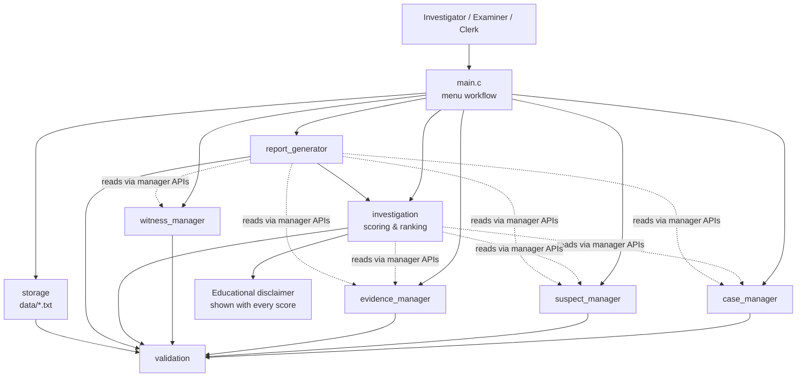

# CASEFILE — Forensic Evidence Management and Crime Investigation System

> **Domain:** Defence / Law Enforcement — Forensic Laboratory Management and Crime Investigation
> **Language:** C (ISO C11) | **Tests:** Google Test | **Build:** Make
> **Status:** Implementation complete — 164 unit tests passing, warning-free build.

CASEFILE is a modular, menu-driven command-line application that helps investigators maintain fictional crime
investigation records: cases, suspects, witnesses, forensic evidence, chain-of-custody history, a transparent
rule-based evidence-to-suspect comparison, and generated investigation reports.

> **The suspicion score produced by this application is an educational, rule-based decision-support indicator for
> prioritising investigative effort. It is not a forensic conclusion, not a probability, and not evidence of guilt.
> All case data in this project is fictional and is used for teaching purposes only.**

---

## Problem statement

> In forensic laboratory and crime-investigation units, investigating officers, forensic examiners and records clerks
> currently face manual, paper-and-spreadsheet case management in which case identifiers, evidence registers,
> chain-of-custody remarks, witness statements and suspect profiles are maintained in disconnected registers. The
> current method results in duplicate and inconsistent identifiers, unqueryable custody history, unsystematic
> comparison between recorded evidence attributes and suspect descriptors, and manually re-typed investigation
> reports. CASEFILE provides a single validated case file with enforced unique identifiers, a structured
> chain-of-custody history, systematic rule-based evidence-to-suspect comparison that ranks investigative leads and
> explains its reasoning, and generated investigation and evidence reports.

## Proposed solution

A layered, menu-driven console application with nine implementation modules. The in-memory database is passed by
pointer into every module (no mutable global state), every fallible function returns a documented status code, and
all records are persisted to plain-text files that carry a signature line so a damaged file is detected rather than
silently misread.

---

## Features

- **Case management** — register cases with auto-generated unique IDs (`CF-YYYY-NNNN`), list, search, filter by
  status or crime type, update details and investigation status, delete with confirmation and cascade to the
  case's suspects, evidence and witnesses.
- **Suspect management** — multiple suspects per case with physical descriptors (gender, height, hair colour, shoe
  size, blood group, known vehicles), alibi, motive and status; search by partial name; update and delete.
- **Forensic evidence management** — evidence with unique IDs, a category enumeration, description, collection date,
  location and collector, examination status, analysis attributes, and a structured chain-of-custody history.
- **Witness management** — witnesses linked to a case with unique statement reference IDs (`ST-NNNNN`), a
  verification flag, search, update and delete.
- **Evidence analysis** — a documented, deterministic, rule-based matching engine producing a 0–100 suspicion score
  per suspect, a ranked list, an explanation of every contributing *and* non-contributing attribute, and an explicit
  *insufficient evidence* outcome when the evidence cannot support a score.
- **Investigation reports** — case summary and evidence summary reports on screen and optionally saved to a file.
- **Persistence** — all records saved to `data/*.txt`, reloaded on start-up, with format validation and graceful
  handling of missing, empty or corrupted files.
- **Robust validation and consistent status codes** across every module.

### The scoring rules

Each evidence item may carry analysis attributes. The engine compares them with the suspect's profile using fixed,
declared weights — no randomness, no statistical model:

| Attribute | Comparison | Weight |
| --- | --- | --- |
| `gender` | exact match, ignoring case | 15 |
| `height` | suspect height inside the recorded band, e.g. `175-185` | 20 |
| `hair` | exact match, ignoring case | 10 |
| `shoe_size` | suspect shoe size inside the recorded band | 15 |
| `blood_group` | exact match, ignoring case | 20 |
| `vehicle` | registration present in the suspect's vehicle list | 25 |

The score is the sum of the weights of the matching attributes, capped at 100. Every attribute that was checked is
recorded, whether it matched or not, so the investigator can see exactly what was examined.

---

## Architecture

```
main.c (presentation)
   │
   ├──▶ case_manager / suspect_manager / evidence_manager / witness_manager  (business logic)
   │              │
   │              └──▶ validation  (shared validation services)
   │
   ├──▶ investigation      (rule-based scoring, ranking, progress)
   ├──▶ report_generator   (case & evidence reports)
   └──▶ storage            (file persistence & format validation) ──▶ validation
```

- `include/casefile.h` holds the shared structures, enumerations, capacity constants and the `CfStatus_t` status
  codes.
- `main.c` contains only initialisation, menu workflow, dispatch, result printing, save and cleanup — no business
  logic.
- The complete in-memory database is a single `CasefileDb_t` passed by pointer into every module function. It is
  heap-allocated because it is far too large for the stack; this is what makes the whole application unit-testable
  without any global setup.



---

## Repository structure

```
CASEFILE/
|
|-- src/
|   |-- main.c                 # application entry point and menu workflow
|   |-- casefile.c             # shared database lookup helpers
|   |-- validation.c           # reusable input and data validation
|   |-- case_manager.c         # crime case register
|   |-- suspect_manager.c      # suspect register and physical profile
|   |-- evidence_manager.c     # evidence register and chain of custody
|   |-- witness_manager.c      # witness register and statement references
|   |-- investigation.c        # rule-based scoring, ranking, progress
|   |-- report_generator.c     # investigation and evidence reports
|   `-- storage.c              # file persistence and format validation
|
|-- include/                   # one public header per module
|   |-- casefile.h
|   |-- validation.h
|   |-- case_manager.h
|   |-- suspect_manager.h
|   |-- evidence_manager.h
|   |-- witness_manager.h
|   |-- investigation.h
|   |-- report_generator.h
|   `-- storage.h
|
|-- tests/
|   |-- test_validation.cpp    # validation helpers and line reading
|   |-- test_records.cpp       # the four record managers
|   |-- test_analysis.cpp      # the rule-based matching engine
|   `-- test_storage.cpp       # persistence format and report generation
|
|-- data/
|   `-- sample_data.txt        # the fictional demonstration dataset
|
|-- docs/
|   |-- project_proposal.md    # Phase 1 deliverable
|   |-- detailed_design.md     # Phase 2 deliverable
|   `-- mini_project_report.md # master report following the official template
|
|-- Makefile
|-- README.md
|-- .gitignore
`-- LICENSE
```

---

## Prerequisites

| Requirement | Notes |
| --- | --- |
| C compiler with C11 support | `clang` on macOS, `gcc` on Linux |
| C++ compiler | Required only to build the Google Test suites |
| `make` | Standard GNU make |
| Google Test | Required only for `make test` |

The Makefile searches for Google Test automatically in `/opt/homebrew/opt/googletest`, `/usr/local/opt/googletest`,
`/opt/homebrew`, `/usr/local`, `/usr`, `~/.local`, `~/local` and `~/opt`. If it is installed somewhere else, point the
build at it:

```bash
make test GTEST_ROOT=/path/to/googletest
```

If Google Test is not installed at all, `make test` stops with an explanatory message instead of a confusing linker
error. Install it with `brew install googletest` (macOS), `sudo apt install libgtest-dev cmake` (Debian) or
`sudo dnf install gtest-devel` (Fedora), or build it from <https://github.com/google/googletest>.

---

## Build, run and test

```bash
make all     # compile the application into build/casefile
make run     # build if needed, then start the application
make test    # build and execute the Google Test suites
make clean   # remove build output, generated data files and reports
```

---

## Sample input and output

### Sample input

The application is menu-driven. Registering a case and a suspect looks like this:

```
 1                       <- main menu: case management
 1                       <- register new case
Warehouse Break-in and Cash Register Theft
theft
high
2026-01-14
Sector 9 Industrial Estate
Insp. R. Kadam
Cash register emptied overnight
 0                       <- back to the main menu
 2                       <- suspect management
 1                       <- add a suspect
CF-2026-0001
Ravi Shankar Deshmukh
34
9820041155
Plot 22, Sector 9
At the depot canteen until 21:00
Owes money to the owner
under_review
male
178
black
42
O+
 0                       <- back to the main menu
```

### Sample output — the case register

```
 CASE REGISTER
=====================================================================
CASE ID          TITLE                                CRIME              STATUS               PRIORITY
-----------------------------------------------------------------------------------------------
CF-2026-0001     Warehouse Break-in and Cash Regis... theft              open                 high

  1 case(s) on record.
```

### Sample output — the suspect register

```
 SUSPECTS OF A CASE
=====================================================================
Case ID: ID           NAME                         AGE    STATUS             ALIBI
---------------------------------------------------------------------------------------------------
SU-00001     Ravi Shankar Deshmukh        34     under_review       At the depot canteen until 21:00

  1 suspect(s).
```

### Sample output — the evidence analysis

```
 EVIDENCE ANALYSIS - SUSPECT COMPARISON
=====================================================================
Case ID:   2 suspect(s) evaluated against 1 comparable evidence item(s).

  Rank 1: Ravi Shankar Deshmukh (SU-00001)
    Score 30 / 100 - moderate priority for review
    Matched 2 of 2 comparable attribute(s)
      [MATCH]   hair        EV-00001 = black        vs black        (+10)
      [MATCH]   height      EV-00001 = 170-185      vs 178          (+20)

  Rank 2: Imran Sayyed Shaikh (SU-00002)
    Score 30 / 100 - moderate priority for review
    Matched 2 of 2 comparable attribute(s)
      [MATCH]   hair        EV-00001 = black        vs black        (+10)
      [MATCH]   height      EV-00001 = 170-185      vs 171          (+20)

  EDUCATIONAL DECISION SUPPORT: the score summarises how many recorded, rule-comparable attributes
  coincide between the recorded evidence and a suspect's profile. It is NOT a forensic conclusion,
  NOT a probability and NOT evidence of guilt. Verify every factor manually before acting.
```

### Sample output — invalid input is handled without crashing

```
  Select:   ! Value 99 is out of range. Enter a number between 0 and 8.
  Select:   ! 'abc' is not a valid whole number.
  Select:   ! Input is empty. Enter a whole number between 0 and 8.
```

```
  Incident date (YYYY-MM-DD):   [!] The date is not valid. Use the YYYY-MM-DD format.
```

```
  Case ID:   [!] No matching record was found.
```

### Sample output — insufficient evidence

```
 EVIDENCE ANALYSIS - SUSPECT COMPARISON
=====================================================================
Case ID:   [!] Insufficient evidence: the recorded evidence cannot support a score.
      No comparable evidence attribute was recorded for this case,
      or the case has no suspects. A score would be misleading, so
      none is produced.
```

---

## Unit-testing summary

164 test cases across 32 suites, covering validation, the four record managers, the matching engine and the storage
and reporting layers.

```bash
$ make test
[==========] Running 164 tests from 32 test suites.
...
[==========] 164 tests from 32 test suites ran. (99 ms total)
[  PASSED  ] 164 tests.
```

The suite includes positive, negative and boundary-value cases: leap-year dates, the exact fit of a field, band
boundaries of the height and shoe-size rules, duplicate identifiers, missing parent records, full record tables,
corrupt and empty data files, and null-pointer arguments. Tests are independent of the interactive menu, use
temporary files that are removed afterwards, and the C headers are given C linkage through `extern "C"` so the C
functions can be called from the C++ test files.

Four genuine defects were found by the tests and fixed, each with a regression test:

1. `validationCopyField` cleared the destination before measuring the source, so copying a field onto itself emptied
   it — which wiped every stored text field.
2. `validationReadLine` stripped the newline before checking whether the line had fitted, so every read also
   discarded the following line.
3. The menu loops used `while (choice != 0)` with `choice` initialised to zero, so the menus were never displayed.
4. The evidence explanation printed an empty suspect value for the textual attributes.

---

## Error-handling summary

Every fallible function returns a `CfStatus_t`. The statuses are: `CF_SUCCESS`, `CF_ERR_NULL_POINTER`,
`CF_ERR_INVALID_ARGUMENT`, `CF_ERR_INVALID_FORMAT`, `CF_ERR_INVALID_DATE`, `CF_ERR_INVALID_ENUM`,
`CF_ERR_INVALID_LENGTH`, `CF_ERR_EMPTY_INPUT`, `CF_ERR_NOT_FOUND`, `CF_ERR_DUPLICATE_ID`, `CF_ERR_CAPACITY_FULL`,
`CF_ERR_FILE_OPEN`, `CF_ERR_FILE_READ`, `CF_ERR_FILE_WRITE`, `CF_ERR_CORRUPT_FILE`,
`CF_ERR_INSUFFICIENT_EVIDENCE` and `CF_ERR_INTERNAL`.

The application is **fail-soft on load** — a missing or corrupt data file produces a warning and an empty but usable
session — and **fail-loud on save**, reporting the failure rather than claiming success. Invalid input never
terminates the program: the message is printed and the prompt repeats.

---

## Coding standards

Four-space indentation · one brace style throughout · uppercase names for constants · header guards on every
header · one clear responsibility per function · all return values checked · no mutable global variables · no
duplicated logic · meaningful comments (purpose and non-obvious logic, not restating the code) · no unsafe input
functions · no machine-specific absolute paths · portable between macOS and Linux.

---

## Documentation

| Document | Purpose |
| --- | --- |
| [`docs/project_proposal.md`](docs/project_proposal.md) | Phase 1 — scenario, problem, solution, scope, requirements, architecture, modules, planned C concepts |
| [`docs/detailed_design.md`](docs/detailed_design.md) | Phase 2 — module design, data design, function design, validation, file handling, error handling, test plan |
| [`docs/mini_project_report.md`](docs/mini_project_report.md) | Master report following the official template's 24 sections in order, with the verified test results |

---

## Known limitations

1. Single-user, single-process command-line application with file-based storage.
2. Fixed record capacities (100 cases, 400 suspects, 400 evidence items, 300 witnesses); the "capacity reached"
   condition is reported rather than growing the tables.
3. The suspicion score is a transparent rule-based indicator for prioritising leads — not a forensic conclusion, not
   a probability, and not a measure of guilt.
4. Evidence content is textual metadata only; there are no binary attachments, imaging or laboratory analysis.
5. Search is exact or substring matching; there is no indexing, regular expressions or date-range querying.
6. The report format is plain text; there is no PDF or HTML export.

## Future enhancements

1. Dynamic capacity growth with `realloc` and a persistent record-count header.
2. Evidence-attribute normalisation with tolerance bands for height and shoe size.
3. Export of reports to PDF/HTML and printing support.
4. Role-based access, an operation audit trail and encrypted storage of sensitive fields.
5. A formal statistical confidence measure expressed alongside the rule score, with clearly stated assumptions.
6. Integration with a laboratory information system through a defined interchange format.

---

## Team members

This is an individual project.

| Field | Details |
| --- | --- |
| Student name | *[To be completed by the student]* |
| Roll number | *[To be completed by the student]* |
| Division / batch | *[To be completed by the student]* |

## GitHub repository

<https://github.com/srushtihingmire27-hub/miniproject>

## License

MIT — see [`LICENSE`](LICENSE).
