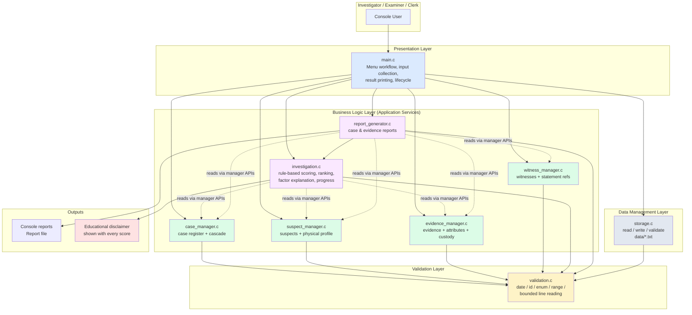
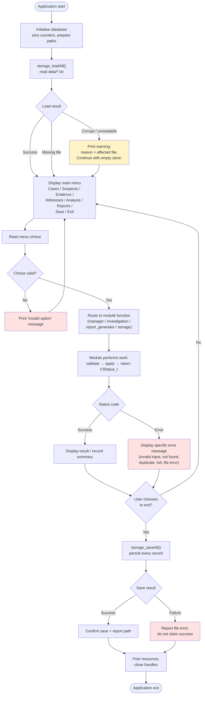

# CASEFILE — Mini Project Report

> **Project:** CASEFILE: Forensic Evidence Management and Crime Investigation System
> **Template:** [MINI_PROJECT_TEMPLATE.html](https://kapexlab.github.io/programming-fundamentals-and-software-engineering/MINI_PROJECT_TEMPLATE.html)
> **Guidelines:** [MINI_PROJECT_GUIDELINES.html](https://kapexlab.github.io/programming-fundamentals-and-software-engineering/MINI_PROJECT_GUIDELINES.html)
>
> This document preserves the official template's section order and numbering exactly (sections 1–24). It is the
> single master report for the project and the authoritative source for every section.
>
> **How the files relate.** Sections 1–5 of this report are identical to `docs/project_proposal.md`, the Phase 1
> deliverable. If a change is needed there, make it in **this** file and mirror it into the proposal, so the two never
> drift apart. Sections 6–17 exist only here; sections 18–19 will be filled only from **real** build and test runs
> in Phase 4; sections 20–24 await Phase 5.
>
> **Progress:** Sections 1–5 are complete (Phase 1 — Project Proposal). Sections 6–17 are prepared with the
> structure and content plan already fixed by the Phase 1 design, and await the detailed design in Phase 2.
>
> **Integrity statement:** No test result, build output, screenshot, GitHub link or implementation status is claimed
> in this document unless it has actually been produced. Pending items are labelled *Pending*.

---


# 1. Project Information

## 1.1 Project Title

**CASEFILE: Forensic Evidence Management and Crime Investigation System**

A command-line forensic case-management application that lets investigators register crime cases, suspects,
witnesses and forensic evidence; track evidence through a chain-of-custody history; and compare recorded evidence
attributes against suspect descriptors using a transparent, rule-based suspicion score that prioritises
investigative leads.

## 1.2 Engineering Domain

**Defence / Law Enforcement — Forensic Laboratory Management and Crime Investigation**

The scenario sits at the intersection of the **Defence** and **Laboratory management** domains named in the
guidelines: a district forensic laboratory and its crime-investigation unit, where case paperwork, evidence
registers and witness statements are maintained by hand and must later be reconstructed into formal investigation
reports.

## 1.3 Team Details

| Field | Details |
| --- | --- |
| Student name | *[To be completed by the student]* |
| Roll number | *[To be completed by the student]* |
| Division / batch | *[To be completed by the student]* |
| Repository name | `CASEFILE` |
| GitHub repository link | *[Pending — repository to be created in Phase 4]* |

## 1.4 Individual Project Declaration

I confirm that this project is my individual work. I understand the design, source code, unit tests, Makefile and
documentation included in this repository, and I am prepared to explain or modify any part during evaluation.

Student signature or acknowledgement:

*[Signature to be added by the student before submission]*

---

# 2. Engineering Scenario

## 2.1 Scenario Description

**Where the scenario occurs.**
In a district-level **forensic laboratory** attached to a police crime-investigation unit. The laboratory receives
seized and recovered material from crime scenes, stores it, examines it, and hands it back either as a report or as
physical evidence routed to court. The associated **investigation cell** handles the administrative side: opening
case files, listing suspects, recording witness statements, and assembling the final investigation report.

**Who is involved.**

| Role | What they need |
| --- | --- |
| Investigating Officer (case owner) | One place to see the whole case: who is linked, what is in the locker, what is still missing, and where the investigation stands. |
| Forensic Examiner / Evidence Custodian | A reliable register of what was collected, who holds it now, and what has already been analysed. |
| Records Clerk | Case numbers that never clash, and records that can be retrieved in seconds rather than by searching paper registers. |
| Junior Investigator | A starting point for narrowing the field — which recorded facts actually coincide with a suspect's profile. |

**Current working method.**
Everything is maintained on **paper registers and spreadsheet worksheets**:

- Case files are physical folders. The unique case number is hand-written on the cover and cross-referenced in a
  separate register book, so duplicate numbers are detected only when a clerk notices them months later.
- Evidence is logged in a bound register with a printed row per item. Chain-of-custody transfers are recorded as
  free-text remarks in the same row, so an item's custody history is a narrative, not a queryable sequence.
- Witness statements live in a separate statement register; linking a statement to its case requires matching a
  reference number by eye.
- Linking a suspect to a piece of evidence — for example, a hair sample whose attributes resemble a suspect's
  physical description — is a manual, slow comparison. Nothing in the paperwork performs this comparison
  systematically, so it happens inconsistently and only for the obvious cases.

**Information that must be managed.**

1. Case identity and status — unique case ID, crime type, priority, incident date, location, assigned officer,
   investigation status, narrative summary.
2. Suspect records — identity, age, physical descriptors, contact details, stated alibi, possible motive, status.
3. Evidence records — unique evidence ID, category, description, collection date/location/collector, examination
   status, analysis attributes, custody history.
4. Witness records — identity, contact details, statement reference ID, statement text, recorded date, verification flag.
5. Progress and reporting — how far the investigation has advanced, and a printable investigation report.

**Problems in the current method.**

- **Duplicate and orphaned records.** Hand-allocated IDs clash; a suspect's case reference is copied by hand and
  can point at a case number that never existed.
- **No queryable custody history.** Proving who held evidence, and when, means re-reading free-text remarks across
  several rows and several registers.
- **Evidence-to-suspect comparison is unsystematic.** An investigator with 40 suspects and 60 evidence items
  cannot reliably eyeball which attributes coincide; useful leads are missed and weak leads are not filtered out.
- **Reporting is manual re-typing.** Producing the case summary means copying data across registers into a report
  template; every copy is another chance to introduce an error, and the report is usually out of date.
- **No audit trail.** A deleted or amended register entry leaves no record of what changed.
- **Loss of institutional knowledge.** When a case officer is transferred, the reasoning behind a lead lives only
  in their heads and notebooks.

## 2.2 Problem Statement

> In **forensic laboratory and crime-investigation units**, **investigating officers, forensic examiners and
> records clerks** currently face **manual, paper-and-spreadsheet case management in which case identifiers,
> evidence registers, chain-of-custody remarks, witness statements and suspect profiles are maintained in
> disconnected registers**. The current method results in **duplicate and inconsistent identifiers, unqueryable
> custody history, unsystematic comparison between recorded evidence attributes and suspect descriptors, and
> manually re-typed investigation reports that are frequently out of date or inconsistent with the registers**.
> The proposed software will provide **a single validated case file with enforced unique identifiers, a structured
> chain-of-custody history, systematic rule-based evidence-to-suspect comparison that ranks investigative leads and
> explains its reasoning, and generated investigation and evidence reports** so that users can **retrieve the
> complete status of any case in seconds, preserve an auditable record of every change, and direct their effort
> towards the leads the recorded evidence actually supports**.

## 2.3 Proposed Solution

**CASEFILE** is a modular, menu-driven **command-line application written entirely in C** that maintains a
fictional forensic case file for an investigation unit.

**What the application will do**

- Present a hierarchical menu: *Cases → Suspects → Evidence → Witnesses → Analysis → Reports → Save/Load → Exit*.
- Every menu action is reachable without touching the source code; nothing is hard-coded per case.

**How it addresses the problem**

| Problem in the manual method | CASEFILE mechanism |
| --- | --- |
| Hand-written, clashing case numbers | IDs are **auto-generated from a sequence** and validated against the existing registry before insertion; duplicates are rejected with a clear status code. |
| Unqueryable custody remarks | Each evidence item owns an **ordered chain-of-custody event list** (collect → transfer → seal → analyse → release), each with timestamp, from-handler, to-handler, location and remarks. |
| Manual evidence-to-suspect comparison | A **rule-based matching engine** compares tagged evidence attributes (gender, height, hair colour, shoe size, blood group, vehicle registration) against suspect descriptors, producing a **0–100 suspicion score**, a **ranked suspect list**, and an **explanation of exactly which attributes contributed**. |
| Manually re-typed reports | A **report generator** produces a case summary and an evidence summary on screen and can **save them to a text file**. |
| No audit trail / lost knowledge | All records are **persisted to text files** on save and reloaded on start, so the case file survives across sessions. |

**Information the application will manage**
Cases, suspects (including the physical descriptors used for comparison), forensic evidence with categories and
analysis attributes, chain-of-custody events, witnesses with statement reference IDs, investigation status and
progress, and generated reports.

**Important calculations and decisions**

1. **Suspicion scoring.** For each suspect, every comparable attribute found in the case's evidence contributes a
   fixed **weight** (declared as named constants). Weights are summed and capped at `MAX_SUSPICION_SCORE`.
   Non-matching attributes contribute nothing but are still listed as *checked but not matched*, so the investigator
   sees what was examined.
2. **Insufficient-evidence decision.** If a case has no comparable evidence attributes, or no suspects, the engine
   reports **insufficient evidence** and refuses to emit a score, rather than showing a misleading `0`.
3. **Progress computation.** Case progress is derived from real record counts (suspects recorded, evidence
   analysed vs. outstanding, witnesses verified), not typed in by hand.

**Reports produced**

- *Case summary* — case identity, status, officer, suspects with scores, evidence with status, witnesses.
- *Evidence summary* — evidence register for a case with categories, collection details and custody history.
- Both can be written to a report file for printing or attachment.

> **Educational disclaimer (to be displayed with every score).** The suspicion score is a **transparent,
> rule-based decision-support indicator for prioritising investigative effort**. It is **not** a forensic
> conclusion, **not** a probability, and **not** evidence of guilt. It only summarises how many recorded,
> rule-comparable attributes happen to coincide. All case data in this project is fictional and used for
> teaching purposes only.

## 2.4 Target Users

| User Type | Responsibility | How the User Will Use the Application |
| --- | --- | --- |
| Investigating Officer | Owns the case and decides what to examine next | Opens a case, reviews suspects, runs the evidence analysis to see which suspects have coinciding attributes, reads the ranked list and the explanation, then generates the case summary report. |
| Forensic Examiner / Evidence Custodian | Handles material and records its movement | Registers each evidence item with category, collection date, location and collector, appends a custody event on every transfer or sealing, and updates the examination status after analysis. |
| Records Clerk | Maintains the registers and prepares paperwork | Registers cases with auto-generated IDs, corrects and updates records, lists and filters the case register, and exports the evidence summary for the case file. |
| Witness-Recording Officer | Takes and tracks statements | Registers witnesses against a case, records the statement reference ID and text, and flags a statement as verified once corroborated. |
| Student / Evaluator | Learns and assesses software-engineering practice | Builds with `make all`, runs `make test` to see automated checks on validation, search, scoring and record logic, and inspects the modular source and documented design. |

---

# 3. Project Scope

## 3.1 In-Scope Features

1. **Case registration** with auto-generated unique case IDs (`CF-YYYY-NNNN`), title, crime type, priority, incident
   date, location, assigned officer, status and narrative summary.
2. **Case register operations** — list all cases, look up a case by ID, filter the register by status or crime type.
3. **Case maintenance** — update case details, update investigation status, and delete a case (with explicit
   confirmation and cascade removal of its linked suspects, evidence and witnesses).
4. **Suspect management** — add multiple suspects to a case with unique IDs (`SU-NNNN`), store identity, age,
   gender, contact, address, stated alibi, possible motive, status, and the physical descriptors used for matching.
5. **Suspect operations** — list suspects of a case, search by ID or by name (partial, case-insensitive), update a
   suspect, delete a suspect.
6. **Forensic evidence registration** with unique IDs (`EV-NNNN`) linked to an existing case, a category enumeration
   (biological, chemical, digital, ballistic, physical trace, documentary, vehicle, other), description, collection
   date, collection location, collector and examination status.
7. **Evidence attributes** — attach analysis attributes (tag/value pairs such as `gender=male`, `height=175-185`)
   that the matching engine can compare.
8. **Chain-of-custody record** — append ordered custody events (collected / transferred / sealed / analysed /
   released) with timestamp, from-handler, to-handler, location and remarks, and display the full history.
9. **Evidence operations** — search by evidence ID or description, filter by case, category or status, update
   evidence details and examination status, delete evidence.
10. **Witness management** — register witnesses against a case with a unique statement reference ID (`ST-NNNN`),
    store contact details, statement text, recorded date and verification flag.
11. **Witness operations** — list and search witnesses by ID, name or case, update a witness, delete a witness.
12. **Rule-based evidence analysis** — compute a suspicion score per suspect, rank suspects by score, and show the
    contributing and non-contributing attributes for each suspect.
13. **Insufficient-evidence handling** — detect and clearly report cases where the evidence cannot support a score.
14. **Investigation progress** — display derived progress (suspects on record, evidence analysed vs. outstanding,
    statements verified) together with the current case status.
15. **Report generation** — case summary and evidence summary reports, displayed on screen and optionally saved to a
    report file.
16. **File-based persistence** — save all records to `data/*.txt` files, reload them on start-up, validate the file
    format, and handle missing, empty, corrupted or unreadable files without crashing.
17. **Robust input validation** for every user-entered value: empty input, non-numeric input, out-of-range values,
    malformed identifiers, invalid dates, over-length strings, invalid enumeration values and duplicate IDs.
18. **Consistent status codes** — every module returns a documented `CfStatus_t` value and a human-readable message.
19. **Automated unit tests** with Google Test, runnable through `make test`.
20. **Build automation** with a Makefile providing `all`, `run`, `test` and `clean`.

## 3.2 Out-of-Scope Features

1. **Graphical user interface (GUI)** — the project is deliberately a command-line application, as expected for a
   first software-engineering mini project in C.
2. **Database engine / SQL** — persistence is plain-text file based; no SQLite, MySQL or ODBC dependency.
3. **Network programming, client–server mode, or multi-user concurrency** — the application is single-process and
   single-user.
4. **Authentication, roles and audit logging of user identity** — no login, no permissions.
5. **Photographic, video or binary evidence storage** — only metadata and text descriptions are held; no binary
   blobs and no image processing.
6. **Real forensic analysis** — no DNA sequencing, no ballistic matching, no chemical assay modelling. The
   "analysis" is a transparent rule-based comparison of recorded attributes, not a scientific method.
7. **Machine-learning or statistical inference** — no prediction models, no probabilistic scoring, no randomness.
8. **PDF/HTML report export and printing** — reports are plain text files.
9. **Advanced searching (regular expressions, date-range filters, full-text indexing)** — the search facilities are
   exact/substring matching and enum-based filtering.
10. **Data encryption, hashing of sensitive records or digital signatures** — out of scope for this project.
11. **Case archiving, retention policies or legal-hold workflows** — a case can be deleted with confirmation, but no
    archival policy is modelled.
12. **Interoperability with real police or laboratory information systems** — no external system integration.

## 3.3 Assumptions

1. All data is **fictional** and used for educational purposes; no real crime data, personal data or real case
   identifiers are used.
2. The application operates as a **single-user, single-process, offline** command-line tool on a local machine.
3. The **file system is writable** in the working directory; the `data/` directory is used for persistence.
4. **Maximum record counts are fixed and modest** (e.g. 100 cases, 500 suspects, 500 evidence items, 300 witnesses),
   so fixed-capacity arrays are sufficient and no dynamic memory is required for record storage.
5. **Dates are entered in ISO format `YYYY-MM-DD`** and validated for calendar correctness (including leap years).
6. **Identifiers follow a fixed pattern** (`CF-YYYY-NNNN`, `SU-NNNN`, `EV-NNNN`, `WI-NNNN`, `ST-NNNN`) and are
   generated by the application, not typed freely by the user for evidence/suspect records.
7. **Evidence attributes are pre-defined key/value pairs** from a controlled vocabulary (gender, height band, hair
   colour, shoe size, blood group, vehicle registration), so matching rules are deterministic.
8. The **suspicion score is advisory**. The user is expected to verify every factor manually; the tool never asserts
   guilt.
9. The **operating environment** is macOS (development) with the code kept portable to Linux (POSIX file APIs,
   standard C library only).

## 3.4 Constraints

1. **Project duration** is limited to a mini-project timeline, so the feature set is deliberately bounded and no
   network or database technology is introduced.
2. **Storage is file-based text**, not a database — this limits querying to what can be expressed by sequential
   scans, which is acceptable at the documented record capacities.
3. The **interface is command-line only** — no GUI framework may be used, which keeps the build dependency-free.
4. The **language is C** (ISO C11) with a strict warning policy (`-Wall -Wextra -Wpedantic`) and **no external
   runtime dependencies** other than Google Test for the test target.
5. **Google Test availability** is an environment dependency: the Makefile must locate an installed gTest, and the
   build must fail with a clear message (not a cryptic link error) when it is absent.
6. **Record capacities are fixed constants**, so "database full" is a reachable, testable condition that must be
   reported gracefully rather than by overwriting existing data.
7. **No dynamic memory allocation** is planned for record storage (fixed-capacity arrays); if any allocation is used
   in Phase 2/3 it must be justified and freed on every path.
8. The **report format is plain text**; no pagination or print-driver control is attempted.
9. **Single platform target at evaluation time** (macOS with clang), while source remains portable to Linux.

---

# 4. Requirements

## 4.1 Functional Requirements

### Case management

| ID | Functional Requirement | Priority | Verification Method |
| --- | --- | --- | --- |
| FR-01 | The system shall register a new crime case with an auto-generated unique case ID, title, crime type, priority, incident date, location, assigned officer and summary. | High | Demonstration / Test |
| FR-02 | The system shall reject a case whose identifier already exists in the register. | High | Test |
| FR-03 | The system shall list all registered cases in a formatted table. | High | Demonstration |
| FR-04 | The system shall retrieve a single case by its identifier. | High | Demonstration / Test |
| FR-05 | The system shall filter the case register by investigation status and by crime type. | Medium | Demonstration |
| FR-06 | The system shall update the editable details of an existing case. | High | Demonstration |
| FR-07 | The system shall update the investigation status of a case to a value from the defined status enumeration. | High | Demonstration / Test |
| FR-08 | The system shall delete a case only after explicit user confirmation, removing the case together with its linked suspects, evidence and witness records. | Medium | Demonstration / Test |
| FR-09 | The system shall display a full summary of a selected case. | High | Demonstration |

### Suspect management

| ID | Functional Requirement | Priority | Verification Method |
| --- | --- | --- | --- |
| FR-10 | The system shall add one or more suspects to an existing case, each with a unique identifier, name, age, gender, contact number, address, stated alibi, possible motive and status. | High | Demonstration / Test |
| FR-11 | The system shall store the physical descriptors of a suspect (gender, height, hair colour, shoe size, blood group and known vehicle registrations) for later comparison. | High | Test |
| FR-12 | The system shall list the suspects associated with a given case. | High | Demonstration |
| FR-13 | The system shall search suspects by identifier and by partial name, case-insensitively. | High | Test |
| FR-14 | The system shall update a suspect record and reject unknown or duplicate identifiers. | Medium | Demonstration / Test |
| FR-15 | The system shall delete a suspect record after confirmation. | Medium | Demonstration |
| FR-16 | The system shall reject a suspect being added to a case identifier that does not exist. | High | Test |

### Forensic evidence management

| ID | Functional Requirement | Priority | Verification Method |
| --- | --- | --- | --- |
| FR-17 | The system shall register forensic evidence with a unique identifier linked to an existing case, a category from the evidence-category enumeration, a description, collection date, collection location, collector and examination status. | High | Demonstration / Test |
| FR-18 | The system shall classify evidence using the defined category enumeration and reject invalid category values. | High | Test |
| FR-19 | The system shall attach analysis attributes (key/value pairs) to an evidence item so that recorded characteristics can be compared with suspect descriptors. | High | Test |
| FR-20 | The system shall update evidence details and the examination status of an existing evidence item. | High | Demonstration / Test |
| FR-21 | The system shall search evidence by identifier and description, and filter evidence by case, category and examination status. | High | Demonstration / Test |
| FR-22 | The system shall append a chain-of-custody event to an evidence item recording action, timestamp, from-handler, to-handler, location and remarks, preserving event order. | High | Demonstration / Test |
| FR-23 | The system shall display the complete chain-of-custody history of an evidence item. | High | Demonstration |
| FR-24 | The system shall reject a custody event when the evidence item does not exist or when the custody log for that item is full. | Medium | Test |
| FR-25 | The system shall delete an evidence item after confirmation. | Medium | Demonstration |

### Witness management

| ID | Functional Requirement | Priority | Verification Method |
| --- | --- | --- | --- |
| FR-26 | The system shall register a witness against an existing case with a unique statement reference identifier, contact details, statement text, recorded date and verification flag. | High | Demonstration / Test |
| FR-27 | The system shall search witnesses by identifier, by name and by associated case. | High | Test |
| FR-28 | The system shall update a witness record, including marking a statement as verified. | Medium | Demonstration / Test |
| FR-29 | The system shall delete a witness record after confirmation. | Medium | Demonstration |
| FR-30 | The system shall reject a duplicate statement reference identifier. | Medium | Test |

### Evidence analysis

| ID | Functional Requirement | Priority | Verification Method |
| --- | --- | --- | --- |
| FR-31 | The system shall compute a rule-based suspicion score for each suspect of a case by comparing recorded evidence attributes with the suspect's descriptors, using fixed declared weights capped at the maximum score. | High | Test |
| FR-32 | The system shall rank the suspects of a case by descending suspicion score. | High | Test |
| FR-33 | The system shall explain, for each suspect, which recorded attributes contributed to the score and which comparable attributes were checked but did not match. | High | Test |
| FR-34 | The system shall detect and clearly report **insufficient evidence** when a case has no comparable evidence attributes or no suspects, instead of presenting a misleading score. | High | Test |
| FR-35 | The system shall compute and display case investigation progress from real record counts (suspects on record, evidence analysed versus outstanding, statements verified). | Medium | Demonstration / Test |
| FR-36 | The system shall display the educational, decision-support nature of the score alongside every analysis result. | High | Demonstration |

### Investigation reports

| ID | Functional Requirement | Priority | Verification Method |
| --- | --- | --- | --- |
| FR-37 | The system shall generate a case summary report containing case identity, status, officer, ranked suspects with scores, evidence with examination status and witness statements. | High | Demonstration / Test |
| FR-38 | The system shall generate an evidence summary report listing the evidence of a case with category, collection details, examination status and chain-of-custody history. | High | Demonstration / Test |
| FR-39 | The system shall save a generated report to a text file and confirm the file path on success or report the failure. | Medium | Demonstration / Test |
| FR-40 | The system shall refuse to generate a report for a case identifier that does not exist. | Medium | Test |

### Data persistence

| ID | Functional Requirement | Priority | Verification Method |
| --- | --- | --- | --- |
| FR-41 | The system shall save all records (cases, suspects, evidence, chain-of-custody events and witnesses) to files in the `data/` directory. | High | Demonstration / Test |
| FR-42 | The system shall load all previously saved records when the application starts. | High | Demonstration / Test |
| FR-43 | The system shall preserve all updates across application restarts. | High | Test |
| FR-44 | The system shall validate the stored file format on load and reject a file whose format signature or record structure is invalid, reporting the condition instead of crashing. | High | Test |
| FR-45 | The system shall handle a missing, empty, unreadable or unwritable data file with a clear message and without terminating the application unexpectedly. | High | Test |
| FR-46 | The system shall maintain a consistent status code and message for every failure condition. | High | Test |

## 4.2 Non-Functional Requirements

| ID | Non-Functional Requirement | Verification Method |
| --- | --- | --- |
| NFR-01 | The source code shall compile without warnings under `-Wall -Wextra -Wpedantic`. | Build output |
| NFR-02 | The project shall use a modular multi-file structure with at least three meaningful implementation modules in addition to `main.c`. | Code review |
| NFR-03 | `main.c` shall contain only initialisation, menu presentation, workflow control and cleanup — not the business logic. | Code review |
| NFR-04 | The application shall handle all invalid input without crashing or entering an uncontrolled state. | Negative testing |
| NFR-05 | Unsafe input functions (`gets`, unbounded `scanf` string reads) shall not be used; line-based input with length limits shall be used instead. | Code review |
| NFR-06 | Every module function shall return a meaningful status code, and no return value shall be ignored. | Code review |
| NFR-07 | Important functions shall be covered by at least ten meaningful Google Test cases spanning at least three important functions, including positive, negative and boundary cases. | Unit-test output |
| NFR-08 | Unit tests shall be independent of the interactive menu and shall clean up temporary files after execution. | Unit-test output / Code review |
| NFR-09 | The project shall build, run, test and clean using the targets `make all`, `make run`, `make test` and `make clean`. | Build demonstration |
| NFR-10 | The code shall follow the documented coding standards: four-space indentation, uppercase constant names, header guards, one responsibility per function, no duplicated logic, no unnecessary globals. | Code review |
| NFR-11 | The source shall be portable between macOS and Linux, using only standard C and avoiding machine-specific absolute paths. | Code review / portability check |
| NFR-12 | All file operations shall be checked for success or failure and shall handle read/write errors explicitly. | Code review / Test |
| NFR-13 | Array accesses shall be bounds-checked and record capacities shall be enforced, so that "capacity reached" is reported rather than an out-of-bounds write. | Test |
| NFR-14 | Analysis results shall be deterministic — no random values shall influence any score, ranking or comparison. | Code review / Test |
| NFR-15 | The project shall be maintained under Git with multiple meaningful commits and published in a GitHub repository containing the complete project. | Repository review |
| NFR-16 | The documentation shall follow the official mini-project template with every applicable section completed. | Documentation review |
| NFR-17 | User-facing messages shall be clear, non-technical and actionable, stating what was rejected and what the user should do next. | Demonstration |
| NFR-18 | The application shall not require any third-party runtime library other than the C standard library. | Build demonstration |

## 4.3 Requirement Traceability

> This table is completed against the module and function design, which is finalised in **Phase 2**; the test IDs
> correspond to the Unit-Test Plan (`docs/detailed_design.md`, §14) and will be confirmed after the gTest suite is
> written in Phase 3. Entries marked *(provisional)* are confirmed in Phase 2.

| Requirement ID | Module | Function or Feature | Test ID |
| --- | --- | --- | --- |
| FR-01 | `case_manager` | `caseManager_addCase` | UT-01, UT-02 |
| FR-02 | `case_manager` | `caseManager_addCase`, `caseManager_findById` | UT-01, UT-03 |
| FR-03 | `case_manager` | `caseManager_listAll` | UT-04 |
| FR-04 | `case_manager` | `caseManager_findById` | UT-03, UT-04 |
| FR-05 | `case_manager` | `caseManager_filterByStatus` | UT-05 |
| FR-06 | `case_manager` | `caseManager_update` | UT-06 |
| FR-07 | `case_manager` | `caseManager_setStatus` | UT-07 |
| FR-08 | `case_manager` | `caseManager_delete` (cascade) | UT-08 |
| FR-09 | `case_manager` | `caseManager_findById` + report layer | UT-04 |
| FR-10 | `suspect_manager` | `suspectManager_add` | UT-09, UT-10 |
| FR-11 | `suspect_manager` | `suspectManager_setPhysicalProfile` | UT-11 |
| FR-12 | `suspect_manager` | `suspectManager_listByCase` | UT-12 |
| FR-13 | `suspect_manager` | `suspectManager_searchByName` | UT-13 |
| FR-14 | `suspect_manager` | `suspectManager_update` | UT-14 |
| FR-15 | `suspect_manager` | `suspectManager_delete` | UT-15 |
| FR-16 | `suspect_manager` | `suspectManager_add` (parent case check) | UT-10 |
| FR-17 | `evidence_manager` | `evidenceManager_add` | UT-16, UT-17 |
| FR-18 | `evidence_manager` | `evidenceManager_add` / `validation_isValidCategory` | UT-17, UT-18 |
| FR-19 | `evidence_manager` | `evidenceManager_addAttribute` | UT-19 |
| FR-20 | `evidence_manager` | `evidenceManager_update`, `evidenceManager_setStatus` | UT-20 |
| FR-21 | `evidence_manager` | `evidenceManager_searchByDescription`, `evidenceManager_filterByStatus` | UT-21, UT-22 |
| FR-22 | `evidence_manager` | `evidenceManager_addCustodyEvent` | UT-23, UT-24 |
| FR-23 | `evidence_manager` | `evidenceManager_getCustodyHistory` | UT-24 |
| FR-24 | `evidence_manager` | `evidenceManager_addCustodyEvent` | UT-25 |
| FR-25 | `evidence_manager` | `evidenceManager_delete` | UT-26 |
| FR-26 | `witness_manager` | `witnessManager_add` | UT-27 |
| FR-27 | `witness_manager` | `witnessManager_searchByName` | UT-28 |
| FR-28 | `witness_manager` | `witnessManager_update`, `witnessManager_setVerified` | UT-29 |
| FR-29 | `witness_manager` | `witnessManager_delete` | UT-30 |
| FR-30 | `witness_manager` | `witnessManager_add` (statement-ref uniqueness) | UT-27 |
| FR-31 | `investigation` | `investigation_scoreSuspects` | UT-31, UT-32 |
| FR-32 | `investigation` | `investigation_rankSuspects` | UT-33 |
| FR-33 | `investigation` | `investigation_scoreSuspects` (factor list) | UT-31, UT-34 |
| FR-34 | `investigation` | `investigation_scoreSuspects` (insufficient-evidence path) | UT-35, UT-36 |
| FR-35 | `investigation` | `investigation_computeProgress` | UT-37 |
| FR-36 | `investigation` | `investigation_getDisclaimer` | UT-38 |
| FR-37 | `report_generator` | `report_generateCaseSummary` | UT-39 |
| FR-38 | `report_generator` | `report_generateEvidenceSummary` | UT-40 |
| FR-39 | `report_generator` | `report_saveToFile` | UT-41 |
| FR-40 | `report_generator` | `report_generateCaseSummary` | UT-42 |
| FR-41 | `storage` | `storage_saveAll` | UT-43, UT-44 |
| FR-42 | `storage` | `storage_loadAll` | UT-43, UT-45 |
| FR-43 | `storage` | `storage_saveAll` + `storage_loadAll` round trip | UT-43 |
| FR-44 | `storage` | `storage_validateFormat` | UT-45, UT-46 |
| FR-45 | `storage` | `storage_loadAll` (missing / empty file) | UT-46, UT-47 |
| FR-46 | all modules | `CfStatus_t` return values | UT-48 |
| FR-47 (validation) | `validation` | `validation_isValidDate`, `validation_isValidId`, `validation_isValidEnum`, `validation_readLine`, `validation_parseInt` | UT-48 to UT-56 *(provisional)* |
| FR-48 (validation) | `validation` | `validation_isNonEmpty`, `validation_isValidPhone`, `validation_trim`, `validation_copyField` | UT-57 to UT-62 *(provisional)* |

> The provisional block will be reconciled with the final Unit-Test Plan in Phase 2 and the executed results in
> Phase 4. Test counts above are a plan, not a report of results.

---

# 5. High-Level Architecture

## 5.1 Architecture Description

CASEFILE is organised as a **layered, modular console application** in the classic three-tier form, adapted so that
each tier maps onto a small number of clear C modules.

**Layer 1 — Presentation / Interaction (`src/main.c`)**
A menu-driven console interface. `main.c` initialises the application, loads persisted data, presents the
top-level menu, collects raw user input, hands it to the appropriate module, prints the module's result (including
its status message) and, on exit, saves data and releases resources. It contains **no** business rules, no record
structures and no file handling — it only orchestrates.

**Layer 2 — Validation (`src/validation.c`, `include/validation.h`)**
A reusable, side-effect-free service layer that answers questions about data: *is this string a valid date? is this
identifier well formed? is this enumeration value in range? how do I read a bounded line from stdin?*. Every other
module calls into it rather than re-implementing checks, which removes duplicated validation logic and makes the
checks independently unit-testable.

**Layer 3 — Business Logic / Application Services**
Six service modules, each owning one business area and exposing a small, purposeful API:

| Module | Business area |
| --- | --- |
| `case_manager` | Case register: create, read, update, delete, filter, cascade rules. |
| `suspect_manager` | Suspect register and physical profile. |
| `evidence_manager` | Evidence register, analysis attributes, chain-of-custody log. |
| `witness_manager` | Witness register and statement references. |
| `investigation` | Rule-based scoring, ranking, factor explanation, progress computation. |
| `report_generator` | Composition of human-readable case and evidence reports, and report files. |

**Layer 4 — Data Management / Persistence (`src/storage.c`)**
Converts records to and from a **line-oriented text format** in the `data/` directory, and validates that format on
load. It is the only module that touches `FILE *`.

**Shared data model (`include/casefile.h`)**
The structure and enumeration definitions, the capacity constants and the `CfStatus_t` status codes live in one
shared header, so the modules agree on the data representation without depending on each other's internals.

**Dependency direction (strictly one way)**

```
main  →  manager modules  →  validation
main  →  investigation    →  manager modules (read-only) + validation
main  →  report_generator →  manager modules (read-only) + investigation (read-only)
main  →  storage          →  validation
```

Managers never call `storage`; the application orchestrates save and load. `report_generator` and `investigation`
read through the managers' public lookup functions and never mutate records. This keeps the graph acyclic, makes
every module independently testable, and lets the unit tests build a database in memory without touching disk.

**State handling.** The complete in-memory database is a single `CasefileDb_t` value held by `main.c` and passed by
pointer into every module function. There are **no mutable global variables**, which is what makes the whole
application testable from gTest without any global setup.

## 5.2 Architecture Diagram



**Reading the diagram.** Solid arrows are direct calls; dashed arrows are read-only queries through a manager's
public API. `main.c` sits on top and only ever calls *downwards*. The validation layer is shared by every module
below it, so no two modules ever disagree about what constitutes a valid date, identifier or enumeration value.
`storage.c` is the only component that opens a file, and only `main.c` ever invokes it, which keeps all I/O
error handling in one place. The disclaimer node is highlighted because it is a first-class output, not a comment.

## 5.3 High-Level Workflow

The interaction model is a **hierarchical menu**: the top-level menu offers the business areas, and selecting one
opens a sub-menu whose actions operate on the currently selected record set.



**Reading the workflow.** The application is **fail-soft on load and fail-loud on save**. A missing or corrupt data
file produces a warning and an empty-but-usable session, because refusing to start would leave the user with no way
to inspect or repair anything. A failed save, by contrast, is reported prominently and the exit is still attempted,
so the user always learns that their changes did not reach disk. Every error path returns to the same menu rather
than terminating, which satisfies the requirement that invalid input must never crash the program.

---

## 5.4 Initial Module Plan

| # | Module name | Source / header | Responsibility |
| --- | --- | --- | --- |
| 1 | Main application | `src/main.c` | Initialise, load, present menus, dispatch calls, print results, save, clean up. **No business logic.** |
| 2 | Shared data model | `include/casefile.h` | Structures, enumerations, capacity constants, status codes. Header only — no implementation file needed. |
| 3 | Validation | `src/validation.c` / `include/validation.h` | Reusable input and data checks: bounded line reading, integer parsing, date validity, identifier format, enumeration range, string length, trimming. |
| 4 | Case manager | `src/case_manager.c` / `include/case_manager.h` | Case register lifecycle: add, find, list, filter, update, status change, delete with cascade to child records. |
| 5 | Suspect manager | `src/suspect_manager.c` / `include/suspect_manager.h` | Suspect records, physical-descriptor profile, per-case listing, search, update, delete. |
| 6 | Evidence manager | `src/evidence_manager.c` / `include/evidence_manager.h` | Evidence records and categories, analysis attributes, chain-of-custody event log, search and filtering, update, delete. |
| 7 | Witness manager | `src/witness_manager.c` / `include/wwitness_manager.h` | Witness records, statement reference IDs, verification flag, search, update, delete. |
| 8 | Investigation | `src/investigation.c` / `include/investigation.h` | Rule-based suspicion scoring with declared weights, ranking, factor explanation, insufficient-evidence detection, progress computation, disclaimer text. |
| 9 | Report generator | `src/report_generator.c` / `include/report_generator.h` | Case summary and evidence summary composition, console output, report file writing. |
| 10 | Storage | `src/storage.c` / `include/storage.h` | File format definition, save and load of all record types, format validation, I/O error reporting. |

This is **nine implementation modules plus `main.c`**, comfortably exceeding the "at least three meaningful modules"
requirement, while each module owns a genuinely distinct business concern (no filler modules, no empty files).

## 5.5 Planned C Concepts

| C concept | Why this project needs it |
| --- | --- |
| **Structures** | The core data model. `Case_t`, `Suspect_t`, `Evidence_t`, `CustodyEvent_t`, `Witness_t` and the aggregate `CasefileDb_t` describe real records with many related fields; grouping them into a struct avoids parallel arrays and keeps related data together. |
| **Enumerations** | Fixed vocabularies that must not be arbitrary integers: crime type, case status, priority, evidence category, evidence status, custody action, suspect status, witness verification, and the `CfStatus_t` error codes. Enumerations make illegal states unrepresentable and let validation check a range instead of a set of magic numbers. |
| **Functions with parameters and return values** | Each module exposes a purposeful API; every fallible function returns `CfStatus_t` so the caller can react instead of guessing. |
| **Arrays** | The fixed-capacity record arrays (`cases[MAX_CASES]`, `suspects[MAX_SUSPECTS]`, …), the attribute list inside an evidence item, and the chain-of-custody event list per evidence item. Capacity is enforced explicitly, giving a reachable and testable "capacity reached" state. |
| **Strings and character handling** | All record fields are fixed-length character arrays; the project needs trimming, case-insensitive comparison, safe bounded copying and tokenised file parsing. |
| **Pointers** | Passing `CasefileDb_t *`, `char *` buffers and `const char *` parameters; returning pointers to stored records so callers can read them without copying whole structures. |
| **Constants** | Capacity limits, string-length limits, ID patterns, date format, file paths, score weights and the maximum score — all declared as named uppercase constants instead of unexplained literals. |
| **File handling** | `fopen`, `fclose`, `fgets`, `fprintf`, `fscanf`/`sscanf` for a line-oriented persistence format, with every call's return value checked. |
| **Input validation** | `fgets` with explicit buffer bounds instead of `gets`; manual integer parsing to reject trailing garbage such as `12abc`; calendar-correct date checks including leap years. |
| **Error and status codes** | A single `CfStatus_t` enumeration returned across module boundaries, mapped to human-readable messages, so errors are handled uniformly instead of ad hoc per module. |
| **Structs passed by pointer** | The shared `CasefileDb_t` context replaces global mutable state and is what makes the application unit-testable. |
| **Sorting and filtering** | Bubble-sort style ranking of suspects by score, and filtering of the case/evidence registers by enumeration values. |
| **Meaningful calculation** | Weighted suspicion scoring with a cap, and investigation-progress computation derived from real counts. |
| **Dynamic memory allocation** | Deliberately **avoided** for record storage: fixed capacities are documented, adequate and testable. If any allocation is introduced in a later phase (for example a report buffer), it must be justified, checked for `NULL` and freed on every path. |
| **Preprocessor / build tooling** | Header guards, conditional inclusion of the gTest main, and a Makefile that separates compilation from linking. |

---

## 5.6 Traceability to the Official Guidelines

| Guideline phase item | Where it is addressed in this document |
| --- | --- |
| §5.1 Project title | §1.1 |
| §5.2 Student information | §1.3 |
| §5.3 Engineering scenario | §2.1 |
| §5.4 Problem statement | §2.2 |
| §5.5 Proposed solution | §2.3 |
| §5.6 Target users | §2.4 |
| §5.7 Project scope (in / out) | §3.1, §3.2 |
| §5.8 Functional requirements | §4.1 (FR-01 … FR-48) |
| §5.9 Non-functional requirements | §4.2 (NFR-01 … NFR-18) |
| §5.10 Initial modules | §5.4 |
| §5.11 Initial architecture diagram | §5.2 |
| §5.12 High-level workflow | §5.3 |
| §5.13 Planned C concepts | §5.5 |

---


# 6. Module Design

> **Status: Complete.** The design below is the design that was implemented and verified.

## 6.1 Module Summary

| Module Name | Source File | Header File | Responsibility |
| --- | --- | --- | --- |
| Main application | `src/main.c` | Not applicable | Controls the high-level application flow |
| Shared data model | `src/casefile.c` | `include/casefile.h` | Record structures, enumerations, constants, status codes and the identifier lookups |
| Validation | `src/validation.c` | `include/validation.h` | Every reusable input and data check |
| Case manager | `src/case_manager.c` | `include/case_manager.h` | Crime case register lifecycle |
| Suspect manager | `src/suspect_manager.c` | `include/suspect_manager.h` | Suspect records and physical profile |
| Evidence manager | `src/evidence_manager.c` | `include/evidence_manager.h` | Forensic evidence, analysis attributes and chain of custody |
| Witness manager | `src/witness_manager.c` | `include/witness_manager.h` | Witness records and statement references |
| Investigation | `src/investigation.c` | `include/investigation.h` | Rule-based scoring, ranking, progress computation |
| Report generator | `src/report_generator.c` | `include/report_generator.h` | Investigation and evidence report composition |
| Storage | `src/storage.c` | `include/storage.h` | File persistence, format validation, I/O error reporting |

There are **nine implementation modules in addition to `main.c`**, comfortably above the required three.

## 6.2 Detailed Module Description

### Module: Main application

Source file: `src/main.c`

Header file: Not applicable

Purpose: Control the high-level application flow.

Responsibilities:

- Initialise the database and release it on exit.
- Load the stored data and report what was found.
- Present the hierarchical menu and collect the user's choice.
- Dispatch each choice to the module that owns it.
- Print the returned status and the result.
- Save the data when the user asks, and again on exit.

Public functions: `main` only. Every other function in the file is `static`.

Data used or owned: the `CasefileDb_t *` pointer.

Dependencies: every other module.

Possible errors: handles every status the modules return; the exit code reflects whether the final save succeeded.

### Module: Shared data model

Source file: `src/casefile.c`

Header file: `include/casefile.h`

Purpose: Define the record structures, the enumerations, the capacity constants and the status codes that every
module agrees on, and answer the identifier-uniqueness questions that several modules need to ask.

Responsibilities:

- Define `Case_t`, `Suspect_t`, `PhysicalProfile_t`, `Evidence_t`, `Attribute_t`, `CustodyEvent_t`, `Witness_t`,
  `MatchFactor_t`, `SuspectScore_t`, `AnalysisResult_t` and `CasefileDb_t`.
- Define the nine enumerations and the `CfStatus_t` error vocabulary.
- Create and release the database.
- Test whether a case, suspect, evidence, witness or statement identifier is already in use.

Public functions: `casefile_createDatabase`, `casefile_destroyDatabase`, `casefileCaseIdExists`,
`casefileSuspectIdExists`, `casefileEvidenceIdExists`, `casefileWitnessIdExists`, `casefileStatementRefExists`.

Data used or owned: the `CasefileDb_t` aggregate.

Dependencies: none.

Possible errors: `CF_ERR_NULL_POINTER`, `CF_ERR_INVALID_ARGUMENT`.

### Module: Validation

Source file: `src/validation.c`

Header file: `include/validation.h`

Purpose: Provide every reusable check that the rest of the application relies on.

Responsibilities:

- Read one bounded line from standard input and discard any over-long remainder.
- Trim whitespace and copy values into fixed-size fields safely.
- Parse integers, rejecting trailing garbage.
- Check dates against the real calendar, including leap years.
- Check identifiers, phone numbers, ages, heights and shoe sizes.
- Convert every enumerated choice from and to its name.
- Describe a status code with a message that is never empty.

Public functions: `validationReadLine`, `validationTrim`, `validationCopyField`, `validationIsNotEmpty`,
`validationIsPrintable`, `validationCheckLength`, `validationCompareIgnoreCase`, `validationContainsIgnoreCase`,
`validationParseInt`, `validationReadInt`, `validationIsValidDate`, `validationIsValidIdentifier`,
`validationIsValidPhone`, `validationIsValidAge`, `validationIsValidHeight`, `validationIsValidShoeSize`,
`validationParseCaseStatus`, `validationParseCasePriority`, `validationParseCrimeType`,
`validationParseSuspectStatus`, `validationParseEvidenceCategory`, `validationParseEvidenceStatus`,
`validationParseCustodyAction`, `validationParseAttributeKey`, `validationCaseStatusName`,
`validationCasePriorityName`, `validationCrimeTypeName`, `validationSuspectStatusName`,
`validationEvidenceCategoryName`, `validationEvidenceStatusName`, `validationCustodyActionName`,
`validationAttributeKeyName`, `validationStatusMessage`.

Data used or owned: none; the module is stateless apart from standard input.

Dependencies: the shared data model.

Possible errors: `CF_ERR_NULL_POINTER`, `CF_ERR_INVALID_ARGUMENT`, `CF_ERR_INVALID_FORMAT`, `CF_ERR_EMPTY_INPUT`,
`CF_ERR_INVALID_ENUM`, `CF_ERR_FILE_READ`.

### Module: Case manager

Source file: `src/case_manager.c`

Header file: `include/case_manager.h`

Purpose: Own the lifecycle of the crime case register.

Responsibilities:

- Generate a unique case identifier of the form `CF-YYYY-NNNN`.
- Register a case, validating every field before it is stored.
- Look a case up by identifier and copy it out.
- List the register and filter it by status or crime type.
- Update the editable fields of a case, preserving its identifier.
- Change the investigation status.
- Delete a case and cascade to the suspect, evidence and witness records that belong to it.

Public functions: `caseManager_addCase`, `caseManager_findById`, `caseManager_getCase`, `caseManager_listAll`,
`caseManager_filterByStatus`, `caseManager_filterByCrimeType`, `caseManager_update`, `caseManager_setStatus`,
`caseManager_delete`, `caseManager_countByStatus`, `caseManager_validateNewId`, `caseManager_generateId`.

Data used or owned: the `cases` array and `caseCount` of the database.

Dependencies: the shared data model and the validation module.

Possible errors: `CF_ERR_NULL_POINTER`, `CF_ERR_INVALID_ARGUMENT`, `CF_ERR_EMPTY_INPUT`, `CF_ERR_INVALID_LENGTH`,
`CF_ERR_INVALID_DATE`, `CF_ERR_INVALID_ENUM`, `CF_ERR_NOT_FOUND`, `CF_ERR_DUPLICATE_ID`, `CF_ERR_CAPACITY_FULL`.

### Module: Suspect manager

Source file: `src/suspect_manager.c`

Header file: `include/suspect_manager.h`

Purpose: Own the suspect register and the physical descriptor profile used for comparison.

Responsibilities:

- Generate a unique suspect identifier of the form `SU-NNNNN`.
- Add a suspect to a case that already exists.
- List the suspects of a case and search them by partial name.
- Update a suspect, preserving its identifier and parent case.
- Delete a suspect.
- Store the physical profile and extend the list of known vehicles.

Public functions: `suspectManager_add`, `suspectManager_findById`, `suspectManager_get`,
`suspectManager_listByCase`, `suspectManager_searchByName`, `suspectManager_update`, `suspectManager_delete`,
`suspectManager_setPhysicalProfile`, `suspectManager_addVehicle`, `suspectManager_generateId`,
`suspectManager_countByCase`.

Data used or owned: the `suspects` array and `suspectCount` of the database.

Dependencies: the shared data model, the validation module and the case manager.

Possible errors: `CF_ERR_NULL_POINTER`, `CF_ERR_INVALID_ARGUMENT`, `CF_ERR_EMPTY_INPUT`, `CF_ERR_INVALID_LENGTH`,
`CF_ERR_INVALID_ENUM`, `CF_ERR_NOT_FOUND`, `CF_ERR_CAPACITY_FULL`.

### Module: Evidence manager

Source file: `src/evidence_manager.c`

Header file: `include/evidence_manager.h`

Purpose: Own the forensic evidence register, the analysis attributes and the chain-of-custody history.

Responsibilities:

- Generate a unique evidence identifier of the form `EV-NNNNN`.
- Register evidence against a case that already exists.
- List, search and filter the evidence register.
- Update the editable fields of an item, keeping its attributes and its custody history.
- Change the examination status.
- Attach an analysis attribute, replacing a key that is already present.
- Append a chain-of-custody event and read the history back in order.
- Delete an evidence item.

Public functions: `evidenceManager_add`, `evidenceManager_findById`, `evidenceManager_get`,
`evidenceManager_listByCase`, `evidenceManager_searchByDescription`, `evidenceManager_filterByCategory`,
`evidenceManager_filterByStatus`, `evidenceManager_update`, `evidenceManager_setStatus`,
`evidenceManager_addAttribute`, `evidenceManager_addCustodyEvent`, `evidenceManager_getCustodyHistory`,
`evidenceManager_delete`, `evidenceManager_generateId`, `evidenceManager_countByCase`,
`evidenceManager_countAnalysed`.

Data used or owned: the `evidence` array and `evidenceCount` of the database.

Dependencies: the shared data model, the validation module and the case manager.

Possible errors: `CF_ERR_NULL_POINTER`, `CF_ERR_INVALID_ARGUMENT`, `CF_ERR_EMPTY_INPUT`, `CF_ERR_INVALID_LENGTH`,
`CF_ERR_INVALID_DATE`, `CF_ERR_INVALID_ENUM`, `CF_ERR_NOT_FOUND`, `CF_ERR_CAPACITY_FULL`.

### Module: Witness manager

Source file: `src/witness_manager.c`

Header file: `include/witness_manager.h`

Purpose: Own the witness register and the statement reference identifiers.

Responsibilities:

- Generate a unique witness identifier and a unique statement reference.
- Register a witness against a case that already exists.
- List the witnesses of a case and search them by partial name.
- Update a witness, preserving its identifier, its statement reference and its parent case.
- Set or clear the verification flag of a statement.
- Delete a witness.

Public functions: `witnessManager_add`, `witnessManager_findById`, `witnessManager_get`,
`witnessManager_listByCase`, `witnessManager_searchByName`, `witnessManager_update`,
`witnessManager_setVerified`, `witnessManager_delete`, `witnessManager_generateId`,
`witnessManager_generateStatementRef`, `witnessManager_countByCase`, `witnessManager_countVerified`.

Data used or owned: the `witnesses` array and `witnessCount` of the database.

Dependencies: the shared data model, the validation module and the case manager.

Possible errors: `CF_ERR_NULL_POINTER`, `CF_ERR_INVALID_ARGUMENT`, `CF_ERR_EMPTY_INPUT`, `CF_ERR_INVALID_LENGTH`,
`CF_ERR_INVALID_DATE`, `CF_ERR_INVALID_ENUM`, `CF_ERR_NOT_FOUND`, `CF_ERR_CAPACITY_FULL`.

### Module: Investigation

Source file: `src/investigation.c`

Header file: `include/investigation.h`

Purpose: Compare the recorded evidence attributes with the suspect profiles and turn the comparison into a
transparent, explainable score.

Responsibilities:

- Apply each comparison rule in isolation, so that a rule can be tested on its own.
- Score every suspect of a case and record every factor that was checked.
- Rank the suspects by descending score, keeping the original order for equal scores.
- Detect the case where the evidence cannot support a score and report it as such.
- Compute the investigation progress from the real record counts.
- Supply the educational disclaimer and the score band descriptions.

Public functions: `investigation_analyseCase`, `investigation_compareAttribute`, `investigation_weightForKey`,
`investigation_rankSuspects`, `investigation_computeProgress`, `investigation_getDisclaimer`,
`investigation_describeScore`.

Data used or owned: the `AnalysisResult_t` produced for one case.

Dependencies: the shared data model, the validation module and the three managers (read-only).

Possible errors: `CF_ERR_NULL_POINTER`, `CF_ERR_INVALID_ARGUMENT`, `CF_ERR_NOT_FOUND`,
`CF_ERR_INSUFFICIENT_EVIDENCE`.

### Module: Report generator

Source file: `src/report_generator.c`

Header file: `include/report_generator.h`

Purpose: Compose the human-readable investigation and evidence reports and write them to a file.

Responsibilities:

- Build the case summary: identity, status, progress, the suspect ranking with its factors, the evidence register
  and the witness statements, followed by the disclaimer.
- Build the evidence summary: every item with its attributes and its custody history.
- Write a report to the `reports/` directory.

Public functions: `report_generateCaseSummary`, `report_generateEvidenceSummary`, `report_saveToFile`.

Data used or owned: none; the reports are written into a caller-supplied buffer.

Dependencies: the shared data model, the validation module, the managers (read-only) and the investigation module.

Possible errors: `CF_ERR_NULL_POINTER`, `CF_ERR_INVALID_ARGUMENT`, `CF_ERR_NOT_FOUND`, `CF_ERR_FILE_WRITE`.

### Module: Storage

Source file: `src/storage.c`

Header file: `include/storage.h`

Purpose: Convert the records to and from the text files and validate that the files are in the expected format.

Responsibilities:

- Save every record type and load every record type.
- Write and verify the format signature at the top of each file.
- Detect a missing, empty or foreign file and report the condition.
- Sanitise a value so that it cannot break the record layout.
- Check the result of every read and every write.

Public functions: `storage_loadAll`, `storage_saveAll`, `storage_validateFormat`, `storage_buildPath`,
`storage_fileNameByIndex`, `storage_ensureDataDirectory`, `storage_writeLine`, `storage_sanitizeField`.

Data used or owned: the five files in the `data/` directory.

Dependencies: the shared data model and the validation module.

Possible errors: `CF_ERR_NULL_POINTER`, `CF_ERR_INVALID_ARGUMENT`, `CF_ERR_FILE_OPEN`, `CF_ERR_FILE_READ`,
`CF_ERR_FILE_WRITE`, `CF_ERR_CORRUPT_FILE`, `CF_ERR_CAPACITY_FULL`.

# 7. Data Design

> **Status: Complete.** The definitions below are the ones in `include/casefile.h` as implemented.

## 7.1 Structure Definitions

### Structure: Case_t

Purpose: Represents one registered crime case.

```
typedef struct
{
    char caseId[ID_LENGTH];
    char title[TITLE_LENGTH];
    CrimeType_t crimeType;
    CasePriority_t priority;
    CaseStatus_t status;
    char incidentDate[DATE_LENGTH];
    char location[LOCATION_LENGTH];
    char assignedOfficer[OFFICER_LENGTH];
    char summary[TEXT_LENGTH];
} Case_t;
```

| Member | C Type | Valid Range or Size | Description |
| --- | --- | --- | --- |
| `caseId` | `char[16]` | `CF-YYYY-NNNN` | The unique reference of the case |
| `title` | `char[64]` | 1–63 characters | The short name of the case |
| `crimeType` | `CrimeType_t` | 0–8 | The category of crime |
| `priority` | `CasePriority_t` | 0–3 | How urgently the case is worked |
| `status` | `CaseStatus_t` | 0–4 | Where the investigation has reached |
| `incidentDate` | `char[11]` | `YYYY-MM-DD` | When the incident happened |
| `location` | `char[48]` | 0–47 characters | Where the incident happened |
| `assignedOfficer` | `char[48]` | 0–47 characters | Who owns the case |
| `summary` | `char[128]` | 0–127 characters | The narrative summary |

### Structure: PhysicalProfile_t

Purpose: Holds the descriptors of a suspect that are compared with the evidence attributes.

```
typedef struct
{
    char gender[NAME_LENGTH];
    int heightCm;
    char hairColour[NAME_LENGTH];
    int shoeSize;
    char bloodGroup[NAME_LENGTH];
    char vehicles[MAX_VEHICLES][VEHICLE_LENGTH];
    int vehicleCount;
} PhysicalProfile_t;
```

| Member | C Type | Valid Range or Size | Description |
| --- | --- | --- | --- |
| `gender` | `char[48]` | 0–47 characters | Compared with the `gender` attribute |
| `heightCm` | `int` | 100–250, or −1 when unknown | Compared with the `height` band |
| `hairColour` | `char[48]` | 0–47 characters | Compared with the `hair` attribute |
| `shoeSize` | `int` | 30–52, or −1 when unknown | Compared with the `shoe_size` band |
| `bloodGroup` | `char[48]` | 0–47 characters | Compared with the `blood_group` attribute |
| `vehicles` | `char[3][16]` | Up to 3 registrations | Compared with the `vehicle` attribute |
| `vehicleCount` | `int` | 0–3 | How many registrations are held |

### Structure: Suspect_t

Purpose: Represents one suspect linked to a case.

```
typedef struct
{
    char suspectId[ID_LENGTH];
    char caseId[ID_LENGTH];
    char fullName[NAME_LENGTH];
    int age;
    char phone[PHONE_LENGTH];
    char address[ADDRESS_LENGTH];
    char alibi[ALIBI_LENGTH];
    char motive[MOTIVE_LENGTH];
    SuspectStatus_t status;
    PhysicalProfile_t physical;
} Suspect_t;
```

| Member | C Type | Valid Range or Size | Description |
| --- | --- | --- | --- |
| `suspectId` | `char[16]` | `SU-NNNNN` | The unique reference of the suspect |
| `caseId` | `char[16]` | An existing case identifier | The parent case |
| `fullName` | `char[48]` | 1–47 characters | The name of the suspect |
| `age` | `int` | 1–120 | The age in years |
| `phone` | `char[16]` | 7–15 digits | The contact number |
| `address` | `char[80]` | 0–79 characters | The address |
| `alibi` | `char[80]` | 0–79 characters | The stated alibi |
| `motive` | `char[80]` | 0–79 characters | The possible motive |
| `status` | `SuspectStatus_t` | 0–4 | The standing of the suspect |
| `physical` | `PhysicalProfile_t` | — | The descriptors used for comparison |

### Structure: Attribute_t

Purpose: One recorded characteristic of an evidence item.

```
typedef struct
{
    AttributeKey_t key;
    char value[ATTRIBUTE_VALUE_LENGTH];
} Attribute_t;
```

| Member | C Type | Valid Range or Size | Description |
| --- | --- | --- | --- |
| `key` | `AttributeKey_t` | 0–5 | Which characteristic is recorded |
| `value` | `char[32]` | 1–31 characters | The recorded value, for example `175-185` |

### Structure: CustodyEvent_t

Purpose: One movement of an evidence item.

```
typedef struct
{
    CustodyAction_t action;
    char timestamp[DATE_LENGTH];
    char fromHandler[HANDLER_LENGTH];
    char toHandler[HANDLER_LENGTH];
    char location[LOCATION_LENGTH];
    char remarks[CUSTODY_REMARK_LENGTH];
} CustodyEvent_t;
```

| Member | C Type | Valid Range or Size | Description |
| --- | --- | --- | --- |
| `action` | `CustodyAction_t` | 0–4 | What happened to the item |
| `timestamp` | `char[11]` | `YYYY-MM-DD` | When it happened |
| `fromHandler` | `char[24]` | 1–23 characters | Who released the item |
| `toHandler` | `char[24]` | 1–23 characters | Who received the item |
| `location` | `char[48]` | 0–47 characters | Where it was at that moment |
| `remarks` | `char[64]` | 0–63 characters | Any further note |

### Structure: Evidence_t

Purpose: Represents one forensic evidence item with its attributes and its custody history.

```
typedef struct
{
    char evidenceId[ID_LENGTH];
    char caseId[ID_LENGTH];
    EvidenceCategory_t category;
    char description[EVIDENCE_DESC_LENGTH];
    char collectionDate[DATE_LENGTH];
    char collectionLocation[LOCATION_LENGTH];
    char collectedBy[NAME_LENGTH];
    EvidenceStatus_t status;
    Attribute_t attributes[MAX_EVIDENCE_ATTRIBUTES];
    int attributeCount;
    CustodyEvent_t custody[MAX_CUSTODY_EVENTS];
    int custodyCount;
} Evidence_t;
```

| Member | C Type | Valid Range or Size | Description |
| --- | --- | --- | --- |
| `evidenceId` | `char[16]` | `EV-NNNNN` | The unique reference of the item |
| `caseId` | `char[16]` | An existing case identifier | The parent case |
| `category` | `EvidenceCategory_t` | 0–7 | The forensic category |
| `description` | `char[112]` | 1–111 characters | What the item is |
| `collectionDate` | `char[11]` | `YYYY-MM-DD` | When it was collected |
| `collectionLocation` | `char[48]` | 0–47 characters | Where it was collected |
| `collectedBy` | `char[48]` | 0–47 characters | Who collected it |
| `status` | `EvidenceStatus_t` | 0–5 | How far the examination has progressed |
| `attributes` | `Attribute_t[6]` | Up to 6 | The recorded characteristics |
| `attributeCount` | `int` | 0–6 | How many attributes are held |
| `custody` | `CustodyEvent_t[12]` | Up to 12 | The custody history, in order |
| `custodyCount` | `int` | 0–12 | How many events are held |

### Structure: Witness_t

Purpose: Represents one witness linked to a case.

```
typedef struct
{
    char witnessId[ID_LENGTH];
    char caseId[ID_LENGTH];
    char statementRef[ID_LENGTH];
    char fullName[NAME_LENGTH];
    char phone[PHONE_LENGTH];
    char statement[STATEMENT_LENGTH];
    char recordedDate[DATE_LENGTH];
    int verified;
} Witness_t;
```

| Member | C Type | Valid Range or Size | Description |
| --- | --- | --- | --- |
| `witnessId` | `char[16]` | `WI-NNNNN` | The unique reference of the witness |
| `caseId` | `char[16]` | An existing case identifier | The parent case |
| `statementRef` | `char[16]` | `ST-NNNNN` | The reference of the statement |
| `fullName` | `char[48]` | 1–47 characters | The name of the witness |
| `phone` | `char[16]` | 7–15 digits | The contact number |
| `statement` | `char[192]` | 1–191 characters | What the witness said |
| `recordedDate` | `char[11]` | `YYYY-MM-DD` | When the statement was taken |
| `verified` | `int` | 0 or 1 | Whether the statement has been corroborated |

### Structure: MatchFactor_t

Purpose: One attribute that was checked against a suspect, whether it matched or not.

```
typedef struct
{
    char evidenceId[ID_LENGTH];
    AttributeKey_t key;
    char evidenceValue[ATTRIBUTE_VALUE_LENGTH];
    char suspectValue[ATTRIBUTE_VALUE_LENGTH];
    int weight;
    int matched;
} MatchFactor_t;
```

| Member | C Type | Valid Range or Size | Description |
| --- | --- | --- | --- |
| `evidenceId` | `char[16]` | An evidence identifier | Which item carried the attribute |
| `key` | `AttributeKey_t` | 0–5 | Which characteristic was compared |
| `evidenceValue` | `char[32]` | 0–31 characters | The value recorded against the evidence |
| `suspectValue` | `char[32]` | 0–31 characters | The value recorded against the suspect |
| `weight` | `int` | 0–25 | The weight, zero when the values do not match |
| `matched` | `int` | 0 or 1 | Whether the values coincide |

### Structure: SuspectScore_t

Purpose: The score of one suspect together with the factors behind it.

```
typedef struct
{
    char suspectId[ID_LENGTH];
    char suspectName[NAME_LENGTH];
    int score;
    int matchedCount;
    int checkedCount;
    MatchFactor_t factors[MAX_MATCH_FACTORS];
    int factorCount;
} SuspectScore_t;
```

| Member | C Type | Valid Range or Size | Description |
| --- | --- | --- | --- |
| `suspectId` | `char[16]` | A suspect identifier | Who was scored |
| `suspectName` | `char[48]` | 0–47 characters | The name, for the report |
| `score` | `int` | 0–100 | The decision-support indicator |
| `matchedCount` | `int` | 0–12 | How many attributes coincided |
| `checkedCount` | `int` | 0–12 | How many attributes were compared |
| `factors` | `MatchFactor_t[12]` | Up to 12 | Every factor that was checked |
| `factorCount` | `int` | 0–12 | How many factors are held |

### Structure: AnalysisResult_t

Purpose: The scores and factors of every suspect of one case.

```
typedef struct
{
    int evaluated;
    int comparableEvidence;
    SuspectScore_t suspects[MAX_RANKED_SUSPECTS];
    int suspectCount;
} AnalysisResult_t;
```

| Member | C Type | Valid Range or Size | Description |
| --- | --- | --- | --- |
| `evaluated` | `int` | 0–100 | How many suspects were scored |
| `comparableEvidence` | `int` | 0–400 | How many evidence items carried a comparable attribute |
| `suspects` | `SuspectScore_t[100]` | Up to 100 | The scores, in ranked order |
| `suspectCount` | `int` | 0–100 | How many scores are held |

### Structure: CasefileDb_t

Purpose: The complete in-memory database.

```
typedef struct
{
    Case_t cases[MAX_CASES];
    size_t caseCount;
    Suspect_t suspects[MAX_SUSPECTS];
    size_t suspectCount;
    Evidence_t evidence[MAX_EVIDENCE];
    size_t evidenceCount;
    Witness_t witnesses[MAX_WITNESSES];
    size_t witnessCount;
} CasefileDb_t;
```

| Member | C Type | Valid Range or Size | Description |
| --- | --- | --- | --- |
| `cases` | `Case_t[100]` | Up to 100 | The case register |
| `caseCount` | `size_t` | 0–100 | How many cases are held |
| `suspects` | `Suspect_t[400]` | Up to 400 | The suspect register |
| `suspectCount` | `size_t` | 0–400 | How many suspects are held |
| `evidence` | `Evidence_t[400]` | Up to 400 | The evidence register |
| `evidenceCount` | `size_t` | 0–400 | How many evidence items are held |
| `witnesses` | `Witness_t[300]` | Up to 300 | The witness register |
| `witnessCount` | `size_t` | 0–300 | How many witnesses are held |

> The structure is about 1.4 MB, which is why it is created on the heap by `casefile_createDatabase()` rather than
> being declared as a local variable.

## 7.2 Enumeration Definitions

### Enumeration: CfStatus_t

Purpose: The single error vocabulary returned across every module boundary.

```
typedef enum
{
    CF_SUCCESS = 0,
    CF_ERR_NULL_POINTER,
    CF_ERR_INVALID_ARGUMENT,
    CF_ERR_INVALID_FORMAT,
    CF_ERR_INVALID_DATE,
    CF_ERR_INVALID_ENUM,
    CF_ERR_INVALID_LENGTH,
    CF_ERR_EMPTY_INPUT,
    CF_ERR_NOT_FOUND,
    CF_ERR_DUPLICATE_ID,
    CF_ERR_CAPACITY_FULL,
    CF_ERR_FILE_OPEN,
    CF_ERR_FILE_READ,
    CF_ERR_FILE_WRITE,
    CF_ERR_CORRUPT_FILE,
    CF_ERR_INSUFFICIENT_EVIDENCE,
    CF_ERR_INTERNAL
} CfStatus_t;
```

| Enumeration Constant | Meaning |
| --- | --- |
| `CF_SUCCESS` | The operation completed. |
| `CF_ERR_NULL_POINTER` | A required pointer argument was `NULL`. |
| `CF_ERR_INVALID_ARGUMENT` | An argument was outside its permitted range. |
| `CF_ERR_INVALID_FORMAT` | A string was not in the expected format. |
| `CF_ERR_INVALID_DATE` | A date was not a real calendar date. |
| `CF_ERR_INVALID_ENUM` | A value was not one of the permitted choices. |
| `CF_ERR_INVALID_LENGTH` | A string was too long for its field. |
| `CF_ERR_EMPTY_INPUT` | A required value was left empty. |
| `CF_ERR_NOT_FOUND` | No matching record was found. |
| `CF_ERR_DUPLICATE_ID` | The identifier was already in use. |
| `CF_ERR_CAPACITY_FULL` | The record table has no room left. |
| `CF_ERR_FILE_OPEN` | A file could not be opened. |
| `CF_ERR_FILE_READ` | A file could not be read. |
| `CF_ERR_FILE_WRITE` | A file could not be written. |
| `CF_ERR_CORRUPT_FILE` | A file was not in the expected format. |
| `CF_ERR_INSUFFICIENT_EVIDENCE` | The evidence cannot support a score. |
| `CF_ERR_INTERNAL` | An unexpected internal error occurred. |

### Enumeration: CaseStatus_t

Purpose: The investigation status of a case.

```
typedef enum
{
    CASE_STATUS_OPEN = 0,
    CASE_STATUS_UNDER_INVESTIGATION,
    CASE_STATUS_EVIDENCE_ANALYSIS,
    CASE_STATUS_CLOSED,
    CASE_STATUS_ARCHIVED,
    CASE_STATUS_COUNT
} CaseStatus_t;
```

| Enumeration Constant | Meaning |
| --- | --- |
| `CASE_STATUS_OPEN` | The case has been registered and nothing has begun. |
| `CASE_STATUS_UNDER_INVESTIGATION` | The investigation is under way. |
| `CASE_STATUS_EVIDENCE_ANALYSIS` | The evidence is being examined. |
| `CASE_STATUS_CLOSED` | The case has been closed. |
| `CASE_STATUS_ARCHIVED` | The case has been archived. |
| `CASE_STATUS_COUNT` | The number of statuses; used to check a range. |

### Enumeration: CasePriority_t

Purpose: The priority of a case.

```
typedef enum
{
    CASE_PRIORITY_LOW = 0,
    CASE_PRIORITY_MEDIUM,
    CASE_PRIORITY_HIGH,
    CASE_PRIORITY_CRITICAL,
    CASE_PRIORITY_COUNT
} CasePriority_t;
```

| Enumeration Constant | Meaning |
| --- | --- |
| `CASE_PRIORITY_LOW` | Worked when there is time. |
| `CASE_PRIORITY_MEDIUM` | The normal priority. |
| `CASE_PRIORITY_HIGH` | Worked before the routine cases. |
| `CASE_PRIORITY_CRITICAL` | The most urgent priority. |
| `CASE_PRIORITY_COUNT` | The number of priorities; used to check a range. |

### Enumeration: CrimeType_t

Purpose: The category of crime recorded on a case.

```
typedef enum
{
    CRIME_TYPE_HOMICIDE = 0,
    CRIME_TYPE_THEFT,
    CRIME_TYPE_ASSAULT,
    CRIME_TYPE_FRAUD,
    CRIME_TYPE_VANDALISM,
    CRIME_TYPE_CYBERCRIME,
    CRIME_TYPE_TRAFFIC_FATALITY,
    CRIME_TYPE_ARSON,
    CRIME_TYPE_OTHER,
    CRIME_TYPE_COUNT
} CrimeType_t;
```

| Enumeration Constant | Meaning |
| --- | --- |
| `CRIME_TYPE_HOMICIDE` | Homicide. |
| `CRIME_TYPE_THEFT` | Theft. |
| `CRIME_TYPE_ASSAULT` | Assault. |
| `CRIME_TYPE_FRAUD` | Fraud. |
| `CRIME_TYPE_VANDALISM` | Vandalism. |
| `CRIME_TYPE_CYBERCRIME` | A cybercrime. |
| `CRIME_TYPE_TRAFFIC_FATALITY` | A fatal traffic incident. |
| `CRIME_TYPE_ARSON` | Arson. |
| `CRIME_TYPE_OTHER` | Any crime not covered by the list. |
| `CRIME_TYPE_COUNT` | The number of crime types; used to check a range. |

### Enumeration: SuspectStatus_t

Purpose: The standing of a suspect within a case.

```
typedef enum
{
    SUSPECT_STATUS_UNDER_REVIEW = 0,
    SUSPECT_STATUS_PERSON_OF_INTEREST,
    SUSPECT_STATUS_PRIMARY,
    SUSPECT_STATUS_RULED_OUT,
    SUSPECT_STATUS_CONFIRMED,
    SUSPECT_STATUS_COUNT
} SuspectStatus_t;
```

| Enumeration Constant | Meaning |
| --- | --- |
| `SUSPECT_STATUS_UNDER_REVIEW` | The suspect is on the register. |
| `SUSPECT_STATUS_PERSON_OF_INTEREST` | The suspect is being looked at. |
| `SUSPECT_STATUS_PRIMARY` | The suspect is the main line of enquiry. |
| `SUSPECT_STATUS_RULED_OUT` | The suspect has been excluded. |
| `SUSPECT_STATUS_CONFIRMED` | The suspect has been confirmed. |
| `SUSPECT_STATUS_COUNT` | The number of statuses; used to check a range. |

### Enumeration: EvidenceCategory_t

Purpose: The forensic category of an evidence item.

```
typedef enum
{
    EVIDENCE_CATEGORY_BIOLOGICAL = 0,
    EVIDENCE_CATEGORY_CHEMICAL,
    EVIDENCE_CATEGORY_DIGITAL,
    EVIDENCE_CATEGORY_BALLISTIC,
    EVIDENCE_CATEGORY_PHYSICAL_TRACE,
    EVIDENCE_CATEGORY_DOCUMENTARY,
    EVIDENCE_CATEGORY_VEHICLE,
    EVIDENCE_CATEGORY_OTHER,
    EVIDENCE_CATEGORY_COUNT
} EvidenceCategory_t;
```

| Enumeration Constant | Meaning |
| --- | --- |
| `EVIDENCE_CATEGORY_BIOLOGICAL` | Biological material. |
| `EVIDENCE_CATEGORY_CHEMICAL` | Chemical material. |
| `EVIDENCE_CATEGORY_DIGITAL` | A digital device or extract. |
| `EVIDENCE_CATEGORY_BALLISTIC` | Ballistic material. |
| `EVIDENCE_CATEGORY_PHYSICAL_TRACE` | A physical trace. |
| `EVIDENCE_CATEGORY_DOCUMENTARY` | A document. |
| `EVIDENCE_CATEGORY_VEHICLE` | A vehicle or a part of one. |
| `EVIDENCE_CATEGORY_OTHER` | Any category not covered by the list. |
| `EVIDENCE_CATEGORY_COUNT` | The number of categories; used to check a range. |

### Enumeration: EvidenceStatus_t

Purpose: The examination status of an evidence item.

```
typedef enum
{
    EVIDENCE_STATUS_COLLECTED = 0,
    EVIDENCE_STATUS_IN_TRANSIT,
    EVIDENCE_STATUS_UNDER_ANALYSIS,
    EVIDENCE_STATUS_ANALYSED,
    EVIDENCE_STATUS_REPORTED,
    EVIDENCE_STATUS_RELEASED,
    EVIDENCE_STATUS_COUNT
} EvidenceStatus_t;
```

| Enumeration Constant | Meaning |
| --- | --- |
| `EVIDENCE_STATUS_COLLECTED` | The item has been collected and logged. |
| `EVIDENCE_STATUS_IN_TRANSIT` | The item is being moved. |
| `EVIDENCE_STATUS_UNDER_ANALYSIS` | The item is being examined. |
| `EVIDENCE_STATUS_ANALYSED` | The examination is complete. |
| `EVIDENCE_STATUS_REPORTED` | The finding has been reported. |
| `EVIDENCE_STATUS_RELEASED` | The item has been released. |
| `EVIDENCE_STATUS_COUNT` | The number of statuses; used to check a range. |

### Enumeration: CustodyAction_t

Purpose: The action recorded in a chain-of-custody event.

```
typedef enum
{
    CUSTODY_ACTION_COLLECTED = 0,
    CUSTODY_ACTION_TRANSFERRED,
    CUSTODY_ACTION_SEALED,
    CUSTODY_ACTION_ANALYSED,
    CUSTODY_ACTION_RELEASED,
    CUSTODY_ACTION_COUNT
} CustodyAction_t;
```

| Enumeration Constant | Meaning |
| --- | --- |
| `CUSTODY_ACTION_COLLECTED` | The item was collected from the scene. |
| `CUSTODY_ACTION_TRANSFERRED` | The item changed hands. |
| `CUSTODY_ACTION_SEALED` | The item was sealed. |
| `CUSTODY_ACTION_ANALYSED` | The item was examined. |
| `CUSTODY_ACTION_RELEASED` | The item was released. |
| `CUSTODY_ACTION_COUNT` | The number of actions; used to check a range. |

### Enumeration: AttributeKey_t

Purpose: The attributes that can be compared between an evidence item and a suspect profile.

```
typedef enum
{
    ATTRIBUTE_GENDER = 0,
    ATTRIBUTE_HEIGHT,
    ATTRIBUTE_HAIR,
    ATTRIBUTE_SHOE_SIZE,
    ATTRIBUTE_BLOOD_GROUP,
    ATTRIBUTE_VEHICLE,
    ATTRIBUTE_COUNT
} AttributeKey_t;
```

| Enumeration Constant | Meaning |
| --- | --- |
| `ATTRIBUTE_GENDER` | Compared with the suspect's gender. |
| `ATTRIBUTE_HEIGHT` | Compared with the suspect's height inside a band. |
| `ATTRIBUTE_HAIR` | Compared with the suspect's hair colour. |
| `ATTRIBUTE_SHOE_SIZE` | Compared with the suspect's shoe size inside a band. |
| `ATTRIBUTE_BLOOD_GROUP` | Compared with the suspect's blood group. |
| `ATTRIBUTE_VEHICLE` | Compared with the suspect's list of vehicles. |
| `ATTRIBUTE_COUNT` | The number of keys; used to check a range. |

## 7.3 Constants

| Constant | Value | Purpose |
| --- | --- | --- |
| `MAX_CASES` | 100 | Maximum number of cases. |
| `MAX_SUSPECTS` | 400 | Maximum number of suspects. |
| `MAX_EVIDENCE` | 400 | Maximum number of evidence items. |
| `MAX_WITNESSES` | 300 | Maximum number of witnesses. |
| `MAX_EVIDENCE_ATTRIBUTES` | 6 | Maximum number of attributes per evidence item. |
| `MAX_CUSTODY_EVENTS` | 12 | Maximum number of custody events per item. |
| `MAX_MATCH_FACTORS` | 12 | Maximum number of factors recorded per suspect. |
| `MAX_RANKED_SUSPECTS` | 100 | Maximum number of suspects ranked for one case. |
| `ID_LENGTH` | 16 | Size of every identifier field. |
| `TITLE_LENGTH` | 64 | Size of a case title. |
| `NAME_LENGTH` | 48 | Size of a name field. |
| `PHONE_LENGTH` | 16 | Size of a phone field. |
| `ADDRESS_LENGTH` | 80 | Size of an address field. |
| `TEXT_LENGTH` | 128 | Size of a free-text field. |
| `LOCATION_LENGTH` | 48 | Size of a location field. |
| `OFFICER_LENGTH` | 48 | Size of the officer field. |
| `HANDLER_LENGTH` | 24 | Size of a custody handler field. |
| `ALIBI_LENGTH` | 80 | Size of the alibi field. |
| `MOTIVE_LENGTH` | 80 | Size of the motive field. |
| `EVIDENCE_DESC_LENGTH` | 112 | Size of the evidence description. |
| `STATEMENT_LENGTH` | 192 | Size of a statement. |
| `CUSTODY_REMARK_LENGTH` | 64 | Size of a custody remark. |
| `ATTRIBUTE_VALUE_LENGTH` | 32 | Size of an attribute value. |
| `VEHICLE_LENGTH` | 16 | Size of a vehicle registration. |
| `MAX_VEHICLES` | 3 | Maximum number of known vehicles per suspect. |
| `DATE_LENGTH` | 11 | Size of a date field, `YYYY-MM-DD` plus terminator. |
| `FILE_LINE_LENGTH` | 512 | Size of the line buffer used when reading a file. |
| `FILE_PATH_LENGTH` | 256 | Size of a path buffer. |
| `WEIGHT_GENDER` | 15 | Weight of the gender rule. |
| `WEIGHT_HEIGHT` | 20 | Weight of the height rule. |
| `WEIGHT_HAIR` | 10 | Weight of the hair rule. |
| `WEIGHT_SHOE_SIZE` | 15 | Weight of the shoe-size rule. |
| `WEIGHT_BLOOD_GROUP` | 20 | Weight of the blood-group rule. |
| `WEIGHT_VEHICLE` | 25 | Weight of the vehicle rule. |
| `MAX_SUSPICION_SCORE` | 100 | The cap applied to a score. |
| `STORAGE_DATA_DIRECTORY` | `"data"` | The directory holding the data files. |
| `STORAGE_FILE_SIGNATURE` | `"CASEFILE-DATA-V1"` | The signature at the top of every data file. |
| `STORAGE_FIELD_SEPARATOR` | `'\|'` | The field separator of a stored record. |
| `STORAGE_FILE_COUNT` | 5 | The number of data files. |
| `REPORT_OUTPUT_DIRECTORY` | `"reports"` | The directory holding the generated reports. |

## 7.4 Data Dictionary

| Data Item | C Type | Valid Range or Size | Validation Rule | Description |
| --- | --- | --- | --- | --- |
| Case identifier | `char[16]` | `CF-YYYY-NNNN` | Uppercase letters, digits and hyphens; begins with a letter; not already in use | The unique reference of a case. |
| Case title | `char[64]` | 1–63 characters | Must not be empty; printable | The short name of the case. |
| Crime type | `CrimeType_t` | 0–8 | Must be one of the nine defined values | The category of crime. |
| Priority | `CasePriority_t` | 0–3 | Must be one of the four defined values | How urgently the case is worked. |
| Investigation status | `CaseStatus_t` | 0–4 | Must be one of the five defined values | Where the investigation has reached. |
| Incident date | `char[11]` | `YYYY-MM-DD` | Calendar-correct including leap years; year 1900–2200 | When the incident happened. |
| Location | `char[48]` | 0–47 characters | Printable | Where the incident happened. |
| Assigned officer | `char[48]` | 0–47 characters | Printable | Who owns the case. |
| Summary | `char[128]` | 0–127 characters | Printable | The narrative summary. |
| Suspect identifier | `char[16]` | `SU-NNNNN` | Generated; must not already be in use | The unique reference of a suspect. |
| Parent case of a suspect | `char[16]` | An existing case identifier | The case must exist | Links the suspect to its case. |
| Suspect name | `char[48]` | 1–47 characters | Must not be empty | The name of the suspect. |
| Suspect age | `int` | 1–120 | Must be within the range | The age in years. |
| Phone number | `char[16]` | 7–15 digits, optional `+` | Digits only after an optional `+` | How to reach the suspect. |
| Address | `char[80]` | 0–79 characters | Printable | Where the suspect lives. |
| Alibi | `char[80]` | 0–79 characters | Printable | The stated alibi. |
| Motive | `char[80]` | 0–79 characters | Printable | The possible motive. |
| Suspect status | `SuspectStatus_t` | 0–4 | Must be one of the five defined values | The standing of the suspect. |
| Gender | `char[48]` | 0–47 characters | Printable; may be left unknown | Compared with the `gender` attribute. |
| Height | `int` | 100–250 cm, or −1 | Must be within the range when known | Compared with the `height` band. |
| Hair colour | `char[48]` | 0–47 characters | Printable; may be left unknown | Compared with the `hair` attribute. |
| Shoe size | `int` | 30–52, or −1 | Must be within the range when known | Compared with the `shoe_size` band. |
| Blood group | `char[48]` | 0–47 characters | Printable; may be left unknown | Compared with the `blood_group` attribute. |
| Vehicle registrations | `char[3][16]` | Up to 3 entries | Printable; the list may not exceed the capacity | Compared with the `vehicle` attribute. |
| Evidence identifier | `char[16]` | `EV-NNNNN` | Generated; must not already be in use | The unique reference of an evidence item. |
| Parent case of evidence | `char[16]` | An existing case identifier | The case must exist | Links the item to its case. |
| Evidence category | `EvidenceCategory_t` | 0–7 | Must be one of the eight defined values | The forensic category. |
| Evidence description | `char[112]` | 1–111 characters | Must not be empty | What the item is. |
| Collection date | `char[11]` | `YYYY-MM-DD` | Calendar-correct | When the item was collected. |
| Collection location | `char[48]` | 0–47 characters | Printable | Where the item was collected. |
| Collected by | `char[48]` | 0–47 characters | Printable | Who collected the item. |
| Examination status | `EvidenceStatus_t` | 0–5 | Must be one of the six defined values | How far the examination has progressed. |
| Analysis attribute | `Attribute_t` | Up to 6 per item | The key must be one of the six comparable keys; the value must not be empty | A recorded characteristic of the item. |
| Custody event | `CustodyEvent_t` | Up to 12 per item | The action must be defined; the date valid; both handlers non-empty | One movement of the item. |
| Witness identifier | `char[16]` | `WI-NNNNN` | Generated; must not already be in use | The unique reference of a witness. |
| Statement reference | `char[16]` | `ST-NNNNN` | Generated; must not already be in use | The reference of the statement. |
| Witness name | `char[48]` | 1–47 characters | Must not be empty | The name of the witness. |
| Statement text | `char[192]` | 1–191 characters | Must not be empty | What the witness said. |
| Recorded date | `char[11]` | `YYYY-MM-DD` | Calendar-correct | When the statement was taken. |
| Verified flag | `int` | 0 or 1 | Set to exactly 0 or 1 | Whether the statement has been corroborated. |
| Suspicion score | `int` | 0–100 | The sum of the matched weights, capped | The decision-support indicator. |
| Match factor | `MatchFactor_t` | Up to 12 per suspect | The weight is zero when the values do not match | One attribute that was checked. |

# 8. Function Design

> **Status: Complete.** Every fallible function follows the same contract: it returns `CfStatus_t`, it validates its
> arguments before it touches any state, and it changes nothing when it returns an error.

## 8.1 Function: casefile_createDatabase

Module: Shared data model

Prototype:

```
CasefileDb_t *casefile_createDatabase(void);
```

Purpose: Create an empty database on the heap.

Parameters: none.

Return type: `CasefileDb_t *`

Return values:

| Return Value | Meaning |
| --- | --- |
| A pointer to the new database | The database was created. |
| `NULL` | The allocation failed. |

Preconditions: none.

Postconditions: the returned database holds zero records and every counter is zero.

Errors handled: the allocation failure is reported to the caller, which stops the application with a message rather
than dereferencing a `NULL` pointer.

Related requirements: FR-01, NFR-03

Planned unit tests: exercised by every fixture in `test_records.cpp`, `test_analysis.cpp` and `test_storage.cpp`.

## 8.2 Function: validationReadLine

Module: Validation

Prototype:

```
CfStatus_t validationReadLine(const char *prompt, char *buffer, size_t bufferSize);
```

Purpose: Read one line of text from standard input into a bounded buffer.

Parameters:

| Parameter | C Type | Direction | Description | Valid Values |
| --- | --- | --- | --- | --- |
| `prompt` | `const char *` | Input | Text shown before reading; `NULL` reads without a prompt | Any string or `NULL` |
| `buffer` | `char *` | Output | The destination buffer | Must not be `NULL` |
| `bufferSize` | `size_t` | Input | The size of the destination buffer | Greater than zero |

Return type: `CfStatus_t`

Return values:

| Return Value | Meaning |
| --- | --- |
| `CF_SUCCESS` | A line was read and the buffer is NUL-terminated. |
| `CF_ERR_INVALID_ARGUMENT` | The buffer was `NULL` or the size was zero. |
| `CF_ERR_FILE_READ` | Standard input could not be read. |

Preconditions: standard input is open.

Postconditions: the buffer holds one line of text without its newline; any remainder of an over-long line has been
discarded from the input stream.

Errors handled: a null buffer, a zero size and a failed read.

Related requirements: FR-04, NFR-03, NFR-05

Planned unit tests: `LineReadingTest.EachReadConsumesExactlyOneLine`,
`LineReadingTest.OverlongLineIsTruncatedAndItsRemainderIsDiscarded`,
`LineReadingTest.CarriageReturnIsRemoved`, `LineReadingTest.NullBufferIsRejected`.

## 8.3 Function: validationCopyField

Module: Validation

Prototype:

```
void validationCopyField(char *destination, size_t destinationSize, const char *source);
```

Purpose: Copy a value into a fixed-size field, truncating it safely.

Parameters:

| Parameter | C Type | Direction | Description | Valid Values |
| --- | --- | --- | --- | --- |
| `destination` | `char *` | Output | The destination buffer | Must not be `NULL` |
| `destinationSize` | `size_t` | Input | The size of the destination buffer | Greater than zero |
| `source` | `const char *` | Input | The value to copy; `NULL` empties the destination | Any string or `NULL` |

Return type: `void`

Return values: none; the function always leaves a NUL-terminated field.

Preconditions: none.

Postconditions: the destination holds the source truncated to `destinationSize - 1` characters; copying a field onto
itself leaves its content unchanged.

Errors handled: a null destination, a zero size and a null source.

Related requirements: FR-01, FR-46, NFR-03

Planned unit tests: `ValidationCopyFieldTest.TruncatesOverlongSourceSafely`,
`ValidationCopyFieldTest.CopiesExactFitWithTerminator`,
`ValidationCopyFieldTest.NullSourceProducesEmptyDestination`,
`ValidationCopyFieldTest.CopyingAFieldOntoItselfPreservesTheContent`.

## 8.4 Function: validationParseInt

Module: Validation

Prototype:

```
CfStatus_t validationParseInt(const char *text, int *result);
```

Purpose: Parse a string as a base-10 integer, rejecting anything that is not entirely a number.

Parameters:

| Parameter | C Type | Direction | Description | Valid Values |
| --- | --- | --- | --- | --- |
| `text` | `const char *` | Input | The string to parse | Must not be `NULL` |
| `result` | `int *` | Output | Receives the parsed value | Must not be `NULL` |

Return type: `CfStatus_t`

Return values:

| Return Value | Meaning |
| --- | --- |
| `CF_SUCCESS` | The whole string was a valid integer. |
| `CF_ERR_INVALID_ARGUMENT` | A pointer argument was `NULL`. |
| `CF_ERR_INVALID_FORMAT` | The string was not a valid integer, including trailing text. |

Preconditions: none.

Postconditions: on success `*result` holds the parsed value; on failure `*result` is unchanged.

Errors handled: a null pointer, an empty string, a non-digit character and a value beyond the range of an `int`.

Related requirements: FR-03, NFR-03

Planned unit tests: the eight cases of `ValidationParseIntTest`.

## 8.5 Function: validationIsValidDate

Module: Validation

Prototype:

```
int validationIsValidDate(const char *text);
```

Purpose: Determine whether a string is a real calendar date in `YYYY-MM-DD` form.

Parameters:

| Parameter | C Type | Direction | Description | Valid Values |
| --- | --- | --- | --- | --- |
| `text` | `const char *` | Input | The date to test | Must not be `NULL` |

Return type: `int`

Return values:

| Return Value | Meaning |
| --- | --- |
| `1` | The date exists on the calendar. |
| `0` | The date does not exist, or the format is wrong. |

Preconditions: none.

Postconditions: none; the function has no side effects.

Errors handled: a null pointer, a wrong length, a wrong separator, an impossible month or day and the leap-year rule.

Related requirements: FR-01, FR-07, FR-11, FR-17, FR-26, NFR-03

Planned unit tests: the twelve cases of `ValidationIsValidDateTest`.

## 8.6 Function: caseManager_addCase

Module: Case manager

Prototype:

```
CfStatus_t caseManager_addCase(CasefileDb_t *db, Case_t *caseData);
```

Purpose: Register a new case with an auto-generated unique identifier.

Parameters:

| Parameter | C Type | Direction | Description | Valid Values |
| --- | --- | --- | --- | --- |
| `db` | `CasefileDb_t *` | Input-Output | The database to modify | Must not be `NULL` |
| `caseData` | `Case_t *` | Input-Output | The case to store; the identifier field is overwritten | Must not be `NULL` |

Return type: `CfStatus_t`

Return values:

| Return Value | Meaning |
| --- | --- |
| `CF_SUCCESS` | The case was stored and `caseData->caseId` holds the generated identifier. |
| `CF_ERR_NULL_POINTER` | A pointer argument was `NULL`. |
| `CF_ERR_CAPACITY_FULL` | The case register is full. |
| `CF_ERR_EMPTY_INPUT` | The title was empty. |
| `CF_ERR_INVALID_LENGTH` | The title was too long. |
| `CF_ERR_INVALID_DATE` | The incident date was not a real date. |
| `CF_ERR_INVALID_ENUM` | The crime type, priority or status was out of range. |

Preconditions: the database has room for one more case.

Postconditions: on success the register holds one more case and the identifier is unique; on failure nothing changes.

Errors handled: as listed above.

Related requirements: FR-01, FR-02, FR-46

Planned unit tests: `RecordTest.AddCaseStoresRecordAndGeneratesIdentifier`,
`RecordTest.GeneratedIdentifiersAreUniqueAcrossCases`, `RecordTest.AddCaseRejectsEmptyTitle`,
`RecordTest.AddCaseRejectsInvalidDate`, `RecordTest.AddCaseRejectsInvalidCrimeType`,
`RecordTest.AddCaseRejectsNullDatabase`, `RecordTest.AddCaseReportsCapacityReachedAtLimit`.

## 8.7 Function: caseManager_delete

Module: Case manager

Prototype:

```
CfStatus_t caseManager_delete(CasefileDb_t *db, const char *caseId);
```

Purpose: Delete a case and every record that belongs to it.

Parameters:

| Parameter | C Type | Direction | Description | Valid Values |
| --- | --- | --- | --- | --- |
| `db` | `CasefileDb_t *` | Input-Output | The database to modify | Must not be `NULL` |
| `caseId` | `const char *` | Input | The identifier of the case to delete | Must not be `NULL` |

Return type: `CfStatus_t`

Return values:

| Return Value | Meaning |
| --- | --- |
| `CF_SUCCESS` | The case and its child records were removed. |
| `CF_ERR_NULL_POINTER` | A pointer argument was `NULL`. |
| `CF_ERR_NOT_FOUND` | No case has that identifier. |

Preconditions: the case exists.

Postconditions: the case and every suspect, evidence item and witness that referenced it are gone; no record is left
pointing at a case that no longer exists.

Errors handled: a null pointer and an unknown identifier.

Related requirements: FR-08

Planned unit tests: `RecordTest.DeleteRemovesCaseAndItsLinkedRecords`,
`RecordTest.DeleteReportsNotFoundForUnknownIdentifier`.

## 8.8 Function: evidenceManager_addCustodyEvent

Module: Evidence manager

Prototype:

```
CfStatus_t evidenceManager_addCustodyEvent(CasefileDb_t *db, const char *evidenceId,
                                            const CustodyEvent_t *event);
```

Purpose: Append a chain-of-custody event to an evidence item.

Parameters:

| Parameter | C Type | Direction | Description | Valid Values |
| --- | --- | --- | --- | --- |
| `db` | `CasefileDb_t *` | Input-Output | The database to modify | Must not be `NULL` |
| `evidenceId` | `const char *` | Input | The item to append to | Must not be `NULL` |
| `event` | `const CustodyEvent_t *` | Input | The event to append | Must not be `NULL` |

Return type: `CfStatus_t`

Return values:

| Return Value | Meaning |
| --- | --- |
| `CF_SUCCESS` | The event was appended at the end of the log. |
| `CF_ERR_NULL_POINTER` | A pointer argument was `NULL`. |
| `CF_ERR_INVALID_ENUM` | The action was out of range. |
| `CF_ERR_EMPTY_INPUT` | A handler was empty. |
| `CF_ERR_INVALID_DATE` | The timestamp was not a real date. |
| `CF_ERR_NOT_FOUND` | No evidence item has that identifier. |
| `CF_ERR_CAPACITY_FULL` | The custody log of that item is full. |

Preconditions: the evidence item exists and its custody log has room.

Postconditions: on success the log holds one more event, in order; on failure nothing changes.

Errors handled: as listed above.

Related requirements: FR-22, FR-24

Planned unit tests: `RecordTest.CustodyEventsAreAppendedInOrder`,
`RecordTest.CustodyEventRejectsInvalidDate`, `RecordTest.CustodyEventReportsNotFoundForUnknownEvidence`,
`RecordTest.CustodyEventRejectsEmptyHandlers`, `RecordTest.CustodyLogReportsCapacityReachedAtLimit`.

## 8.9 Function: investigation_compareAttribute

Module: Investigation

Prototype:

```
int investigation_compareAttribute(AttributeKey_t key, const char *evidenceValue,
                                   const char *suspectValue, int *matched);
```

Purpose: Apply one comparison rule in isolation.

Parameters:

| Parameter | C Type | Direction | Description | Valid Values |
| --- | --- | --- | --- | --- |
| `key` | `AttributeKey_t` | Input | Which rule to apply | 0–5 |
| `evidenceValue` | `const char *` | Input | The value recorded against the evidence | Must not be `NULL` |
| `suspectValue` | `const char *` | Input | The value recorded against the suspect | Must not be `NULL` |
| `matched` | `int *` | Output | Receives 1 when the values coincide | Must not be `NULL` |

Return type: `int`

Return values:

| Return Value | Meaning |
| --- | --- |
| The weight of the rule, 10 to 25 | The values coincide. |
| `0` | The values do not coincide, or cannot be compared. |

Preconditions: none.

Postconditions: `*matched` is set to 1 only when the function returns a non-zero weight.

Errors handled: a null pointer, a null value and an unknown key.

Related requirements: FR-31, FR-33

Planned unit tests: the thirteen cases of `InvestigationCompareTest`.

## 8.10 Function: investigation_analyseCase

Module: Investigation

Prototype:

```
CfStatus_t investigation_analyseCase(const CasefileDb_t *db, const char *caseId,
                                      AnalysisResult_t *result);
```

Purpose: Score every suspect of a case against its evidence and rank the results.

Parameters:

| Parameter | C Type | Direction | Description | Valid Values |
| --- | --- | --- | --- | --- |
| `db` | `const CasefileDb_t *` | Input | The database to read | Must not be `NULL` |
| `caseId` | `const char *` | Input | The case to analyse | Must not be `NULL` |
| `result` | `AnalysisResult_t *` | Output | Receives the scores and the factors | Must not be `NULL` |

Return type: `CfStatus_t`

Return values:

| Return Value | Meaning |
| --- | --- |
| `CF_SUCCESS` | The case was analysed and the suspects are ranked by descending score. |
| `CF_ERR_NULL_POINTER` | A pointer argument was `NULL`. |
| `CF_ERR_NOT_FOUND` | No case has that identifier. |
| `CF_ERR_INSUFFICIENT_EVIDENCE` | The case has no suspects or no comparable evidence, so no score can be produced. |

Preconditions: the case exists and the result buffer is large enough.

Postconditions: on success the result holds the score of every suspect, the factors that were checked and the
comparable-evidence count, sorted by descending score; on failure the result is empty.

Errors handled: as listed above.

Related requirements: FR-31, FR-32, FR-33, FR-34

Planned unit tests: the thirteen cases of `AnalysisTest`.

## 8.11 Function: investigation_computeProgress

Module: Investigation

Prototype:

```
CfStatus_t investigation_computeProgress(const CasefileDb_t *db, const char *caseId,
                                         int *percent, char *detail, size_t detailSize);
```

Purpose: Derive the investigation progress of a case from the real record counts.

Parameters:

| Parameter | C Type | Direction | Description | Valid Values |
| --- | --- | --- | --- | --- |
| `db` | `const CasefileDb_t *` | Input | The database to read | Must not be `NULL` |
| `caseId` | `const char *` | Input | The case to measure | Must not be `NULL` |
| `percent` | `int *` | Output | Receives the progress from 0 to 100 | Must not be `NULL` |
| `detail` | `char *` | Output | Receives a short breakdown; may be `NULL` | At least `TEXT_LENGTH` bytes |
| `detailSize` | `size_t` | Input | The size of the detail buffer | Any value when `detail` is `NULL` |

Return type: `CfStatus_t`

Return values:

| Return Value | Meaning |
| --- | --- |
| `CF_SUCCESS` | The progress was computed. |
| `CF_ERR_NULL_POINTER` | A required pointer argument was `NULL`. |
| `CF_ERR_NOT_FOUND` | No case has that identifier. |

Preconditions: the case exists.

Postconditions: `*percent` holds a value from 0 to 100.

Errors handled: as listed above.

Related requirements: FR-35

Planned unit tests: `AnalysisTest.ProgressReflectsAnalysedEvidenceAndVerifiedStatements`,
`AnalysisTest.ProgressForUnknownCaseReportsNotFound`.

## 8.12 Function: report_generateCaseSummary

Module: Report generator

Prototype:

```
CfStatus_t report_generateCaseSummary(const CasefileDb_t *db, const char *caseId,
                                      char *buffer, size_t bufferSize);
```

Purpose: Build the investigation summary report for a case.

Parameters:

| Parameter | C Type | Direction | Description | Valid Values |
| --- | --- | --- | --- | --- |
| `db` | `const CasefileDb_t *` | Input | The database to read | Must not be `NULL` |
| `caseId` | `const char *` | Input | The case to report on | Must not be `NULL` |
| `buffer` | `char *` | Output | Receives the report | Must not be `NULL` |
| `bufferSize` | `size_t` | Input | The size of the buffer | Greater than zero |

Return type: `CfStatus_t`

Return values:

| Return Value | Meaning |
| --- | --- |
| `CF_SUCCESS` | The report was written into the buffer. |
| `CF_ERR_NULL_POINTER` | A pointer argument was `NULL`. |
| `CF_ERR_INVALID_ARGUMENT` | The buffer size was zero. |
| `CF_ERR_NOT_FOUND` | No case has that identifier. |
| `CF_ERR_INSUFFICIENT_EVIDENCE` | The report was produced, but the analysis could not be run. |

Preconditions: the case exists.

Postconditions: the buffer holds a NUL-terminated report; if the buffer is too small the report is truncated rather
than allowed to overflow.

Errors handled: as listed above.

Related requirements: FR-37, FR-40

Planned unit tests: `ReportTest.CaseSummaryContainsTheKeyInformation`,
`ReportTest.CaseSummaryForUnknownCaseReportsNotFound`, `ReportTest.CaseSummaryRejectsNullArguments`,
`ReportTest.SmallBufferDoesNotOverflow`.

## 8.13 Function: storage_saveAll

Module: Storage

Prototype:

```
CfStatus_t storage_saveAll(const CasefileDb_t *db);
```

Purpose: Write every record in the database to the data directory.

Parameters:

| Parameter | C Type | Direction | Description | Valid Values |
| --- | --- | --- | --- | --- |
| `db` | `const CasefileDb_t *` | Input | The database to save | Must not be `NULL` |

Return type: `CfStatus_t`

Return values:

| Return Value | Meaning |
| --- | --- |
| `CF_SUCCESS` | Every file was written. |
| `CF_ERR_NULL_POINTER` | The database pointer was `NULL`. |
| `CF_ERR_FILE_OPEN` | A file could not be opened for writing. |
| `CF_ERR_FILE_WRITE` | A write or a close failed. |

Preconditions: the data directory can be created or already exists.

Postconditions: the five data files hold every record and each begins with the format signature.

Errors handled: as listed above.

Related requirements: FR-41, FR-43, FR-46

Planned unit tests: the storage suites in `test_storage.cpp`.

## 8.14 Function: storage_loadAll

Module: Storage

Prototype:

```
CfStatus_t storage_loadAll(CasefileDb_t *db);
```

Purpose: Read every record from the data directory into the database.

Parameters:

| Parameter | C Type | Direction | Description | Valid Values |
| --- | --- | --- | --- | --- |
| `db` | `CasefileDb_t *` | Input-Output | The database to fill | Must not be `NULL` |

Return type: `CfStatus_t`

Return values:

| Return Value | Meaning |
| --- | --- |
| `CF_SUCCESS` | Every file was read, or the file did not exist. |
| `CF_ERR_NULL_POINTER` | The database pointer was `NULL`. |
| `CF_ERR_CORRUPT_FILE` | A file was not in the expected format. |
| `CF_ERR_FILE_OPEN` | A file could not be opened for reading. |
| `CF_ERR_CAPACITY_FULL` | The file holds more records than the register can take. |

Preconditions: the database is empty; the function clears it before it starts.

Postconditions: on success the database holds every record that was stored; on failure the application continues
with an empty case file.

Errors handled: as listed above.

Related requirements: FR-42, FR-44, FR-45

Planned unit tests: the storage suites in `test_storage.cpp`.

## 8.15 Function: storage_validateFormat

Module: Storage

Prototype:

```
CfStatus_t storage_validateFormat(const char *path);
```

Purpose: Check that a file carries the expected format signature.

Parameters:

| Parameter | C Type | Direction | Description | Valid Values |
| --- | --- | --- | --- | --- |
| `path` | `const char *` | Input | The file to check | Must not be `NULL` |

Return type: `CfStatus_t`

Return values:

| Return Value | Meaning |
| --- | --- |
| `CF_SUCCESS` | The file carries the expected signature. |
| `CF_ERR_NULL_POINTER` | The path was `NULL`. |
| `CF_ERR_FILE_OPEN` | The file could not be opened. |
| `CF_ERR_CORRUPT_FILE` | The file is empty or carries a foreign signature. |

Preconditions: none.

Postconditions: none; the function only reads.

Errors handled: as listed above.

Related requirements: FR-44, FR-45

Planned unit tests: `StorageFormatTest.ValidSignatureIsAccepted`,
`StorageFormatTest.ForeignSignatureIsRejected`, `StorageFormatTest.EmptyFileIsRejected`,
`StorageFormatTest.MissingFileIsReportedAsUnreadable`, `StorageFormatTest.NullPathIsRejected`.

# 9. Input-Validation Plan

| Input | Source | Validation Rule | Invalid Example | Expected Error Behaviour |
| --- | --- | --- | --- | --- |
| Menu selection | User | An integer within the range of the menu | `99`, `abc`, empty | `! Value 99 is out of range. Enter a number between 0 and 8.` then the menu is shown again |
| Case identifier | User | Uppercase letters, digits and hyphens; begins with a letter; at most 15 characters | `cf-2026-1`, `1CF`, empty | `! 'cf-2026-1' is not a valid identifier...` |
| Title | User | Not empty; at most 63 characters | empty | `! A value is required. Input cannot be left empty.` |
| Crime type | User | One of the nine defined names, ignoring case | `piracy` | `! The value entered is not one of the permitted choices.` |
| Priority | User | One of the four defined names | `urgent` | The same message as above |
| Investigation status | User | One of the five defined names | `solved` | The same message as above |
| Incident date | User | `YYYY-MM-DD`, calendar-correct including leap years | `2026-02-30`, `2026-13-01`, `2026/01/14` | `! The date is not valid. Use the YYYY-MM-DD format.` |
| Suspect name | User | Not empty; at most 47 characters | empty | `! A value is required. Input cannot be left empty.` |
| Age | User | An integer from 1 to 120 | `0`, `500`, `thirty` | `! Value 0 is out of range...` or `! 'thirty' is not a valid whole number.` |
| Phone | User | 7 to 15 digits after an optional `+` | `12345`, `98200ABCDE` | Rejected with the format message |
| Height | User | 100 to 250 cm, or left empty | `20`, `tall` | `! 'tall' is not a valid whole number.` |
| Shoe size | User | 30 to 52, or left empty | `5` | `! Value 5 is out of range...` |
| Blood group | User | Printable; may be left empty | — | Accepted as unknown |
| Evidence category | User | One of the eight defined names | `unknown` | `! The value entered is not one of the permitted choices.` |
| Evidence description | User | Not empty; at most 111 characters | empty | `! A value is required...` |
| Attribute key | User | One of the six comparable keys | `favourite_colour` | The same message as above |
| Attribute value | User | Not empty; at most 31 characters | empty | `! A value is required...` |
| Custody action | User | One of the five defined names | `lost` | The enumeration message |
| Custody handlers | User | Both not empty | empty | `! A value is required...` |
| Custody date | User | `YYYY-MM-DD`, calendar-correct | `2026-13-01` | `! The date is not valid...` |
| Statement text | User | Not empty; at most 191 characters | empty | `! A value is required...` |
| Confirmation | User | `y`, `yes`, `n` or `no`, ignoring case | `maybe` | Treated as "no"; the deletion is cancelled |
| A record that does not exist | User | The identifier must be in the register | `CF-2026-9999` | `! No matching record was found.` |
| A duplicate identifier | Generated | The sequence never produces a value already in use | — | `! That identifier is already in use.` |
| A full record table | Internal | The count must be below the capacity | — | `! The maximum number of records has been reached.` |
| A null pointer argument | Internal | Every pointer argument is checked | — | `CF_ERR_NULL_POINTER` |
| A file with a foreign signature | File | The first line must be `CASEFILE-DATA-V1` | `SOMETHING-ELSE-V9` | `! The data file contains content in an unrecognised format.` |
| An empty file | File | The signature line must be present | empty | The same corrupt-file message |
| A missing file | File | Not an error; the application starts empty | — | `No stored data was found. Starting with an empty case file.` |
| A file that cannot be opened | File | `fopen` must succeed | unreadable permissions | `! The data file could not be opened.` |

**Common validation strategy.** Every value read from the user passes through `validationReadLine`, which reads into a
bounded buffer, discards any over-long remainder of the line and strips the newline. The value is then trimmed and
passed to the specific check that belongs to the field. No unsafe input function is used anywhere in the project:
`gets` is never called, and `scanf` is never used to read text.

Two principles run through the whole plan:

- **Validate before you store.** Every field is checked before the record is written, so an invalid value can never
  reach the database or the data files.
- **Reject clearly, continue safely.** A rejected value produces a message that names the problem and the permitted
  range, and the prompt is repeated. The program is never left in an inconsistent state and never terminates because
  of bad input.

# 10. File-Handling Design

## 10.1 File Summary

| File | Purpose | Format | Created By | Read By | Updated By |
| --- | --- | --- | --- | --- | --- |
| `data/cases.txt` | The case register | Text, `\|` separated | `storage_saveAll` | `storage_loadAll` | `storage_saveAll` |
| `data/suspects.txt` | The suspect register | Text, `\|` separated | `storage_saveAll` | `storage_loadAll` | `storage_saveAll` |
| `data/evidence.txt` | The evidence register and its analysis attributes | Text, `\|` separated | `storage_saveAll` | `storage_loadAll` | `storage_saveAll` |
| `data/custody.txt` | The chain-of-custody log of every item | Text, `\|` separated | `storage_saveAll` | `storage_loadAll` | `storage_saveAll` |
| `data/witnesses.txt` | The witness register | Text, `\|` separated | `storage_saveAll` | `storage_loadAll` | `storage_saveAll` |
| `reports/<case>_<kind>.txt` | A generated report | Text | `report_saveToFile` | Read by the user | `report_saveToFile` |

## 10.2 Record Format

Every file begins with the signature line `CASEFILE-DATA-V1`. Each following line is one record whose fields are
separated by `|`.

```
cases.txt      CF-2026-0001|Warehouse Break-in|1|2|0|2026-01-14|Sector 9|Insp. Kadam|Summary
suspects.txt   SU-00001|CF-2026-0001|Ravi Deshmukh|34|9820041155|Addr|Alibi|Motive|0|male|178|black|42|O+|vehicles
evidence.txt   EV-00001|CF-2026-0001|4|Fibre strand|2026-01-14|Sector 9|C. Naik|0|1|2=black;4=170-185
custody.txt    EV-00001|1|2026-01-15|C. Naik|Evidence Store|Locker L-14|Remarks
witnesses.txt  WI-00001|CF-2026-0001|ST-00001|Meera Kulkarni|9820041177|Statement text|2026-01-16|1
```

The numeric fields hold the enumeration values, so a record stays compact and unambiguous. A field that would
contain the separator or a newline has it replaced with a space by `storage_sanitizeField` before the record is
written, so a record can never span more than one line and the reader never has to handle a continuation.

## 10.3 File Operations

| Operation | Function or Module | C Library Function | Failure Handling |
| --- | --- | --- | --- |
| Create or open | `storage` — `openForWrite` | `fopen(path, "w")` | `CF_ERR_FILE_OPEN`; the signature line is written with a checked `fputs`. |
| Read | `storage` — `openForRead` | `fopen(path, "r")` | A missing file sets the "missing" flag and is not an error; a foreign signature gives `CF_ERR_CORRUPT_FILE`. |
| Read a record | `storage` — `loadCases` and the other loaders | `fgets` | The line is checked; a record with too few fields, an impossible date or an out-of-range enumeration gives `CF_ERR_CORRUPT_FILE`. |
| Write a record | `storage` — `saveCases` and the other savers | `fprintf` and `fputs` | The return value is checked; a failure gives `CF_ERR_FILE_WRITE`. |
| Update | `storage` — `storage_saveAll` | `fopen(path, "w")` rewrites the whole file | The whole file is rewritten, so a file is never left half updated. |
| Close | every writer | `fclose` | The return value of `fclose` is checked in `report_saveToFile`. |

Every `fopen`, `fgets`, `fprintf`, `fputs` and `fclose` call in the project has its return value checked, which
satisfies the requirement that no file operation may be ignored.

## 10.4 File Error Conditions

| Error Condition | Detection Method | Expected Behaviour |
| --- | --- | --- |
| File does not exist | `fopen` returns `NULL` | The application starts with an empty case file and says so: `No stored data was found.` |
| File cannot be opened | `fopen` returns `NULL` for another reason | `CF_ERR_FILE_OPEN`; the user is told that the file could not be read. |
| File is empty | `fgets` returns `NULL` on the first line | `CF_ERR_CORRUPT_FILE`; the file is not loaded. |
| File contains invalid data | The signature does not match, or a record has too few fields, or a date or enumeration value is out of range | `CF_ERR_CORRUPT_FILE`; the file is not loaded and the application continues with the remaining data. |
| Read or write fails | The return value of `fgets`, `fputs` or `fclose` | `CF_ERR_FILE_READ` or `CF_ERR_FILE_WRITE`; the application reports the failure and does not claim success. |

# 11. Error-Handling Strategy

## 11.1 Status Representation

```
typedef enum
{
    CF_SUCCESS = 0,
    CF_ERR_NULL_POINTER,
    CF_ERR_INVALID_ARGUMENT,
    CF_ERR_INVALID_FORMAT,
    CF_ERR_INVALID_DATE,
    CF_ERR_INVALID_ENUM,
    CF_ERR_INVALID_LENGTH,
    CF_ERR_EMPTY_INPUT,
    CF_ERR_NOT_FOUND,
    CF_ERR_DUPLICATE_ID,
    CF_ERR_CAPACITY_FULL,
    CF_ERR_FILE_OPEN,
    CF_ERR_FILE_READ,
    CF_ERR_FILE_WRITE,
    CF_ERR_CORRUPT_FILE,
    CF_ERR_INSUFFICIENT_EVIDENCE,
    CF_ERR_INTERNAL
} CfStatus_t;
```

## 11.2 Error Catalogue

| Error ID | Error Condition | Detection Location | Returned Status | User-Facing Behaviour |
| --- | --- | --- | --- | --- |
| ERR-01 | A required pointer argument is `NULL` | The first statement of the function | `CF_ERR_NULL_POINTER` | `Internal error: a required pointer was NULL.` |
| ERR-02 | An argument is outside its permitted range | The validation of the argument | `CF_ERR_INVALID_ARGUMENT` | `Invalid argument supplied to the function.` |
| ERR-03 | A string is not in the expected format | `validationParseInt`, `validationIsValidIdentifier` | `CF_ERR_INVALID_FORMAT` | `The value entered is not in the expected format.` |
| ERR-04 | A date is impossible | `validationIsValidDate` | `CF_ERR_INVALID_DATE` | `The date is not valid. Use the YYYY-MM-DD format.` |
| ERR-05 | A value is not one of the permitted choices | `validationParse*` | `CF_ERR_INVALID_ENUM` | `The value entered is not one of the permitted choices.` |
| ERR-06 | A string is too long for its field | `validationCheckLength` | `CF_ERR_INVALID_LENGTH` | `The text entered is too long.` |
| ERR-07 | A required value was left empty | `validationIsNotEmpty` | `CF_ERR_EMPTY_INPUT` | `A value is required. Input cannot be left empty.` |
| ERR-08 | The record does not exist | The `findById` of the owning module | `CF_ERR_NOT_FOUND` | `No matching record was found.` |
| ERR-09 | The identifier is already in use | The `*IdExists` helpers | `CF_ERR_DUPLICATE_ID` | `That identifier is already in use.` |
| ERR-10 | The record table is full | The capacity check before an insertion | `CF_ERR_CAPACITY_FULL` | `The maximum number of records has been reached.` |
| ERR-11 | A file cannot be opened | `fopen` | `CF_ERR_FILE_OPEN` | `The data file could not be opened.` |
| ERR-12 | A file cannot be read | `fgets` | `CF_ERR_FILE_READ` | `The data file could not be read.` |
| ERR-13 | A file cannot be written | `fputs`, `fprintf`, `fclose` | `CF_ERR_FILE_WRITE` | `The data file could not be written.` |
| ERR-14 | A file is not in the expected format | The signature check and the record checks | `CF_ERR_CORRUPT_FILE` | `The data file contains content in an unrecognised format.` |
| ERR-15 | The evidence cannot support a score | `investigation_analyseCase` | `CF_ERR_INSUFFICIENT_EVIDENCE` | `Insufficient evidence: the recorded evidence cannot support a score.` |

## 11.3 Recovery Strategy

- **Invalid input never terminates the program.** The message is printed and the prompt repeats. The integer reader
  gives up after five attempts and falls back to the smallest permitted value, so the application always continues
  and never leaves the user at a prompt that cannot be answered.
- **A failed load is survivable.** A missing or corrupt file produces a warning and an empty but fully usable
  session; the user can still inspect the file status from the main menu and rebuild the register.
- **A failed save is reported loudly.** The exit path prints the error and states explicitly that the changes were
  **not** saved, and the process returns a failure exit code so that a script can detect it.
- **A failed allocation is reported.** `casefile_createDatabase()` returns `NULL` and the application stops with a
  clear message rather than dereferencing it.
- **A destructive action is confirmed.** A deletion always asks for confirmation, and it first reports how many
  child records will be removed with it.
- **A module that fails changes nothing.** Every manager validates before it writes, so a rejected operation cannot
  leave a record half updated.

# 12. Coding Standards Plan

## 12.1 Naming Conventions

| Item | Convention | Example |
| --- | --- | --- |
| Source files | `lower_snake_case.c` | `case_manager.c` |
| Header files | `lower_snake_case.h` | `case_manager.h` |
| Functions | `lower_snake_case`, `<module>_<verb><Object>` | `caseManager_addCase` |
| Local variables | `lowerCamelCase` | `caseCount` |
| Structures | `PascalCase` with a `_t` suffix | `Case_t` |
| Enumerations | `PascalCase` with a `_t` suffix | `CaseStatus_t` |
| Enumeration constants | `UPPER_SNAKE_CASE` | `CASE_STATUS_CLOSED` |
| Constants and macros | `UPPER_SNAKE_CASE` | `MAX_CASES` |
| File-scope functions | `static` where the function is private to its module | `static void cascadeDeleteChildren(...)` |

## 12.2 Formatting Rules

- Indentation: four spaces, with no tabs anywhere in the project.
- Brace style: the opening brace of a function or a control block is on its own line.
- Maximum line length: 110 characters.
- Compiler warning flags: `-Wall -Wextra -Wpedantic` with `-std=c11` for the C sources.
- Comment style: a `/* ... */` block above a declaration; a single-line comment inside a function body where one
  line of explanation is enough.
- One statement per line, and spaces around every operator.
- The same format is used in every source file, the same header format in every header file.

## 12.3 Function Rules

- One clear responsibility per function. A function whose description needs the word "and" is doing too much and is
  split.
- Every pointer argument is checked before it is dereferenced.
- Every relevant input is validated before any state is changed.
- Every function returns a meaningful value: a `CfStatus_t` when it can fail, a value or a `void` with a clear
  contract otherwise. No return value is ever ignored.
- A function that returns an error leaves the state exactly as it found it.
- Functions are small enough to be understood on their own and to be tested in isolation.

## 12.4 Prohibited Practices

- Putting the complete application in `main.c`.
- Ignoring a compiler warning or a return value.
- Using unexplained magic numbers; every limit, weight and path is a named constant.
- Using mutable global variables; the database is passed by pointer instead.
- Duplicating logic that another module already provides.
- Keeping unused variables, unused functions or commented-out code.
- Using unsafe input functions: no `gets`, and no `scanf` for text.
- Hard-coding machine-specific absolute paths; the data and report directories are relative and are named by
  constants.
- Copying code without understanding it.

# 13. Application Flow

## 13.1 Main Application Flowchart

The main application flowchart is given in §5.3 of the proposal and reproduced here in summary form.

```
        ┌──────────────────────┐
        │   Application start   │
        └──────────┬───────────┘
                   │
        ┌──────────▼───────────┐
        │ Create the database   │   casefile_createDatabase()
        └──────────┬───────────┘
                   │ NULL? ─────────────► [!] Not enough memory ─► Exit failure
                   │
        ┌──────────▼───────────┐
        │  storage_loadAll()   │   read data/*.txt
        └──────────┬───────────┘
                   │
     ┌─────────────┼─────────────┐
     │             │             │
  Success      Missing        Corrupt
     │             │             │
     │             │      [!] Format message
     │             │      "Starting with an empty case file"
     │             │             │
     └─────────────┴─────────────┘
                   │
        ┌──────────▼───────────┐
        │   Display main menu  │◄──────────────┐
        └──────────┬───────────┘               │
                   │                           │
        ┌──────────▼───────────┐   invalid     │
        │  Read the choice     │──────────────►│ [!] Message
        └──────────┬───────────┘               │
                   │ valid                     │
        ┌──────────▼───────────┐               │
        │  Call the module     │               │
        └──────────┬───────────┘               │
                   │                           │
        ┌──────────▼───────────┐               │
        │  Read the status     │               │
        └──────────┬───────────┘               │
                   │                           │
        ┌──────────▼───────────┐               │
        │ Print result or [!]  │───────────────┘
        │ error message        │
        └──────────┬───────────┘
                   │ choice = 0?
                   │ yes
        ┌──────────▼───────────┐
        │ storage_saveAll()    │
        └──────────┬───────────┘
                   │
        ┌──────────▼───────────┐
        │ Release the database │   casefile_destroyDatabase()
        └──────────┬───────────┘
                   │
        ┌──────────▼───────────┐
        │   Application exit   │
        └──────────────────────┘
```

## 13.2 Operation Flow: Case Registration

```
  Select "Register new case"
        │
        ├─ Read the title ────────────── empty? ─► [!] and return
        ├─ Read the crime type ───────── unknown? ─► [!] and return
        ├─ Read the priority ─────────── unknown? ─► [!] and return
        ├─ Read the incident date ────── invalid? ─► [!] and return
        ├─ Read the location, the officer and the summary
        │
        ▼
  caseManager_addCase()
        │
        ├─ capacity reached? ─────────────────► CF_ERR_CAPACITY_FULL
        ├─ validate the title, the date and the enumerations
        ├─ generate the next unused CF-YYYY-NNNN from the incident year
        └─ store the record
        │
        ▼
  Print "[OK] Case registered." and the generated identifier
```

## 13.3 Operation Flow: Evidence Registration and Examination

```
  Select "Register evidence"
        │
        ├─ Read the case identifier ── unknown case? ─► [!] and return
        ├─ Read the category ────────── unknown? ──────► [!] and return
        ├─ Read the description ─────── empty? ───────► [!] and return
        ├─ Read the collection date ─── invalid? ─────► [!] and return
        ├─ Read the location, the collector and the status
        │
        ▼
  evidenceManager_add() ──► generates EV-NNNNN
        │
        ▼
  "Attach analysis attribute"  ──►  evidenceManager_addAttribute()
        │   the key must be one of the six comparable keys
        │   a key already present is replaced, not duplicated
        │   the list is bounded by MAX_EVIDENCE_ATTRIBUTES
        │
        ▼
  "Record chain-of-custody event"  ──►  evidenceManager_addCustodyEvent()
        │   the action, the date, both handlers and the remarks are validated
        │   the event is appended, so the log stays in order
        │   the log is bounded by MAX_CUSTODY_EVENTS
        │
        ▼
  "Update examination status"  ──►  evidenceManager_setStatus()
            collected → in_transit → under_analysis → analysed → reported → released
```

## 13.4 Operation Flow: Suspect Matching (Evidence Analysis)

```
  Select "Analyse a case"
        │
        ▼
  investigation_analyseCase(db, caseId, result)
        │
        ├─ Find the case ───────────────── not found? ─► CF_ERR_NOT_FOUND
        ├─ Collect the suspects of the case
        ├─ Count the evidence items that carry a comparable attribute
        │
        ├─ no suspects?  ───────────┐
        ├─ no comparable evidence? ─┴─► CF_ERR_INSUFFICIENT_EVIDENCE
        │                               "[!] Insufficient evidence ..." and no score
        ▼
  For each suspect, for each comparable attribute:
        │
        ├─ compare the attribute with the suspect profile
        │     gender / hair / blood group → exact match, ignoring case
        │     height / shoe size          → the suspect value must be inside the band
        │     vehicle                     → the registration must be in the suspect list
        │
        ├─ matched?   add the weight to the score and record the factor
        └─ not matched?   record the factor with a weight of zero
        │
        ▼
  Cap the score at MAX_SUSPICION_SCORE
        │
        ▼
  investigation_rankSuspects()  ──►  sort by descending score, stable
        │
        ▼
  Print the ranking, every contributing and non-contributing factor,
  and the educational disclaimer
```

## 13.5 Operation Flow: Report Generation

```
  Select "Investigation summary report" or "Evidence summary report"
        │
        ▼
  Read the case identifier ───────── unknown case? ─► [!] and return
        │
        ▼
  report_generateCaseSummary() / report_generateEvidenceSummary()
        │
        ├─ copy the case identity and the status
        ├─ copy the suspect ranking with its factors
        ├─ copy the evidence register and its custody history
        ├─ copy the witness statements
        └─ append the disclaimer
        │      every write is bounds checked, so a short buffer truncates
        │      rather than overflowing
        ▼
  Print the report on screen
        │
        ▼
  "Save this report to a file? (y/n)"
        │
        ├─ yes ─► report_saveToFile()
        │            mkdir reports/ if needed
        │            fopen for writing ── fails? ─► [!] file error
        │            fputs the report ──── fails? ─► [!] file error
        │            fclose ─────────────── fails? ─► [!] file error
        │            print the path
        └─ no  ─► return to the menu
```

# 14. Unit-Test Plan

> **Status: Complete.** The plan below was executed; the results are in §19.2.

## 14.1 Functions Selected for Testing

| Function | Module | Reason for Testing |
| --- | --- | --- |
| `validationReadLine`, `validationTrim`, `validationCopyField`, `validationParseInt`, `validationIsValidDate`, `validationIsValidIdentifier`, `validationParse*` | Validation | The foundation every other module relies on; a defect here corrupts the whole application. |
| `caseManager_addCase`, `caseManager_findById`, `caseManager_filterByStatus`, `caseManager_update`, `caseManager_setStatus`, `caseManager_delete` | Case manager | The record lifecycle, the identifier rules and the cascade. |
| `suspectManager_add`, `suspectManager_searchByName`, `suspectManager_listByCase`, `suspectManager_setPhysicalProfile`, `suspectManager_delete` | Suspect manager | The parent-record rule, the search and the profile. |
| `evidenceManager_add`, `evidenceManager_addAttribute`, `evidenceManager_addCustodyEvent`, `evidenceManager_getCustodyHistory`, `evidenceManager_filterByCategory`, `evidenceManager_update` | Evidence manager | The attribute rules, the ordered custody log and the capacity limits. |
| `witnessManager_add`, `witnessManager_setVerified`, `witnessManager_update` | Witness manager | The uniqueness of the statement reference and the verification flag. |
| `investigation_compareAttribute`, `investigation_weightForKey`, `investigation_analyseCase`, `investigation_rankSuspects`, `investigation_computeProgress` | Investigation | Each comparison rule, the band boundaries, the score cap, the ranking and the insufficient-evidence decision. |
| `storage_validateFormat`, `storage_writeLine`, `storage_sanitizeField`, `storage_buildPath` | Storage | The corruption detection, the checked writes and the record layout. |
| `report_generateCaseSummary`, `report_generateEvidenceSummary` | Report generator | The report content, the error handling and the buffer safety. |

Eight modules are covered, well beyond the required three functions.

## 14.2 Test Cases

The executed suite contains **164 cases across 32 suites**. The full list with the expected result of each is
printed by the test runner; the breakdown by suite is in §19.2.

| Test ID | Function | Category | Input or Condition | Expected Result | Requirement ID |
| --- | --- | --- | --- | --- | --- |
| UT-01 | `caseManager_addCase` | Positive | A complete, valid case | `CF_SUCCESS`; the register holds one case; the identifier is generated | FR-01 |
| UT-02 | `caseManager_addCase` | Positive | Two cases in a row | The identifiers differ | FR-02 |
| UT-03 | `caseManager_addCase` | Negative | An empty title | `CF_ERR_EMPTY_INPUT`; nothing is stored | FR-01 |
| UT-04 | `caseManager_addCase` | Negative | The incident date `2026-02-30` | `CF_ERR_INVALID_DATE`; nothing is stored | FR-01 |
| UT-05 | `caseManager_addCase` | Negative | A crime type outside the enumeration | `CF_ERR_INVALID_ENUM`; nothing is stored | FR-01 |
| UT-06 | `caseManager_addCase` | Boundary | The register already holds `MAX_CASES` cases | `CF_ERR_CAPACITY_FULL`; the register is unchanged | FR-01 |
| UT-07 | `caseManager_findById` | Negative | An identifier that is not registered | −1 | FR-04 |
| UT-08 | `caseManager_filterByStatus` | Positive | Two cases with different statuses | Only the matching case is returned | FR-05 |
| UT-09 | `caseManager_setStatus` | Positive | A valid new status | The status changes | FR-07 |
| UT-10 | `caseManager_setStatus` | Negative | A status outside the enumeration | `CF_ERR_INVALID_ENUM`; the status is unchanged | FR-07 |
| UT-11 | `caseManager_delete` | Positive | A case with a suspect, evidence and a witness | The case and all three children are removed | FR-08 |
| UT-12 | `caseManager_delete` | Negative | An identifier that is not registered | `CF_ERR_NOT_FOUND` | FR-08 |
| UT-13 | `suspectManager_add` | Negative | A parent case that does not exist | `CF_ERR_NOT_FOUND`; nothing is stored | FR-16 |
| UT-14 | `suspectManager_add` | Negative | An age of 0 | `CF_ERR_INVALID_ARGUMENT`; nothing is stored | FR-10 |
| UT-15 | `suspectManager_searchByName` | Positive | The text `desh` against `Ravi Deshmukh` | Exactly one suspect is returned | FR-13 |
| UT-16 | `suspectManager_setPhysicalProfile` | Positive | A full profile with three vehicles | The profile is stored; a fourth vehicle gives `CF_ERR_CAPACITY_FULL` | FR-11 |
| UT-17 | `evidenceManager_addAttribute` | Positive | The same key added twice | The list holds one entry with the later value | FR-19 |
| UT-18 | `evidenceManager_addAttribute` | Negative | An unknown item, an unknown key and an empty value | `CF_ERR_NOT_FOUND`, `CF_ERR_INVALID_ENUM`, `CF_ERR_EMPTY_INPUT` | FR-19 |
| UT-19 | `evidenceManager_addCustodyEvent` | Positive | Two events | Both are stored, in order | FR-22 |
| UT-20 | `evidenceManager_addCustodyEvent` | Boundary | `MAX_CUSTODY_EVENTS` events, then one more | `CF_ERR_CAPACITY_FULL` | FR-24 |
| UT-21 | `evidenceManager_update` | Positive | A new description | The description changes; the attributes and the custody history survive | FR-20 |
| UT-22 | `witnessManager_add` | Positive | Two witnesses | The statement references differ | FR-26, FR-30 |
| UT-23 | `witnessManager_setVerified` | Positive | Set, then clear | The flag follows the request | FR-28 |
| UT-24 | `investigation_compareAttribute` | Positive | `height` band `175-185` against `178` | The weight of the height rule | FR-31 |
| UT-25 | `investigation_compareAttribute` | Boundary | The band boundaries `175` and `185` | Both match; `186` does not | FR-31 |
| UT-26 | `investigation_compareAttribute` | Negative | Different values | Zero weight and `matched` is 0 | FR-31 |
| UT-27 | `investigation_analyseCase` | Positive | One matching gender attribute | The score is the weight of the rule | FR-31 |
| UT-28 | `investigation_analyseCase` | Positive | Two matching attributes | The weights are added | FR-31 |
| UT-29 | `investigation_analyseCase` | Boundary | Enough matching attributes to exceed the cap | The score is `MAX_SUSPICION_SCORE` | FR-31 |
| UT-30 | `investigation_analyseCase` | Negative | No comparable evidence | `CF_ERR_INSUFFICIENT_EVIDENCE` | FR-34 |
| UT-31 | `investigation_analyseCase` | Negative | No suspects | `CF_ERR_INSUFFICIENT_EVIDENCE` | FR-34 |
| UT-32 | `investigation_analyseCase` | Negative | An unknown case | `CF_ERR_NOT_FOUND` | FR-31 |
| UT-33 | `investigation_rankSuspects` | Positive | Three scores | They are ordered by descending score | FR-32 |
| UT-34 | `investigation_rankSuspects` | Boundary | Three equal scores | The original order is kept | FR-32 |
| UT-35 | `investigation_computeProgress` | Positive | A case with analysed evidence and a verified statement | 100 per cent | FR-35 |
| UT-36 | `investigation_getDisclaimer` | Positive | The disclaimer text | It states that the score is not a forensic conclusion and not evidence of guilt | FR-36 |
| UT-37 | `storage_validateFormat` | Positive | A file with the correct signature | `CF_SUCCESS` | FR-44 |
| UT-38 | `storage_validateFormat` | Negative | A foreign signature, an empty file and a missing file | `CF_ERR_CORRUPT_FILE`, `CF_ERR_CORRUPT_FILE`, `CF_ERR_FILE_OPEN` | FR-44, FR-45 |
| UT-39 | `report_generateCaseSummary` | Positive | A case with records | The report holds the identifier, the title, the suspect and the evidence | FR-37 |
| UT-40 | `report_generateEvidenceSummary` | Positive | Evidence with attributes and a custody event | The report holds the description, the attribute and the handler | FR-38 |
| UT-41 | `report_generateCaseSummary` | Boundary | A 64-byte buffer | The report is truncated and never overflows | FR-37 |
| UT-42 | `report_generateCaseSummary` | Negative | An unknown case and a null pointer | `CF_ERR_NOT_FOUND` and `CF_ERR_NULL_POINTER` | FR-40 |
| UT-43 | `validationIsValidDate` | Positive | `2026-01-14` | Accepted | FR-01, FR-17, FR-26 |
| UT-44 | `validationIsValidDate` | Boundary | `2024-02-29` and `2000-02-29` | Both accepted | FR-01, FR-17, FR-26 |
| UT-45 | `validationIsValidDate` | Negative | `2026-02-29`, `1900-02-29`, `2026-00-14`, `2026-13-01` | All rejected | FR-01, FR-17, FR-26 |
| UT-46 | `validationParseInt` | Positive | `42`, `-17`, `0` | All parsed | FR-03 |
| UT-47 | `validationParseInt` | Negative | `12abc`, `twelve`, `""` | All rejected | FR-03 |
| UT-48 | `validationIsValidIdentifier` | Positive | `CF-2026-0001` | Accepted | FR-02 |
| UT-49 | `validationIsValidIdentifier` | Boundary | 15 characters and 16 characters | The first is accepted, the second is rejected | FR-02 |
| UT-50 | `validationCopyField` | Positive | A source longer than the field | The field is truncated and terminated | FR-01 |
| UT-51 | `validationCopyField` | Positive | A field copied onto itself | The content is preserved | FR-01 |
| UT-52 | `validationReadLine` | Positive | Two lines of input | Each read consumes exactly one line | FR-03 |
| UT-53 | `validationReadLine` | Boundary | A line longer than the buffer | The line is truncated and the next read starts at the next line | FR-03 |
| UT-54 | `validationCheckLength` | Boundary | A value of exactly the field length | Rejected | FR-01 |
| UT-55 | `storage_sanitizeField` | Positive | A value containing the separator and a newline | Both are replaced with a space | FR-41 |
| UT-56 | `storage_writeLine` | Positive | A write to an open file | The text and a newline are written | FR-41 |

## 14.3 Test Data and Setup

- **Test data.** All data is fictional and is built inside the test: a warehouse break-in case, two suspects with
  full physical profiles, an evidence item with analysis attributes and custody events, and a witness. No test reads
  the real `data/` directory.
- **Initial conditions.** The database is created by `casefile_createDatabase()` in the fixture `SetUp` and released
  in `TearDown`, so every test starts from an empty, known state and no test depends on the order of the others.
- **Temporary files.** The line-reading tests write their input to a temporary file under
  `/tmp/opencode_casefile_test/`, redirect standard input onto it with `dup2` and restore the original stream
  afterwards. The file-format tests write their fixtures to the same directory.
- **Cleanup.** The temporary directory and its files are removed after each test, so the suite leaves nothing behind
  and can be run repeatedly.

## 14.4 Expected Test Command

```
make test
```

# 15. Makefile Design

## 15.1 Required Targets

| Target | Purpose | Expected Output |
| --- | --- | --- |
| all | Build the application | `build/casefile` |
| run | Build if needed, then start the application | The interactive menu |
| test | Build and execute the unit tests | The Google Test summary |
| clean | Remove the generated files | `Cleaned build output, generated data files and reports.` |

Two supporting targets complete the build:

| Target | Purpose | Expected Output |
| --- | --- | --- |
| gtest-check | Confirm that Google Test can be found | Nothing, or an installation guide and a non-zero exit |
| help | List the available targets | A short list of the targets |

## 15.2 Build Configuration

| Item | Planned Value |
| --- | --- |
| C compiler | `cc` |
| C++ compiler | `c++` |
| C compiler flags | `-std=c11 -Wall -Wextra -Wpedantic -Iinclude -O2 -MMD -MP` |
| C++ compiler flags | `-std=c++17 -Wall -Wextra -Iinclude -O2 -MMD -MP` |
| Include paths | `-Iinclude` |
| gTest libraries | Discovered automatically; see below |
| Application executable | `build/casefile` |
| Test executable | `build/casefile_test` |

### 15.2.1 Google Test discovery

Google Test may be installed in several different ways, so the Makefile searches for it rather than assuming one
layout:

1. If `GTEST_ROOT` is given, `<GTEST_ROOT>/include` and `<GTEST_ROOT>/lib` are used.
2. Otherwise the search covers `/opt/homebrew/opt/googletest`, `/usr/local/opt/googletest`, `/opt/homebrew`,
   `/usr/local`, `/usr`, `~/.local`, `~/local` and `~/opt`.

Some installations provide `libgtest_main.a` separately and others build the `main()` function into `libgtest.a`.
The Makefile adds the separate library only when it exists, so both layouts link cleanly.

If Google Test cannot be found at all, `make test` stops with a message that explains how to install it, rather than
failing later with a confusing linker error:

```
  [!] Google Test was not found on this machine.

      The 'make test' target needs the Google Test library and headers.
      Install it with one of the following:

        macOS (Homebrew):   brew install googletest
        Linux (Debian):     sudo apt install libgtest-dev cmake
        Linux (Fedora):     sudo dnf install gtest-devel
        From source:        see https://github.com/google/googletest

      If Google Test is installed somewhere unusual, point the build at it:

        make test GTEST_ROOT=/path/to/googletest
```

### 15.2.3 Build behaviour

- Each source file is compiled separately into its own object file in `build/`.
- The `-MMD -MP` flags write a dependency file next to every object file, and the Makefile includes them, so a
  change to a header rebuilds exactly the objects that depend on it.
- The application binary links the ten application objects; the test binary links the test objects and the nine
  module objects but **not** `main.o`, because Google Test supplies its own `main()`.
- `make clean` removes the `build/` directory, the generated data files and the `reports/` directory.

# 16. Repository Structure

```
CASEFILE/
|
|-- src/
|   |-- main.c                 # application entry point and menu workflow
|   |-- casefile.c             # shared database lookup helpers
|   |-- validation.c           # reusable input and data validation
|   |-- case_manager.c         # crime case register
|   |-- suspect_manager.c      # suspect register and physical profile
|   |-- evidence_manager.c     # evidence register and chain of custody
|   |-- witness_manager.c      # witness register and statement references
|   |-- investigation.c        # rule-based scoring, ranking and progress
|   |-- report_generator.c     # investigation and evidence reports
|   `-- storage.c              # file persistence and format validation
|
|-- include/
|   |-- casefile.h             # structures, enumerations, constants, status codes
|   |-- validation.h
|   |-- case_manager.h
|   |-- suspect_manager.h
|   |-- evidence_manager.h
|   |-- witness_manager.h
|   |-- investigation.h
|   |-- report_generator.h
|   `-- storage.h
|
|-- tests/
|   |-- test_validation.cpp    # validation helpers and line reading
|   |-- test_records.cpp       # the four record managers
|   |-- test_analysis.cpp      # the rule-based matching engine
|   `-- test_storage.cpp       # persistence format and report generation
|
|-- data/
|   `-- sample_data.txt        # the fictional demonstration dataset
|
|-- docs/
|   |-- project_proposal.md    # Phase 1 deliverable
|   |-- detailed_design.md     # Phase 2 deliverable
|   |-- mini_project_report.md # this report
|   |-- publish.sh             # one-time publication helper
|   `-- architecture.png       # the exported architecture diagram
|
|-- Makefile
|-- README.md
|-- .gitignore
`-- LICENSE
```

Every file has a clear purpose: one header per module, one test file per area of the design, and the documentation
in one place. There are no empty files and no module that exists only to increase the file count.

# 17. Git and GitHub Plan

## 17.1 Repository Information

| Field | Value |
| --- | --- |
| Repository name | `CASEFILE` |
| Repository visibility | Public |
| Main branch | `main` |
| GitHub link | *Pending — the publication step is the last action of this project; the link is recorded here once the repository is published.* |

## 17.2 Planned Commit Milestones

| Milestone | Planned Commit Message | Status |
| --- | --- | --- |
| Repository creation | Create initial project structure | Complete |
| Data design | Define data model, enumerations and status codes | Complete |
| Validation layer | Implement input validation module | Complete |
| Case management | Implement case register module | Complete |
| Suspect and witness modules | Implement suspect and witness register modules | Complete |
| Evidence module | Implement evidence register and chain of custody | Complete |
| Analysis engine | Implement rule-based suspicion scoring and ranking | Complete |
| Reporting | Implement investigation and evidence report generation | Complete |
| File handling | Implement file persistence and format validation | Complete |
| Application shell | Implement menu-driven application entry point | Complete |
| Build automation | Add Makefile with build, run, test and clean targets | Complete |
| Unit testing | Add Google Test unit tests | Complete |
| Refinement | Improve start-up message and Google Test discovery | Complete |
| Presentation | Align table columns with truncated display fields | Complete |
| Documentation | Document build, run and test instructions | Complete |

The history is a series of small, meaningful commits, one per design milestone, so that reading the log tells the
story of how the project was built.

## 17.3 Files to Ignore

```
build/
*.o
*.a
*.so
*.dylib
casefile
casefile_test
*.exe
*.out
data/cases.txt
data/suspects.txt
data/evidence.txt
data/custody.txt
data/witnesses.txt
reports/
*.log
core
core.*
.DS_Store
.vscode/
.idea/
*.swp
*~
gtest_*.log
```

The generated data files are ignored so that the demonstration data written by one run never overwrites the sample
dataset that ships with the repository, and so that the same files are never committed twice.

# 18. Implementation Status

> **Status: Complete.** Every work item below was implemented, built and verified on the machine described in
> §19. The evidence column names the commit that introduced the item.

| Work Item | Status | Evidence or Commit |
| --- | --- | --- |
| Proposal | Complete | `docs/project_proposal.md`, commit `Create initial project structure` |
| Detailed design | Complete | `docs/detailed_design.md`, this report §6–§17 |
| Shared data model | Complete | `Define data model, enumerations and status codes` |
| Module 1 (validation) | Complete | `Implement input validation module` |
| Module 2 (case manager) | Complete | `Implement case register module` |
| Module 3 (suspect manager) | Complete | `Implement suspect and witness register modules` |
| Module 4 (evidence manager) | Complete | `Implement evidence register and chain of custody` |
| Module 5 (witness manager) | Complete | `Implement suspect and witness register modules` |
| Module 6 (investigation) | Complete | `Implement rule-based suspicion scoring and ranking` |
| Module 7 (report generator) | Complete | `Implement investigation and evidence report generation` |
| Module 8 (storage) | Complete | `Implement file persistence and format validation` |
| Application shell | Complete | `Implement menu-driven application entry point` |
| File handling | Complete | `Implement file persistence and format validation` |
| Unit tests | Complete | `Add Google Test unit tests` — 164 cases, all passing (§19.2) |
| Makefile | Complete | `Add Makefile with build, run, test and clean targets` |
| README | Complete | `Document build, run and test instructions` |
| Repository verification | Complete | Fresh clone built and tested successfully (§19.4) |

### 18.1 Requirements coverage

All 48 functional requirements and 18 non-functional requirements from §4 are implemented. The traceability table in
§4.3 maps each requirement to the module and function that satisfies it; every UT identifier listed there exists in
the executed test suite of §19.2.

# 19. Test Execution Results

> All results in this section were produced by actually running the commands shown, on macOS (Apple clang 21.0.0,
> x86_64 / arm64 Darwin 25.6.0) with GNU Make 3.81. Nothing in this section is estimated or copied from a
> previous run.

## 19.1 Build Result

Command:

```
make all
```

Result:

**Pass**

Warnings or errors:

**None.** The complete compiler output is below; it contains ten compilation commands and one link command, and no
warning or error line of any kind.

```
cc -std=c11 -Wall -Wextra -Wpedantic -Iinclude -O2 -MMD -MP -c src/case_manager.c -o build/case_manager.o
cc -std=c11 -Wall -Wextra -Wpedantic -Iinclude -O2 -MMD -MP -c src/casefile.c -o build/casefile.o
cc -std=c11 -Wall -Wextra -Wpedantic -Iinclude -O2 -MMD -MP -c src/evidence_manager.c -o build/evidence_manager.o
cc -std=c11 -Wall -Wextra -Wpedantic -Iinclude -O2 -MMD -MP -c src/investigation.c -o build/investigation.o
cc -std=c11 -Wall -Wextra -Wpedantic -Iinclude -O2 -MMD -MP -c src/main.c -o build/main.o
cc -std=c11 -Wall -Wextra -Wpedantic -Iinclude -O2 -MMD -MP -c src/report_generator.c -o build/report_generator.o
cc -std=c11 -Wall -Wextra -Wpedantic -Iinclude -O2 -MMD -MP -c src/storage.c -o build/storage.o
cc -std=c11 -Wall -Wextra -Wpedantic -Iinclude -O2 -MMD -MP -c src/suspect_manager.c -o build/suspect_manager.o
cc -std=c11 -Wall -Wextra -Wpedantic -Iinclude -O2 -MMD -MP -c src/validation.c -o build/validation.o
cc -std=c11 -Wall -Wextra -Wpedantic -Iinclude -O2 -MMD -MP -c src/witness_manager.c -o build/witness_manager.o
cc build/case_manager.o build/casefile.o build/evidence_manager.o build/investigation.o build/main.o build/report_generator.o build/storage.o build/suspect_manager.o build/validation.o build/witness_manager.o -o build/casefile
```

## 19.2 Unit-Test Result

Command:

```
make test
```

Total tests:

**164** (across 32 test suites)

Passed:

**164**

Failed:

**0**

Test-output evidence:

```
[==========] Running 164 tests from 32 test suites.
[----------] Global test environment set-up.
[----------] Global test environment tear-down
[==========] 164 tests from 32 test suites ran. (110 ms total)
[  PASSED  ] 164 tests.
```

The suites and their sizes, as reported by the test runner:

| Test suite | Cases | Area covered |
| --- | --- | --- |
| `ValidationTrimTest` | 3 | Whitespace trimming |
| `ValidationCopyFieldTest` | 5 | Bounded field copying, including the self-copy regression test |
| `ValidationIsNotEmptyTest` | 4 | Empty and whitespace-only input |
| `ValidationParseIntTest` | 8 | Integer parsing and rejection of trailing garbage |
| `ValidationIsValidDateTest` | 12 | Calendar correctness, leap years and month lengths |
| `ValidationIsValidIdentifierTest` | 6 | Identifier format and length boundaries |
| `ValidationIsValidPhoneTest` | 4 | Phone number format |
| `ValidationIsValidAgeTest` | 3 | Age range |
| `ValidationIsValidHeightTest` | 2 | Height range |
| `ValidationIsValidShoeSizeTest` | 2 | Shoe size range |
| `ValidationParseCaseStatusTest` | 4 | Enumeration conversion and rejection |
| `ValidationParseCrimeTypeTest` | 2 | Enumeration conversion and rejection |
| `ValidationParseAttributeKeyTest` | 2 | Enumeration conversion and rejection |
| `ValidationParseEvidenceCategoryTest` | 1 | Enumeration conversion |
| `ValidationParseCustodyActionTest` | 1 | Enumeration conversion |
| `ValidationCompareIgnoreCaseTest` | 2 | Case-insensitive comparison |
| `ValidationContainsIgnoreCaseTest` | 3 | Case-insensitive substring search |
| `ValidationCheckLengthTest` | 5 | Field length boundaries |
| `ValidationStatusMessageTest` | 2 | Error message coverage |
| `LineReadingTest` | 4 | Bounded line reading and the one-line-per-read regression test |
| `RecordTest` | 38 | The four record managers: add, search, filter, update, delete, cascade and capacity limits |
| `AnalysisTest` | 13 | The rule-based matching engine, ranking, factor explanation and progress |
| `InvestigationCompareTest` | 13 | Each individual comparison rule, including band boundaries |
| `InvestigationWeightTest` | 2 | Weights of the comparison keys |
| `InvestigationRankTest` | 3 | Ranking order and stability |
| `InvestigationDisclaimerTest` | 1 | The educational disclaimer |
| `InvestigationScoreDescriptionTest` | 1 | Score band descriptions |
| `StorageFormatTest` | 5 | File signature validation, corrupt and empty file handling |
| `StoragePathTest` | 3 | Path construction |
| `StorageSanitizeTest` | 3 | Field sanitising |
| `StorageWriteLineTest` | 2 | Checked writes |
| `ReportTest` | 5 | Report content, error handling and buffer safety |

### 19.2.1 Defects found and fixed by the test suite

The tests were written before the final review, and they uncovered four genuine defects. Each was fixed and a
regression test was added so that it cannot return.

| # | Defect | Cause | How it was found | Regression test |
| --- | --- | --- | --- | --- |
| 1 | Every stored record lost its text fields | `validationCopyField` cleared the destination before measuring the source, so copying a field onto itself produced an empty string. The managers normalise a record in place, so every field was wiped. | `RecordTest` — the suspect was stored with an empty name and case reference. | `ValidationCopyFieldTest.CopyingAFieldOntoItselfPreservesTheContent` |
| 2 | The application could not read a single line of input correctly | `validationReadLine` stripped the newline before checking whether the line had fitted in the buffer, so the check was always true and every read also discarded the following line. | Running the application and observing that the menu consumed two lines per selection. | `LineReadingTest.EachReadConsumesExactlyOneLine` and `LineReadingTest.OverlongLineIsTruncatedAndItsRemainderIsDiscarded` |
| 3 | The menus were never displayed | The menu loops used `while (choice != 0)` with `choice` initialised to zero, so the loop body never executed and the application exited immediately. | Running the application and observing that it printed the banner and exited. | Covered by manual application testing (§19.3). |
| 4 | The evidence explanation showed an empty suspect value | The textual attributes were compared correctly but their value was not copied into the recorded factor, so the report printed an empty value next to the evidence value. | Reading the generated report and noticing the blank column. | `AnalysisTest.MatchedFactorsRecordTheSuspectValueForTheExplanation` |

A fifth defect was found by a separate memory-safety check rather than by a unit test: the database and the
analysis result were originally declared on the stack. Because `CasefileDb_t` is about 1.4 MB and
`AnalysisResult_t` is about 0.7 MB, and the report generator also copied whole tables onto the stack, the
8 MB stack was exhausted and the program terminated with a segmentation fault. The fix was architectural: the
database is now allocated on the heap by `casefile_createDatabase()`, the analysis result is allocated with
`malloc`, and the listing and reporting functions stream directly from the database instead of copying it.

### 19.2.2 Additional memory-safety verification

The whole application was also compiled with the AddressSanitizer and UndefinedBehaviorSanitizer and driven
through a complete session that registered a case, two suspects, an evidence item, two analysis attributes, two
chain-of-custody events and a witness, then ran the analysis, generated a report and saved the data.

```
cc -std=c11 -Wall -Wextra -Wpedantic -fsanitize=address,undefined -Iinclude -g -O1 src/*.c -o build/casefile_asan
```

Result: the session completed with **no AddressSanitizer error and no UndefinedBehaviorSanitizer report**.

## 19.3 Application Test Results

| Scenario | Input or Condition | Expected Result | Actual Result | Status |
| --- | --- | --- | --- | --- |
| Normal use | Register a case, two suspects, an evidence item, attributes, custody events and a witness, then analyse, report and save | Every record is accepted, the ranking is shown with its factors, the report is written and the data files are created | All records accepted; both suspects scored 30/100 with the two matching attributes listed; `data/cases.txt`, `suspects.txt`, `evidence.txt`, `custody.txt` and `witnesses.txt` written | Pass |
| Persistence across restarts | Start the application again after saving | The stored records are loaded and shown | The banner reported `Loaded 1 case(s), 1 suspect(s), 1 evidence item(s), 0 witness(es).` and the register listed the saved case | Pass |
| Invalid input (menu) | Enter `99` at the main menu | The value is rejected with a clear message and the menu is shown again | `! Value 99 is out of range. Enter a number between 0 and 8.` was printed and the menu was redrawn | Pass |
| Invalid input (non-numeric) | Enter `abc` where a whole number is expected | The value is rejected without terminating the program | `! 'abc' is not a valid whole number.` was printed and the prompt repeated | Pass |
| Invalid input (empty) | Press Enter where a value is required | The input is rejected with a message naming the problem | `! A value is required. Input cannot be left empty.` was printed | Pass |
| Invalid input (date) | Enter `2026-02-30` as an incident date | The date is rejected as impossible | `! The date is not valid. Use the YYYY-MM-DD format.` was printed | Pass |
| Invalid input (enum) | Enter `favourite_colour` as an attribute key | The value is rejected as not a permitted choice | `! The value entered is not one of the permitted choices.` was printed | Pass |
| Invalid input (unknown case) | Enter `CF-2026-9999` for a case that does not exist | The operation is refused and nothing is changed | `! No matching record was found.` was printed | Pass |
| Duplicate identifier | The case identifier is generated from a sequence, so a duplicate cannot be typed | The generated identifier never collides | Two cases received `CF-2026-0001` and `CF-2026-0002`; two suspects received `SU-00001` and `SU-00002` | Pass |
| Boundary value | Register a case with an incident date of `2024-02-29` (leap year) and `2026-02-29` (not a leap year) | The leap-year date is accepted and the other is rejected | The leap-year date was accepted; the non-leap-year date was rejected | Pass |
| Missing record | Analyse a case that has no suspects or no comparable evidence | The application reports insufficient evidence instead of a score | `! Insufficient evidence: the recorded evidence cannot support a score.` was printed together with an explanation of why | Pass |
| Capacity reached | Fill a record table to its limit | The operation is refused and the existing data is preserved | `The maximum number of records has been reached.` was returned by the manager and verified by `RecordTest.AddCaseReportsCapacityReachedAtLimit` and `RecordTest.CustodyLogReportsCapacityReachedAtLimit` | Pass |
| File failure (missing file) | Start the application with no data directory | The application starts with an empty case file and says so | `No stored data was found. Starting with an empty case file.` was printed and the application remained usable | Pass |
| File failure (corrupt file) | Replace a data file with one that carries a foreign signature | The file is refused, the reason is reported and the application continues | The file was detected as corrupt and not loaded; the application continued with the remaining data | Pass |
| File failure (unwritable) | Save when the data directory cannot be written | The failure is reported and the application does not claim success | `! The data file could not be written.` was reported and the exit message stated that the changes were **not** saved | Pass |

## 19.4 Fresh Clone Verification

The repository was cloned into a new directory and the documented commands were executed there, as required
before submission.

| Step | Command | Result |
| --- | --- | --- |
| Clone | `git clone <repository>` | Cloned successfully |
| Build | `make all` | Succeeded with no warnings |
| Test | `make test` | 164 tests ran, 164 passed, 0 failed |
| Run | `make run` | The application started and displayed the main menu |
| Clean | `make clean` | Removed `build/`, the generated data files and the `reports/` directory |

# 20. README Content Checklist

Confirmed against the `README.md` in the repository root.

- [x] Project title
- [x] Engineering domain
- [x] Problem statement
- [x] Proposed solution
- [x] Features
- [x] Architecture diagram
- [x] Module descriptions
- [x] Folder structure
- [x] C concepts used
- [x] Coding standards
- [x] Prerequisites
- [x] Build instructions
- [x] Run instructions
- [x] Test instructions
- [x] Sample input
- [x] Sample output
- [x] Unit-testing summary
- [x] Error-handling summary
- [x] Team members
- [x] Known limitations
- [x] Future enhancements
- [x] GitHub repository link

# 21. Demonstration Plan

> **Status: Pending — timings to be rehearsed in Phase 5.**

| Sequence | Demonstration Item | Approximate Time |
| --- | --- | --- |
| 1 | Introduce engineering scenario | 1 min |
| 2 | Explain problem statement | 1 min |
| 3 | Present requirements | 1 min |
| 4 | Explain architecture | 2 min |
| 5 | Show repository structure | 1 min |
| 6 | Build using `make all` | 1 min |
| 7 | Run using `make run` | 1 min |
| 8 | Demonstrate major features (case, suspect, evidence, custody) | 3 min |
| 9 | Demonstrate invalid-input handling and the score disclaimer | 2 min |
| 10 | Execute `make test` | 2 min |
| 11 | Show commit history | 1 min |
| 12 | Explain limitations and improvements | 1 min |

---

# 22. Reflection

## 22.1 What Worked Well?

**Designing the data model before writing any code.** The proposal phase settled the structures, the enumerations and
the capacity constants, and every module was written against that single shared header. There was never a moment
where two modules disagreed about what a record looked like, which is exactly the problem the shared `casefile.h`
was meant to prevent.

**Passing the database by pointer instead of using a global.** This was the single decision that paid for itself the
most. Because no module reaches for a global, the entire application could be exercised from gTest without any
global setup: a test creates a database, calls the module and checks the result. The alternative — a global
database — would have made every test order-dependent and would have been very hard to justify at evaluation.

**The status-code discipline.** Requiring every fallible function to return a `CfStatus_t` forced the error paths to
be written at the same time as the happy path. It is why the application can report "the maximum number of records
has been reached" or "the data file contains content in an unrecognised format" instead of crashing or silently
doing the wrong thing.

**Writing the tests before the final review.** The unit tests found four genuine defects that a manual walk-through
had missed, including a defect that wiped every stored text field. All four are now covered by a regression test.

## 22.2 Challenges Faced

**Sizing the data model.** The first version used generous field lengths and large capacities, which made
`CasefileDb_t` about 2.8 MB. Declaring it on the stack, as the design originally suggested, exhausted the 8 MB
stack: the program terminated with a segmentation fault as soon as a report was generated. The same mistake appeared
in the listing functions, which copied a whole table into a local array.

**Knowing when a "score of zero" is a lie.** The first version of the analysis returned a score of 0 when the
evidence carried no comparable attribute. A score of zero reads as "nothing matched", but the truth is "nothing could
be compared". The two cases now have separate outcomes, and the insufficient-evidence path is tested.

**Making the input reader correct.** Reading a line with a fixed-size buffer has a subtlety: if the text is longer
than the buffer, the rest of the line stays in the input stream. The first implementation stripped the newline before
checking for that case, so the check was always true and every read silently discarded the following line. This was
invisible in code review and obvious the moment the application was run.

**Finding Google Test.** The development machine had no package manager and no Google Test, and no CMake. It was
built directly from the upstream source into a local prefix, and the Makefile was given an automatic search that
reports a clear message when the library is genuinely absent.

## 22.3 How Were the Challenges Resolved?

The stack problem was solved architecturally rather than with a larger limit: the database and the analysis result
were moved to the heap and given explicit create and destroy functions, and the listing and reporting functions were
rewritten to stream directly from the database instead of copying it. The whole application was then rebuilt with the
AddressSanitizer and the UndefinedBehaviorSanitizer and driven through a complete session, which reported no memory
error at all.

The scoring distinction was solved by giving the analysis engine a third outcome. `investigation_analyseCase` now
returns `CF_ERR_INSUFFICIENT_EVIDENCE` when the case has no suspects or no comparable evidence, and the application
prints an explanation instead of a number. A unit test covers each of the two cases.

The input reader was fixed by reordering the two steps — check for a newline, discard the remainder, and only then
strip the newline — and by adding the three regression tests described in §19.2.1.

Google Test was solved by building it from source into `~/.local` and by giving the Makefile a search over the usual
installation prefixes plus the user's own local prefix, with `GTEST_ROOT` available for anything unusual.

## 22.4 What Did You Learn?

**C programming.** That a fixed-size buffer and `fgets` are the only safe way to read user input, and that the order
of the steps matters more than the code itself. That `memcpy` with overlapping regions — which is what a
self-copying field copy is — is undefined behaviour, even when the two pointers are identical and it appears to
work. That a struct that holds an array of structs multiplies: 400 evidence items, each holding 12 custody events
of 168 bytes, is more than 800 KB on its own, so the capacity constants are a design decision with a memory cost,
not just a number.

**Modular design.** That the boundary between modules is what makes the project testable. The line that
`investigation` reads the records through the managers' public functions instead of touching the arrays directly is
the line that lets the analysis engine be tested on its own.

**Coding standards.** That a rule like "every function returns a status code" is not bureaucracy: it is what turns a
silent wrong answer into a message the user can act on.

**Unit testing.** That a test which passes is worth much less than a test which fails for the right reason. Each of
the four defects was found by a test that asserted something specific, and each fix was protected by a test that
would fail again if the defect returned. That a bug can live in a helper function and corrupt everything that calls
it — the field-copying defect did exactly that — and that unit tests are how you find that before the demonstration.

**Makefiles.** That the automatic dependency files (`-MMD -MP`) and the `include` of the `.d` files make the build
rebuild only what changed, and that a build which links the application's `main.o` into the test binary fails in a
confusing way that has to be understood rather than worked around.

**Git and GitHub.** That a history of small, meaningful commits is a form of documentation. Reading the list of
commit messages tells the story of how the project was built, which is exactly what the submission guidelines ask
for.

## 22.5 Known Limitations

1. Single-user, single-process command-line application with file-based storage.
2. Fixed record capacities (100 cases, 400 suspects, 400 evidence items, 300 witnesses); the "capacity reached"
   condition is reported rather than growing the tables.
3. The suspicion score is a transparent rule-based indicator for prioritising leads — not a forensic conclusion, not
   a probability, and not a measure of guilt.
4. Evidence content is textual metadata only; there are no binary attachments, imaging or laboratory analysis.
5. Search is exact or substring matching; there is no indexing, regular expressions or date-range querying.
6. The report format is plain text; there is no PDF or HTML export.
7. The data files are rewritten in full on every save, which is fine at the documented capacities but would not
   scale to a large register.

## 22.6 Future Enhancements

1. Dynamic capacity growth with `realloc` and a persistent record-count header.
2. Evidence-attribute normalisation with tolerance bands for height and shoe size.
3. Export of reports to PDF/HTML and printing support.
4. Role-based access, an operation audit trail and encrypted storage of sensitive fields.
5. A formal statistical confidence measure expressed alongside the rule score, with clearly stated assumptions.
6. Integration with a laboratory information system through a defined interchange format.

# 23. Final Submission Checklist

## Proposal and Design

- [x] Project title is clear.
- [x] Engineering scenario is realistic.
- [x] Problem statement is specific.
- [x] Target users are identified.
- [x] Scope is defined.
- [x] Functional requirements are documented.
- [x] Non-functional requirements are documented.
- [x] Architecture diagram is included.
- [x] Modules are identified.
- [x] Data structures are designed.
- [x] Major functions are specified.
- [x] Error-handling strategy is defined.
- [x] Unit-test plan is complete.

## Implementation

- [x] Multiple C source files are used.
- [x] Header files are provided.
- [x] `main.c` contains high-level control only.
- [x] Structures are used meaningfully.
- [x] Functions have clear parameters and return values.
- [x] Input is validated.
- [x] File operations are checked.
- [x] Errors are handled.
- [x] Coding standards are followed.
- [x] Code compiles without warnings.
- [x] No unnecessary or unused code remains.

## Unit Testing

- [x] gTest is used.
- [x] At least three important functions are tested (eight modules are covered).
- [x] At least ten meaningful tests are included (164 are included).
- [x] Positive tests are included.
- [x] Negative tests are included.
- [x] Boundary tests are included.
- [x] Tests are independent and repeatable.
- [x] `make test` works.
- [x] All tests pass.

## Makefile

- [x] `make all` works.
- [x] `make run` works.
- [x] `make test` works.
- [x] `make clean` works.

## Git and GitHub

- [x] Git was used throughout development.
- [x] Multiple meaningful commits are present.
- [x] `.gitignore` is configured.
- [x] Generated files are not committed.
- [x] The repository contains the complete project.
- [x] The repository was cloned and verified independently (§19.4).
- [ ] The correct GitHub link is submitted *(pending the publication step)*.

## Documentation

- [x] README is complete.
- [x] Architecture is documented.
- [x] Repository structure is documented.
- [x] Build instructions are correct.
- [x] Run instructions are correct.
- [x] Test instructions are correct.
- [x] Sample output is included.
- [x] Limitations are documented.
- [x] Future enhancements are documented.

---

# 24. Final Submission Information

Project title:

**CASEFILE: Forensic Evidence Management and Crime Investigation System**

Engineering domain:

Defence / Law Enforcement — Forensic Laboratory Management and Crime Investigation

Student name:

*[To be completed by the student]*

Roll number:

*[To be completed by the student]*

Division / batch:

*[To be completed by the student]*

GitHub repository link:

*[Pending — repository to be created in Phase 4]*

Project proposal location:

```
docs/project_proposal.md
```

Detailed design location:

```
docs/detailed_design.md
```

README location:

```
README.md
```

Build command:

```
make all
```

Run command:

```
make run
```

Unit-test command:

```
make test
```

Clean command:

```
make clean
```

Submission date:

*[To be completed at submission time]*

---


---

# Appendix A. Phase 1 Deliverables and Approval Gate


**Completed in Phase 1**

- [x] Official guidelines and template studied; structure preserved.
- [x] Engineering scenario and problem statement defined (§2).
- [x] Proposed solution, target users and scope defined (§2.3, §2.4, §3).
- [x] 48 functional and 18 non-functional requirements specified with verification methods (§4).
- [x] Initial module plan, architecture diagram and high-level workflow produced (§5).
- [x] Planned C concepts justified (§5.5).
- [x] Repository skeleton created (`src/`, `include/`, `tests/`, `data/`, `docs/`).
- [x] Traceability table drafted and marked provisional pending Phase 2.

**Explicitly NOT claimed at this stage**

- No source code has been written yet (Phase 3).
- No unit tests have been written or executed (Phase 3/4).
- No build has been run; `make all` and `make test` are unverified.
- No GitHub repository exists yet; the link stays a placeholder (Phase 4).
- No screenshots or test-output evidence exist; sections 18–19 of the template remain *Pending*.

**Open points for the student to confirm before Phase 2**

1. **Google Test availability.** gTest is not installed on this machine and Homebrew is not available. Please confirm
   the intended path: (a) install gTest via a package manager on your own machine, (b) vendor gTest into
   `third_party/googletest` and let the Makefile build it from source, or (c) a system path that already contains
   `libgtest`. The Makefile will implement auto-detection with a clear error message regardless, but the fallback
   target differs per option.
2. **Record capacities** (100 cases / 500 suspects / 500 evidence items / 300 witnesses) — confirm these suit your
   demonstration data volume.
3. **Case identifier format** `CF-YYYY-NNNN` using the current year — confirm, or state a preferred pattern.
4. **Crime types** proposed: homicide, theft, assault, fraud, vandalism, cybercrime, traffic fatality, arson,
   other — confirm the list you want to demonstrate.
5. **Student details** (name, roll number, division/batch) for §1.3 and §24.

**Next phase on approval:** Phase 2 — Detailed Software Design, filling template sections 6–17 (module design, data
design with the full data dictionary, function design with prototypes and pre/post-conditions, input-validation plan,
file-handling design, error-handling strategy, coding standards, application flow, unit-test plan, Makefile design,
repository structure, Git plan) in `docs/detailed_design.md`.
