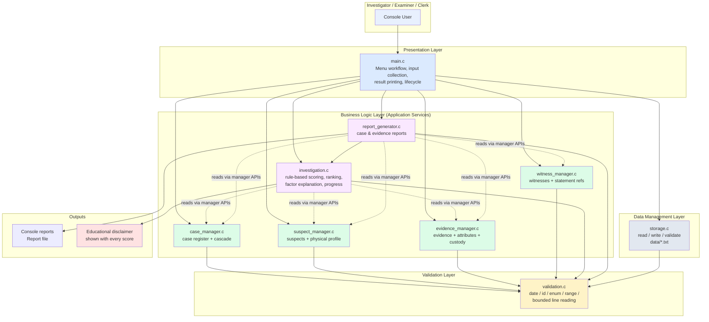
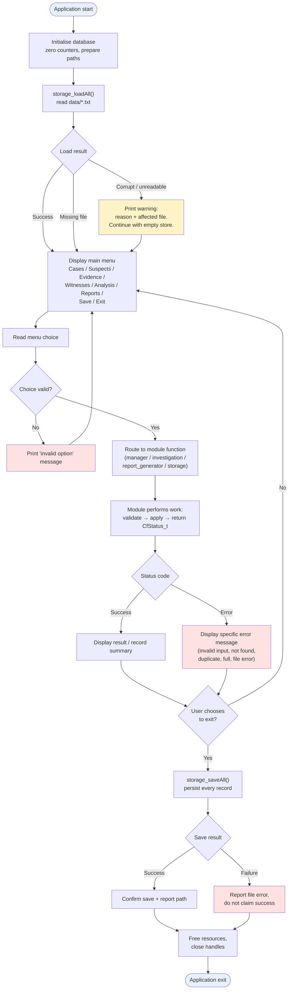

# CASEFILE — Project Proposal

> **Document:** Phase 1 deliverable (Project Proposal)
> **Template source:** [MINI_PROJECT_TEMPLATE.html](https://kapexlab.github.io/programming-fundamentals-and-software-engineering/MINI_PROJECT_TEMPLATE.html)
> **Guidelines source:** [MINI_PROJECT_GUIDELINES.html](https://kapexlab.github.io/programming-fundamentals-and-software-engineering/MINI_PROJECT_GUIDELINES.html)
> **Status:** Phase 1 complete. Sections 1–5 of the official template are filled in full. Sections 6–24 are drafted as
> Phase 2–5 placeholders in `docs/mini_project_report.md` and will be completed only after implementation and
> verification. No test results, repository links or implementation status are claimed at this stage.

---

# 1. Project Information

## 1.1 Project Title

**CASEFILE: Forensic Evidence Management and Crime Investigation System**

A command-line forensic case-management application that lets investigators register crime cases, suspects,
witnesses and forensic evidence; track evidence through a chain-of-custody history; and compare recorded evidence
attributes against suspect descriptors using a transparent, rule-based suspicion score that prioritises
investigative leads.

## 1.2 Engineering Domain

**Defence / Law Enforcement — Forensic Laboratory Management and Crime Investigation**

The scenario sits at the intersection of the **Defence** and **Laboratory management** domains named in the
guidelines: a district forensic laboratory and its crime-investigation unit, where case paperwork, evidence
registers and witness statements are maintained by hand and must later be reconstructed into formal investigation
reports.

## 1.3 Team Details

| Field | Details |
| --- | --- |
| Student name | Srushti Hingmire |
| Roll number | 612505154 |
| Division / batch | elec div 2 |
| Repository name | `miniproject` |
| GitHub repository link | <https://github.com/srushtihingmire27-hub/miniproject> |

## 1.4 Individual Project Declaration

I confirm that this project is my individual work. I understand the design, source code, unit tests, Makefile and
documentation included in this repository, and I am prepared to explain or modify any part during evaluation.

Submitted by Srushti Hingmire (Roll number 612505154, elec div 2) as an individual mini project.

Student signature or acknowledgement:

Srushti Hingmire

*(Signature to be completed by hand on the submitted copy.)*

---

# 2. Engineering Scenario

## 2.1 Scenario Description

**Where the scenario occurs.**
In a district-level **forensic laboratory** attached to a police crime-investigation unit. The laboratory receives
seized and recovered material from crime scenes, stores it, examines it, and hands it back either as a report or as
physical evidence routed to court. The associated **investigation cell** handles the administrative side: opening
case files, listing suspects, recording witness statements, and assembling the final investigation report.

**Who is involved.**

| Role | What they need |
| --- | --- |
| Investigating Officer (case owner) | One place to see the whole case: who is linked, what is in the locker, what is still missing, and where the investigation stands. |
| Forensic Examiner / Evidence Custodian | A reliable register of what was collected, who holds it now, and what has already been analysed. |
| Records Clerk | Case numbers that never clash, and records that can be retrieved in seconds rather than by searching paper registers. |
| Junior Investigator | A starting point for narrowing the field — which recorded facts actually coincide with a suspect's profile. |

**Current working method.**
Everything is maintained on **paper registers and spreadsheet worksheets**:

- Case files are physical folders. The unique case number is hand-written on the cover and cross-referenced in a
  separate register book, so duplicate numbers are detected only when a clerk notices them months later.
- Evidence is logged in a bound register with a printed row per item. Chain-of-custody transfers are recorded as
  free-text remarks in the same row, so an item's custody history is a narrative, not a queryable sequence.
- Witness statements live in a separate statement register; linking a statement to its case requires matching a
  reference number by eye.
- Linking a suspect to a piece of evidence — for example, a hair sample whose attributes resemble a suspect's
  physical description — is a manual, slow comparison. Nothing in the paperwork performs this comparison
  systematically, so it happens inconsistently and only for the obvious cases.

**Information that must be managed.**

1. Case identity and status — unique case ID, crime type, priority, incident date, location, assigned officer,
   investigation status, narrative summary.
2. Suspect records — identity, age, physical descriptors, contact details, stated alibi, possible motive, status.
3. Evidence records — unique evidence ID, category, description, collection date/location/collector, examination
   status, analysis attributes, custody history.
4. Witness records — identity, contact details, statement reference ID, statement text, recorded date, verification flag.
5. Progress and reporting — how far the investigation has advanced, and a printable investigation report.

**Problems in the current method.**

- **Duplicate and orphaned records.** Hand-allocated IDs clash; a suspect's case reference is copied by hand and
  can point at a case number that never existed.
- **No queryable custody history.** Proving who held evidence, and when, means re-reading free-text remarks across
  several rows and several registers.
- **Evidence-to-suspect comparison is unsystematic.** An investigator with 40 suspects and 60 evidence items
  cannot reliably eyeball which attributes coincide; useful leads are missed and weak leads are not filtered out.
- **Reporting is manual re-typing.** Producing the case summary means copying data across registers into a report
  template; every copy is another chance to introduce an error, and the report is usually out of date.
- **No audit trail.** A deleted or amended register entry leaves no record of what changed.
- **Loss of institutional knowledge.** When a case officer is transferred, the reasoning behind a lead lives only
  in their heads and notebooks.

## 2.2 Problem Statement

> In **forensic laboratory and crime-investigation units**, **investigating officers, forensic examiners and
> records clerks** currently face **manual, paper-and-spreadsheet case management in which case identifiers,
> evidence registers, chain-of-custody remarks, witness statements and suspect profiles are maintained in
> disconnected registers**. The current method results in **duplicate and inconsistent identifiers, unqueryable
> custody history, unsystematic comparison between recorded evidence attributes and suspect descriptors, and
> manually re-typed investigation reports that are frequently out of date or inconsistent with the registers**.
> The proposed software will provide **a single validated case file with enforced unique identifiers, a structured
> chain-of-custody history, systematic rule-based evidence-to-suspect comparison that ranks investigative leads and
> explains its reasoning, and generated investigation and evidence reports** so that users can **retrieve the
> complete status of any case in seconds, preserve an auditable record of every change, and direct their effort
> towards the leads the recorded evidence actually supports**.

## 2.3 Proposed Solution

**CASEFILE** is a modular, menu-driven **command-line application written entirely in C** that maintains a
fictional forensic case file for an investigation unit.

**What the application will do**

- Present a hierarchical menu: *Cases → Suspects → Evidence → Witnesses → Analysis → Reports → Save/Load → Exit*.
- Every menu action is reachable without touching the source code; nothing is hard-coded per case.

**How it addresses the problem**

| Problem in the manual method | CASEFILE mechanism |
| --- | --- |
| Hand-written, clashing case numbers | IDs are **auto-generated from a sequence** and validated against the existing registry before insertion; duplicates are rejected with a clear status code. |
| Unqueryable custody remarks | Each evidence item owns an **ordered chain-of-custody event list** (collect → transfer → seal → analyse → release), each with timestamp, from-handler, to-handler, location and remarks. |
| Manual evidence-to-suspect comparison | A **rule-based matching engine** compares tagged evidence attributes (gender, height, hair colour, shoe size, blood group, vehicle registration) against suspect descriptors, producing a **0–100 suspicion score**, a **ranked suspect list**, and an **explanation of exactly which attributes contributed**. |
| Manually re-typed reports | A **report generator** produces a case summary and an evidence summary on screen and can **save them to a text file**. |
| No audit trail / lost knowledge | All records are **persisted to text files** on save and reloaded on start, so the case file survives across sessions. |

**Information the application will manage**
Cases, suspects (including the physical descriptors used for comparison), forensic evidence with categories and
analysis attributes, chain-of-custody events, witnesses with statement reference IDs, investigation status and
progress, and generated reports.

**Important calculations and decisions**

1. **Suspicion scoring.** For each suspect, every comparable attribute found in the case's evidence contributes a
   fixed **weight** (declared as named constants). Weights are summed and capped at `MAX_SUSPICION_SCORE`.
   Non-matching attributes contribute nothing but are still listed as *checked but not matched*, so the investigator
   sees what was examined.
2. **Insufficient-evidence decision.** If a case has no comparable evidence attributes, or no suspects, the engine
   reports **insufficient evidence** and refuses to emit a score, rather than showing a misleading `0`.
3. **Progress computation.** Case progress is derived from real record counts (suspects recorded, evidence
   analysed vs. outstanding, witnesses verified), not typed in by hand.

**Reports produced**

- *Case summary* — case identity, status, officer, suspects with scores, evidence with status, witnesses.
- *Evidence summary* — evidence register for a case with categories, collection details and custody history.
- Both can be written to a report file for printing or attachment.

> **Educational disclaimer (to be displayed with every score).** The suspicion score is a **transparent,
> rule-based decision-support indicator for prioritising investigative effort**. It is **not** a forensic
> conclusion, **not** a probability, and **not** evidence of guilt. It only summarises how many recorded,
> rule-comparable attributes happen to coincide. All case data in this project is fictional and used for
> teaching purposes only.

## 2.4 Target Users

| User Type | Responsibility | How the User Will Use the Application |
| --- | --- | --- |
| Investigating Officer | Owns the case and decides what to examine next | Opens a case, reviews suspects, runs the evidence analysis to see which suspects have coinciding attributes, reads the ranked list and the explanation, then generates the case summary report. |
| Forensic Examiner / Evidence Custodian | Handles material and records its movement | Registers each evidence item with category, collection date, location and collector, appends a custody event on every transfer or sealing, and updates the examination status after analysis. |
| Records Clerk | Maintains the registers and prepares paperwork | Registers cases with auto-generated IDs, corrects and updates records, lists and filters the case register, and exports the evidence summary for the case file. |
| Witness-Recording Officer | Takes and tracks statements | Registers witnesses against a case, records the statement reference ID and text, and flags a statement as verified once corroborated. |
| Student / Evaluator | Learns and assesses software-engineering practice | Builds with `make all`, runs `make test` to see automated checks on validation, search, scoring and record logic, and inspects the modular source and documented design. |

---

# 3. Project Scope

## 3.1 In-Scope Features

1. **Case registration** with auto-generated unique case IDs (`CF-YYYY-NNNN`), title, crime type, priority, incident
   date, location, assigned officer, status and narrative summary.
2. **Case register operations** — list all cases, look up a case by ID, filter the register by status or crime type.
3. **Case maintenance** — update case details, update investigation status, and delete a case (with explicit
   confirmation and cascade removal of its linked suspects, evidence and witnesses).
4. **Suspect management** — add multiple suspects to a case with unique IDs (`SU-NNNN`), store identity, age,
   gender, contact, address, stated alibi, possible motive, status, and the physical descriptors used for matching.
5. **Suspect operations** — list suspects of a case, search by ID or by name (partial, case-insensitive), update a
   suspect, delete a suspect.
6. **Forensic evidence registration** with unique IDs (`EV-NNNN`) linked to an existing case, a category enumeration
   (biological, chemical, digital, ballistic, physical trace, documentary, vehicle, other), description, collection
   date, collection location, collector and examination status.
7. **Evidence attributes** — attach analysis attributes (tag/value pairs such as `gender=male`, `height=175-185`)
   that the matching engine can compare.
8. **Chain-of-custody record** — append ordered custody events (collected / transferred / sealed / analysed /
   released) with timestamp, from-handler, to-handler, location and remarks, and display the full history.
9. **Evidence operations** — search by evidence ID or description, filter by case, category or status, update
   evidence details and examination status, delete evidence.
10. **Witness management** — register witnesses against a case with a unique statement reference ID (`ST-NNNN`),
    store contact details, statement text, recorded date and verification flag.
11. **Witness operations** — list and search witnesses by ID, name or case, update a witness, delete a witness.
12. **Rule-based evidence analysis** — compute a suspicion score per suspect, rank suspects by score, and show the
    contributing and non-contributing attributes for each suspect.
13. **Insufficient-evidence handling** — detect and clearly report cases where the evidence cannot support a score.
14. **Investigation progress** — display derived progress (suspects on record, evidence analysed vs. outstanding,
    statements verified) together with the current case status.
15. **Report generation** — case summary and evidence summary reports, displayed on screen and optionally saved to a
    report file.
16. **File-based persistence** — save all records to `data/*.txt` files, reload them on start-up, validate the file
    format, and handle missing, empty, corrupted or unreadable files without crashing.
17. **Robust input validation** for every user-entered value: empty input, non-numeric input, out-of-range values,
    malformed identifiers, invalid dates, over-length strings, invalid enumeration values and duplicate IDs.
18. **Consistent status codes** — every module returns a documented `CfStatus_t` value and a human-readable message.
19. **Automated unit tests** with Google Test, runnable through `make test`.
20. **Build automation** with a Makefile providing `all`, `run`, `test` and `clean`.

## 3.2 Out-of-Scope Features

1. **Graphical user interface (GUI)** — the project is deliberately a command-line application, as expected for a
   first software-engineering mini project in C.
2. **Database engine / SQL** — persistence is plain-text file based; no SQLite, MySQL or ODBC dependency.
3. **Network programming, client–server mode, or multi-user concurrency** — the application is single-process and
   single-user.
4. **Authentication, roles and audit logging of user identity** — no login, no permissions.
5. **Photographic, video or binary evidence storage** — only metadata and text descriptions are held; no binary
   blobs and no image processing.
6. **Real forensic analysis** — no DNA sequencing, no ballistic matching, no chemical assay modelling. The
   "analysis" is a transparent rule-based comparison of recorded attributes, not a scientific method.
7. **Machine-learning or statistical inference** — no prediction models, no probabilistic scoring, no randomness.
8. **PDF/HTML report export and printing** — reports are plain text files.
9. **Advanced searching (regular expressions, date-range filters, full-text indexing)** — the search facilities are
   exact/substring matching and enum-based filtering.
10. **Data encryption, hashing of sensitive records or digital signatures** — out of scope for this project.
11. **Case archiving, retention policies or legal-hold workflows** — a case can be deleted with confirmation, but no
    archival policy is modelled.
12. **Interoperability with real police or laboratory information systems** — no external system integration.

## 3.3 Assumptions

1. All data is **fictional** and used for educational purposes; no real crime data, personal data or real case
   identifiers are used.
2. The application operates as a **single-user, single-process, offline** command-line tool on a local machine.
3. The **file system is writable** in the working directory; the `data/` directory is used for persistence.
4. **Maximum record counts are fixed and modest** (100 cases, 400 suspects, 400 evidence items, 300 witnesses),
   so fixed-capacity arrays are sufficient and no dynamic memory is required for record storage.
5. **Dates are entered in ISO format `YYYY-MM-DD`** and validated for calendar correctness (including leap years).
6. **Identifiers follow a fixed pattern** (`CF-YYYY-NNNN`, `SU-NNNN`, `EV-NNNN`, `WI-NNNN`, `ST-NNNN`) and are
   generated by the application, not typed freely by the user for evidence/suspect records.
7. **Evidence attributes are pre-defined key/value pairs** from a controlled vocabulary (gender, height band, hair
   colour, shoe size, blood group, vehicle registration), so matching rules are deterministic.
8. The **suspicion score is advisory**. The user is expected to verify every factor manually; the tool never asserts
   guilt.
9. The **operating environment** is macOS (development) with the code kept portable to Linux (POSIX file APIs,
   standard C library only).

## 3.4 Constraints

1. **Project duration** is limited to a mini-project timeline, so the feature set is deliberately bounded and no
   network or database technology is introduced.
2. **Storage is file-based text**, not a database — this limits querying to what can be expressed by sequential
   scans, which is acceptable at the documented record capacities.
3. The **interface is command-line only** — no GUI framework may be used, which keeps the build dependency-free.
4. The **language is C** (ISO C11) with a strict warning policy (`-Wall -Wextra -Wpedantic`) and **no external
   runtime dependencies** other than Google Test for the test target.
5. **Google Test availability** is an environment dependency: the Makefile must locate an installed gTest, and the
   build must fail with a clear message (not a cryptic link error) when it is absent.
6. **Record capacities are fixed constants**, so "database full" is a reachable, testable condition that must be
   reported gracefully rather than by overwriting existing data.
7. **No dynamic memory allocation** is planned for record storage (fixed-capacity arrays); if any allocation is used
   in Phase 2/3 it must be justified and freed on every path.
8. The **report format is plain text**; no pagination or print-driver control is attempted.
9. **Single platform target at evaluation time** (macOS with clang), while source remains portable to Linux.

---

# 4. Requirements

## 4.1 Functional Requirements

### Case management

| ID | Functional Requirement | Priority | Verification Method |
| --- | --- | --- | --- |
| FR-01 | The system shall register a new crime case with an auto-generated unique case ID, title, crime type, priority, incident date, location, assigned officer and summary. | High | Demonstration / Test |
| FR-02 | The system shall reject a case whose identifier already exists in the register. | High | Test |
| FR-03 | The system shall list all registered cases in a formatted table. | High | Demonstration |
| FR-04 | The system shall retrieve a single case by its identifier. | High | Demonstration / Test |
| FR-05 | The system shall filter the case register by investigation status and by crime type. | Medium | Demonstration |
| FR-06 | The system shall update the editable details of an existing case. | High | Demonstration |
| FR-07 | The system shall update the investigation status of a case to a value from the defined status enumeration. | High | Demonstration / Test |
| FR-08 | The system shall delete a case only after explicit user confirmation, removing the case together with its linked suspects, evidence and witness records. | Medium | Demonstration / Test |
| FR-09 | The system shall display a full summary of a selected case. | High | Demonstration |

### Suspect management

| ID | Functional Requirement | Priority | Verification Method |
| --- | --- | --- | --- |
| FR-10 | The system shall add one or more suspects to an existing case, each with a unique identifier, name, age, gender, contact number, address, stated alibi, possible motive and status. | High | Demonstration / Test |
| FR-11 | The system shall store the physical descriptors of a suspect (gender, height, hair colour, shoe size, blood group and known vehicle registrations) for later comparison. | High | Test |
| FR-12 | The system shall list the suspects associated with a given case. | High | Demonstration |
| FR-13 | The system shall search suspects by identifier and by partial name, case-insensitively. | High | Test |
| FR-14 | The system shall update a suspect record and reject unknown or duplicate identifiers. | Medium | Demonstration / Test |
| FR-15 | The system shall delete a suspect record after confirmation. | Medium | Demonstration |
| FR-16 | The system shall reject a suspect being added to a case identifier that does not exist. | High | Test |

### Forensic evidence management

| ID | Functional Requirement | Priority | Verification Method |
| --- | --- | --- | --- |
| FR-17 | The system shall register forensic evidence with a unique identifier linked to an existing case, a category from the evidence-category enumeration, a description, collection date, collection location, collector and examination status. | High | Demonstration / Test |
| FR-18 | The system shall classify evidence using the defined category enumeration and reject invalid category values. | High | Test |
| FR-19 | The system shall attach analysis attributes (key/value pairs) to an evidence item so that recorded characteristics can be compared with suspect descriptors. | High | Test |
| FR-20 | The system shall update evidence details and the examination status of an existing evidence item. | High | Demonstration / Test |
| FR-21 | The system shall search evidence by identifier and description, and filter evidence by case, category and examination status. | High | Demonstration / Test |
| FR-22 | The system shall append a chain-of-custody event to an evidence item recording action, timestamp, from-handler, to-handler, location and remarks, preserving event order. | High | Demonstration / Test |
| FR-23 | The system shall display the complete chain-of-custody history of an evidence item. | High | Demonstration |
| FR-24 | The system shall reject a custody event when the evidence item does not exist or when the custody log for that item is full. | Medium | Test |
| FR-25 | The system shall delete an evidence item after confirmation. | Medium | Demonstration |

### Witness management

| ID | Functional Requirement | Priority | Verification Method |
| --- | --- | --- | --- |
| FR-26 | The system shall register a witness against an existing case with a unique statement reference identifier, contact details, statement text, recorded date and verification flag. | High | Demonstration / Test |
| FR-27 | The system shall search witnesses by identifier, by name and by associated case. | High | Test |
| FR-28 | The system shall update a witness record, including marking a statement as verified. | Medium | Demonstration / Test |
| FR-29 | The system shall delete a witness record after confirmation. | Medium | Demonstration |
| FR-30 | The system shall reject a duplicate statement reference identifier. | Medium | Test |

### Evidence analysis

| ID | Functional Requirement | Priority | Verification Method |
| --- | --- | --- | --- |
| FR-31 | The system shall compute a rule-based suspicion score for each suspect of a case by comparing recorded evidence attributes with the suspect's descriptors, using fixed declared weights capped at the maximum score. | High | Test |
| FR-32 | The system shall rank the suspects of a case by descending suspicion score. | High | Test |
| FR-33 | The system shall explain, for each suspect, which recorded attributes contributed to the score and which comparable attributes were checked but did not match. | High | Test |
| FR-34 | The system shall detect and clearly report **insufficient evidence** when a case has no comparable evidence attributes or no suspects, instead of presenting a misleading score. | High | Test |
| FR-35 | The system shall compute and display case investigation progress from real record counts (suspects on record, evidence analysed versus outstanding, statements verified). | Medium | Demonstration / Test |
| FR-36 | The system shall display the educational, decision-support nature of the score alongside every analysis result. | High | Demonstration |

### Investigation reports

| ID | Functional Requirement | Priority | Verification Method |
| --- | --- | --- | --- |
| FR-37 | The system shall generate a case summary report containing case identity, status, officer, ranked suspects with scores, evidence with examination status and witness statements. | High | Demonstration / Test |
| FR-38 | The system shall generate an evidence summary report listing the evidence of a case with category, collection details, examination status and chain-of-custody history. | High | Demonstration / Test |
| FR-39 | The system shall save a generated report to a text file and confirm the file path on success or report the failure. | Medium | Demonstration / Test |
| FR-40 | The system shall refuse to generate a report for a case identifier that does not exist. | Medium | Test |

### Data persistence

| ID | Functional Requirement | Priority | Verification Method |
| --- | --- | --- | --- |
| FR-41 | The system shall save all records (cases, suspects, evidence, chain-of-custody events and witnesses) to files in the `data/` directory. | High | Demonstration / Test |
| FR-42 | The system shall load all previously saved records when the application starts. | High | Demonstration / Test |
| FR-43 | The system shall preserve all updates across application restarts. | High | Test |
| FR-44 | The system shall validate the stored file format on load and reject a file whose format signature or record structure is invalid, reporting the condition instead of crashing. | High | Test |
| FR-45 | The system shall handle a missing, empty, unreadable or unwritable data file with a clear message and without terminating the application unexpectedly. | High | Test |
| FR-46 | The system shall maintain a consistent status code and message for every failure condition. | High | Test |

## 4.2 Non-Functional Requirements

| ID | Non-Functional Requirement | Verification Method |
| --- | --- | --- |
| NFR-01 | The source code shall compile without warnings under `-Wall -Wextra -Wpedantic`. | Build output |
| NFR-02 | The project shall use a modular multi-file structure with at least three meaningful implementation modules in addition to `main.c`. | Code review |
| NFR-03 | `main.c` shall contain only initialisation, menu presentation, workflow control and cleanup — not the business logic. | Code review |
| NFR-04 | The application shall handle all invalid input without crashing or entering an uncontrolled state. | Negative testing |
| NFR-05 | Unsafe input functions (`gets`, unbounded `scanf` string reads) shall not be used; line-based input with length limits shall be used instead. | Code review |
| NFR-06 | Every module function shall return a meaningful status code, and no return value shall be ignored. | Code review |
| NFR-07 | Important functions shall be covered by at least ten meaningful Google Test cases spanning at least three important functions, including positive, negative and boundary cases. | Unit-test output |
| NFR-08 | Unit tests shall be independent of the interactive menu and shall clean up temporary files after execution. | Unit-test output / Code review |
| NFR-09 | The project shall build, run, test and clean using the targets `make all`, `make run`, `make test` and `make clean`. | Build demonstration |
| NFR-10 | The code shall follow the documented coding standards: four-space indentation, uppercase constant names, header guards, one responsibility per function, no duplicated logic, no unnecessary globals. | Code review |
| NFR-11 | The source shall be portable between macOS and Linux, using only standard C and avoiding machine-specific absolute paths. | Code review / portability check |
| NFR-12 | All file operations shall be checked for success or failure and shall handle read/write errors explicitly. | Code review / Test |
| NFR-13 | Array accesses shall be bounds-checked and record capacities shall be enforced, so that "capacity reached" is reported rather than an out-of-bounds write. | Test |
| NFR-14 | Analysis results shall be deterministic — no random values shall influence any score, ranking or comparison. | Code review / Test |
| NFR-15 | The project shall be maintained under Git with multiple meaningful commits and published in a GitHub repository containing the complete project. | Repository review |
| NFR-16 | The documentation shall follow the official mini-project template with every applicable section completed. | Documentation review |
| NFR-17 | User-facing messages shall be clear, non-technical and actionable, stating what was rejected and what the user should do next. | Demonstration |
| NFR-18 | The application shall not require any third-party runtime library other than the C standard library. | Build demonstration |

## 4.3 Requirement Traceability

> This table is completed against the module and function design, which is finalised in **Phase 2**; the test IDs
> correspond to the Unit-Test Plan (`docs/detailed_design.md`, §14) and will be confirmed after the gTest suite is
> written in Phase 3. Entries marked *(provisional)* are confirmed in Phase 2.

| Requirement ID | Module | Function or Feature | Test ID |
| --- | --- | --- | --- |
| FR-01 | `case_manager` | `caseManager_addCase` | UT-01, UT-02 |
| FR-02 | `case_manager` | `caseManager_addCase`, `caseManager_findById` | UT-01, UT-03 |
| FR-03 | `case_manager` | `caseManager_listAll` | UT-04 |
| FR-04 | `case_manager` | `caseManager_findById` | UT-03, UT-04 |
| FR-05 | `case_manager` | `caseManager_filterByStatus` | UT-05 |
| FR-06 | `case_manager` | `caseManager_update` | UT-06 |
| FR-07 | `case_manager` | `caseManager_setStatus` | UT-07 |
| FR-08 | `case_manager` | `caseManager_delete` (cascade) | UT-08 |
| FR-09 | `case_manager` | `caseManager_findById` + report layer | UT-04 |
| FR-10 | `suspect_manager` | `suspectManager_add` | UT-09, UT-10 |
| FR-11 | `suspect_manager` | `suspectManager_setPhysicalProfile` | UT-11 |
| FR-12 | `suspect_manager` | `suspectManager_listByCase` | UT-12 |
| FR-13 | `suspect_manager` | `suspectManager_searchByName` | UT-13 |
| FR-14 | `suspect_manager` | `suspectManager_update` | UT-14 |
| FR-15 | `suspect_manager` | `suspectManager_delete` | UT-15 |
| FR-16 | `suspect_manager` | `suspectManager_add` (parent case check) | UT-10 |
| FR-17 | `evidence_manager` | `evidenceManager_add` | UT-16, UT-17 |
| FR-18 | `evidence_manager` | `evidenceManager_add` / `validation_isValidCategory` | UT-17, UT-18 |
| FR-19 | `evidence_manager` | `evidenceManager_addAttribute` | UT-19 |
| FR-20 | `evidence_manager` | `evidenceManager_update`, `evidenceManager_setStatus` | UT-20 |
| FR-21 | `evidence_manager` | `evidenceManager_searchByDescription`, `evidenceManager_filterByStatus` | UT-21, UT-22 |
| FR-22 | `evidence_manager` | `evidenceManager_addCustodyEvent` | UT-23, UT-24 |
| FR-23 | `evidence_manager` | `evidenceManager_getCustodyHistory` | UT-24 |
| FR-24 | `evidence_manager` | `evidenceManager_addCustodyEvent` | UT-25 |
| FR-25 | `evidence_manager` | `evidenceManager_delete` | UT-26 |
| FR-26 | `witness_manager` | `witnessManager_add` | UT-27 |
| FR-27 | `witness_manager` | `witnessManager_searchByName` | UT-28 |
| FR-28 | `witness_manager` | `witnessManager_update`, `witnessManager_setVerified` | UT-29 |
| FR-29 | `witness_manager` | `witnessManager_delete` | UT-30 |
| FR-30 | `witness_manager` | `witnessManager_add` (statement-ref uniqueness) | UT-27 |
| FR-31 | `investigation` | `investigation_scoreSuspects` | UT-31, UT-32 |
| FR-32 | `investigation` | `investigation_rankSuspects` | UT-33 |
| FR-33 | `investigation` | `investigation_scoreSuspects` (factor list) | UT-31, UT-34 |
| FR-34 | `investigation` | `investigation_scoreSuspects` (insufficient-evidence path) | UT-35, UT-36 |
| FR-35 | `investigation` | `investigation_computeProgress` | UT-37 |
| FR-36 | `investigation` | `investigation_getDisclaimer` | UT-38 |
| FR-37 | `report_generator` | `report_generateCaseSummary` | UT-39 |
| FR-38 | `report_generator` | `report_generateEvidenceSummary` | UT-40 |
| FR-39 | `report_generator` | `report_saveToFile` | UT-41 |
| FR-40 | `report_generator` | `report_generateCaseSummary` | UT-42 |
| FR-41 | `storage` | `storage_saveAll` | UT-43, UT-44 |
| FR-42 | `storage` | `storage_loadAll` | UT-43, UT-45 |
| FR-43 | `storage` | `storage_saveAll` + `storage_loadAll` round trip | UT-43 |
| FR-44 | `storage` | `storage_validateFormat` | UT-45, UT-46 |
| FR-45 | `storage` | `storage_loadAll` (missing / empty file) | UT-46, UT-47 |
| FR-46 | all modules | `CfStatus_t` return values | UT-48 |
| FR-47 (validation) | `validation` | `validation_isValidDate`, `validation_isValidId`, `validation_isValidEnum`, `validation_readLine`, `validation_parseInt` | UT-48 to UT-56 *(provisional)* |
| FR-48 (validation) | `validation` | `validation_isNonEmpty`, `validation_isValidPhone`, `validation_trim`, `validation_copyField` | UT-57 to UT-62 *(provisional)* |

> The provisional block will be reconciled with the final Unit-Test Plan in Phase 2 and the executed results in
> Phase 4. Test counts above are a plan, not a report of results.

---

# 5. High-Level Architecture

## 5.1 Architecture Description

CASEFILE is organised as a **layered, modular console application** in the classic three-tier form, adapted so that
each tier maps onto a small number of clear C modules.

**Layer 1 — Presentation / Interaction (`src/main.c`)**
A menu-driven console interface. `main.c` initialises the application, loads persisted data, presents the
top-level menu, collects raw user input, hands it to the appropriate module, prints the module's result (including
its status message) and, on exit, saves data and releases resources. It contains **no** business rules, no record
structures and no file handling — it only orchestrates.

**Layer 2 — Validation (`src/validation.c`, `include/validation.h`)**
A reusable, side-effect-free service layer that answers questions about data: *is this string a valid date? is this
identifier well formed? is this enumeration value in range? how do I read a bounded line from stdin?*. Every other
module calls into it rather than re-implementing checks, which removes duplicated validation logic and makes the
checks independently unit-testable.

**Layer 3 — Business Logic / Application Services**
Six service modules, each owning one business area and exposing a small, purposeful API:

| Module | Business area |
| --- | --- |
| `case_manager` | Case register: create, read, update, delete, filter, cascade rules. |
| `suspect_manager` | Suspect register and physical profile. |
| `evidence_manager` | Evidence register, analysis attributes, chain-of-custody log. |
| `witness_manager` | Witness register and statement references. |
| `investigation` | Rule-based scoring, ranking, factor explanation, progress computation. |
| `report_generator` | Composition of human-readable case and evidence reports, and report files. |

**Layer 4 — Data Management / Persistence (`src/storage.c`)**
Converts records to and from a **line-oriented text format** in the `data/` directory, and validates that format on
load. It is the only module that touches `FILE *`.

**Shared data model (`include/casefile.h`)**
The structure and enumeration definitions, the capacity constants and the `CfStatus_t` status codes live in one
shared header, so the modules agree on the data representation without depending on each other's internals.

**Dependency direction (strictly one way)**

```
main  →  manager modules  →  validation
main  →  investigation    →  manager modules (read-only) + validation
main  →  report_generator →  manager modules (read-only) + investigation (read-only)
main  →  storage          →  validation
```

Managers never call `storage`; the application orchestrates save and load. `report_generator` and `investigation`
read through the managers' public lookup functions and never mutate records. This keeps the graph acyclic, makes
every module independently testable, and lets the unit tests build a database in memory without touching disk.

**State handling.** The complete in-memory database is a single `CasefileDb_t` value held by `main.c` and passed by
pointer into every module function. There are **no mutable global variables**, which is what makes the whole
application testable from gTest without any global setup.

## 5.2 Architecture Diagram



**Reading the diagram.** Solid arrows are direct calls; dashed arrows are read-only queries through a manager's
public API. `main.c` sits on top and only ever calls *downwards*. The validation layer is shared by every module
below it, so no two modules ever disagree about what constitutes a valid date, identifier or enumeration value.
`storage.c` is the only component that opens a file, and only `main.c` ever invokes it, which keeps all I/O
error handling in one place. The disclaimer node is highlighted because it is a first-class output, not a comment.

## 5.3 High-Level Workflow

The interaction model is a **hierarchical menu**: the top-level menu offers the business areas, and selecting one
opens a sub-menu whose actions operate on the currently selected record set.



**Reading the workflow.** The application is **fail-soft on load and fail-loud on save**. A missing or corrupt data
file produces a warning and an empty-but-usable session, because refusing to start would leave the user with no way
to inspect or repair anything. A failed save, by contrast, is reported prominently and the exit is still attempted,
so the user always learns that their changes did not reach disk. Every error path returns to the same menu rather
than terminating, which satisfies the requirement that invalid input must never crash the program.

---

## 5.4 Initial Module Plan

| # | Module name | Source / header | Responsibility |
| --- | --- | --- | --- |
| 1 | Main application | `src/main.c` | Initialise, load, present menus, dispatch calls, print results, save, clean up. **No business logic.** |
| 2 | Shared data model | `include/casefile.h` | Structures, enumerations, capacity constants, status codes. Header only — no implementation file needed. |
| 3 | Validation | `src/validation.c` / `include/validation.h` | Reusable input and data checks: bounded line reading, integer parsing, date validity, identifier format, enumeration range, string length, trimming. |
| 4 | Case manager | `src/case_manager.c` / `include/case_manager.h` | Case register lifecycle: add, find, list, filter, update, status change, delete with cascade to child records. |
| 5 | Suspect manager | `src/suspect_manager.c` / `include/suspect_manager.h` | Suspect records, physical-descriptor profile, per-case listing, search, update, delete. |
| 6 | Evidence manager | `src/evidence_manager.c` / `include/evidence_manager.h` | Evidence records and categories, analysis attributes, chain-of-custody event log, search and filtering, update, delete. |
| 7 | Witness manager | `src/witness_manager.c` / `include/wwitness_manager.h` | Witness records, statement reference IDs, verification flag, search, update, delete. |
| 8 | Investigation | `src/investigation.c` / `include/investigation.h` | Rule-based suspicion scoring with declared weights, ranking, factor explanation, insufficient-evidence detection, progress computation, disclaimer text. |
| 9 | Report generator | `src/report_generator.c` / `include/report_generator.h` | Case summary and evidence summary composition, console output, report file writing. |
| 10 | Storage | `src/storage.c` / `include/storage.h` | File format definition, save and load of all record types, format validation, I/O error reporting. |

This is **nine implementation modules plus `main.c`**, comfortably exceeding the "at least three meaningful modules"
requirement, while each module owns a genuinely distinct business concern (no filler modules, no empty files).

## 5.5 Planned C Concepts

| C concept | Why this project needs it |
| --- | --- |
| **Structures** | The core data model. `Case_t`, `Suspect_t`, `Evidence_t`, `CustodyEvent_t`, `Witness_t` and the aggregate `CasefileDb_t` describe real records with many related fields; grouping them into a struct avoids parallel arrays and keeps related data together. |
| **Enumerations** | Fixed vocabularies that must not be arbitrary integers: crime type, case status, priority, evidence category, evidence status, custody action, suspect status, witness verification, and the `CfStatus_t` error codes. Enumerations make illegal states unrepresentable and let validation check a range instead of a set of magic numbers. |
| **Functions with parameters and return values** | Each module exposes a purposeful API; every fallible function returns `CfStatus_t` so the caller can react instead of guessing. |
| **Arrays** | The fixed-capacity record arrays (`cases[MAX_CASES]`, `suspects[MAX_SUSPECTS]`, …), the attribute list inside an evidence item, and the chain-of-custody event list per evidence item. Capacity is enforced explicitly, giving a reachable and testable "capacity reached" state. |
| **Strings and character handling** | All record fields are fixed-length character arrays; the project needs trimming, case-insensitive comparison, safe bounded copying and tokenised file parsing. |
| **Pointers** | Passing `CasefileDb_t *`, `char *` buffers and `const char *` parameters; returning pointers to stored records so callers can read them without copying whole structures. |
| **Constants** | Capacity limits, string-length limits, ID patterns, date format, file paths, score weights and the maximum score — all declared as named uppercase constants instead of unexplained literals. |
| **File handling** | `fopen`, `fclose`, `fgets`, `fprintf`, `fscanf`/`sscanf` for a line-oriented persistence format, with every call's return value checked. |
| **Input validation** | `fgets` with explicit buffer bounds instead of `gets`; manual integer parsing to reject trailing garbage such as `12abc`; calendar-correct date checks including leap years. |
| **Error and status codes** | A single `CfStatus_t` enumeration returned across module boundaries, mapped to human-readable messages, so errors are handled uniformly instead of ad hoc per module. |
| **Structs passed by pointer** | The shared `CasefileDb_t` context replaces global mutable state and is what makes the application unit-testable. |
| **Sorting and filtering** | Bubble-sort style ranking of suspects by score, and filtering of the case/evidence registers by enumeration values. |
| **Meaningful calculation** | Weighted suspicion scoring with a cap, and investigation-progress computation derived from real counts. |
| **Dynamic memory allocation** | Deliberately **avoided** for record storage: fixed capacities are documented, adequate and testable. If any allocation is introduced in a later phase (for example a report buffer), it must be justified, checked for `NULL` and freed on every path. |
| **Preprocessor / build tooling** | Header guards, conditional inclusion of the gTest main, and a Makefile that separates compilation from linking. |

---

## 5.6 Traceability to the Official Guidelines

| Guideline phase item | Where it is addressed in this document |
| --- | --- |
| §5.1 Project title | §1.1 |
| §5.2 Student information | §1.3 |
| §5.3 Engineering scenario | §2.1 |
| §5.4 Problem statement | §2.2 |
| §5.5 Proposed solution | §2.3 |
| §5.6 Target users | §2.4 |
| §5.7 Project scope (in / out) | §3.1, §3.2 |
| §5.8 Functional requirements | §4.1 (FR-01 … FR-48) |
| §5.9 Non-functional requirements | §4.2 (NFR-01 … NFR-18) |
| §5.10 Initial modules | §5.4 |
| §5.11 Initial architecture diagram | §5.2 |
| §5.12 High-level workflow | §5.3 |
| §5.13 Planned C concepts | §5.5 |

---

## Phase 1 Deliverables and Approval Gate

**Completed in Phase 1**

- [x] Official guidelines and template studied; structure preserved.
- [x] Engineering scenario and problem statement defined (§2).
- [x] Proposed solution, target users and scope defined (§2.3, §2.4, §3).
- [x] 48 functional and 18 non-functional requirements specified with verification methods (§4).
- [x] Initial module plan, architecture diagram and high-level workflow produced (§5).
- [x] Planned C concepts justified (§5.5).
- [x] Repository skeleton created (`src/`, `include/`, `tests/`, `data/`, `docs/`).
- [x] Traceability table drafted and marked provisional pending Phase 2.

**Explicitly NOT claimed at this stage**

- No source code has been written yet (Phase 3).
- No unit tests have been written or executed (Phase 3/4).
- No build has been run; `make all` and `make test` are unverified.
- No GitHub repository exists yet; the link stays a placeholder (Phase 4).
- No screenshots or test-output evidence exist; sections 18–19 of the template remain *Pending*.

**Open points raised in Phase 1 — all resolved**

1. **Google Test availability.** gTest was not installed and Homebrew was not available on the development machine.
   It was built directly from the upstream source into `~/.local`. The Makefile now searches the usual installation
   prefixes together with the user's own local prefix, and prints clear installation instructions when the library
   cannot be found instead of failing later with a link error.
2. **Record capacities.** Confirmed and implemented as 100 cases, 400 suspects, 400 evidence items and 300
   witnesses. The suspect and evidence limits were lowered from the 500 first proposed, because the evidence record
   holds its chain-of-custody log and the analysis result holds every factor of every suspect, and the larger
   figures made the in-memory structures too large to place on the stack.
3. **Case identifier format.** Confirmed as `CF-YYYY-NNNN`, using the year of the incident date.
4. **Crime types.** Confirmed as proposed: homicide, theft, assault, fraud, vandalism, cybercrime,
   traffic fatality, arson and other.
5. **Student details.** Recorded as Srushti Hingmire, roll number 612505154, elec div 2, in §1.3, §1.4 and §24.

**Next phase on approval:** Phase 2 — Detailed Software Design, filling template sections 6–17 (module design, data
design with the full data dictionary, function design with prototypes and pre/post-conditions, input-validation plan,
file-handling design, error-handling strategy, coding standards, application flow, unit-test plan, Makefile design,
repository structure, Git plan) in `docs/detailed_design.md`.
